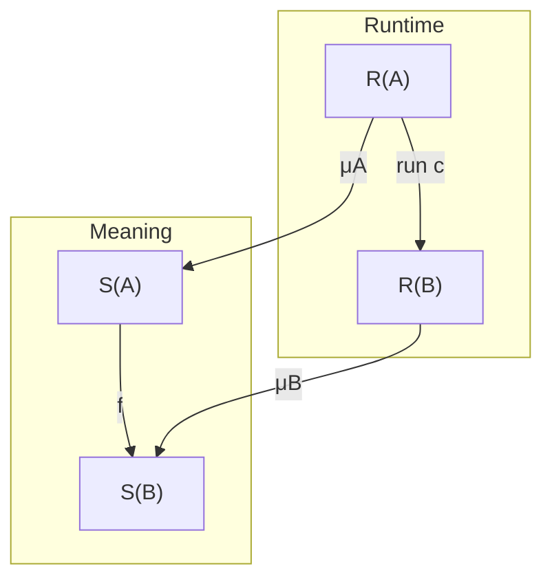

# Compiling to categories, recast as compositional correctness

## Outcome and scope

This is an original reconstruction in **Lean 4.19.0**. It makes the
implementation, its specification, the interpretation of its data, and its
correctness proof explicit. It includes a typed categorical compiler and a
concrete dependent extension. It does not reproduce the original article's
text or claim to port the GHC plugin, every application backend, or all of
Lean/Agda.

The mathematical ingredients fit together as follows:

1. A representation is a map from runtime values to ideal values.
2. A correct computation is a commutative square between representations.
3. Categorical operations compose these squares.
4. A syntax-directed compiler assembles the operations, and therefore the
   certificates, following the structure of a typed program.
5. With dependent types, representations and correctness become indexed by
   contexts. Substitution and transport become part of the interface.

Felix's current README describes a general category-theory library separated
from `denotational-hardware` [F1]. At the inspected commit,
`Construct/Comma/Type.agda` already has the general square construction [F2].
`Homomorphism.agda` still marks `CartesianClosedH` as a TODO, and
`MakeLawful.agda` likewise leaves closed structure unfinished [F3]. That
provides a precise connection to the proposed extension. The code here is an
independent Lean development, not a change to those Agda modules.

## 1. The fundamental specification

For each type A, choose runtime values R(A), ideal values S(A), and a data
interpretation

\[
\mu_A:R(A)\longrightarrow S(A).
\]

For an implementation c of a specified function f, demand

\[
\boxed{\mu_B\circ\operatorname{run}(c)=f\circ\mu_A.}
\tag{1}
\]

The four arrows are essential. An implementation can only be correct relative
to the chosen meaning of its input and output representations. For example,
changing how an array denotes a matrix can change which operation implements
matrix multiplication, even if the machine code is unchanged.



The code makes this a record:

```lean
structure Rep where
  R : Type u
  S : Type u
  decode : R → S

structure Square (A B : Rep) where
  impl : A.R → B.R
  spec : A.S → B.S
  commutes : ∀ x, B.decode (impl x) = spec (A.decode x)
```

Elliott's podcast account emphasizes these four arrows and their two
directions of composition [F4]. In the concrete function model,
representations are objects of the arrow category and squares are its
morphisms. Felix uses the more general comma construction: for functors
F : Cᵢ → C and G : Cₛ → C, an object is a triple (Aᵢ,Aₛ,μ : F Aᵢ → G Aₛ),
and a morphism has arrows c and f satisfying

\[
\mu_B\circ F(c)=G(f)\circ\mu_A.
\]

This separates the syntax or machine category from the common category in
which meanings can be compared.

### Horizontal and vertical composition

If c implements f and d implements g, their horizontal composite implements
g ∘ f:

\[
\mu_C\circ(d\circ c)
 =(g\circ\mu_B)\circ c
 =g\circ(f\circ\mu_A)
 =(g\circ f)\circ\mu_A.
\]

`Squares.compose` implements that proof. Identity and associativity are
proved for the whole square.

Vertical composition is useful for a chain of representations. Suppose
μ : R → M and ν : M → S, and the intermediate computation implements the
specification under ν. Pasting the squares gives correctness under ν ∘ μ.
`Squares.vertical` permits extensionally equal middle computations rather
than demanding they be literally the same expression.

Products are componentwise:

\[
\mu_{A\times B}(a,b)=(\mu_A(a),\mu_B(b)).
\]

Projections and pairing are certified by their defining equations. This is
already sufficient for a large first-order, cartesian programming fragment.

## 2. The higher-order obstacle and its resolution

Maps μA : AR → AS and μB : BR → BS do **not**, in general, determine a map

\[
(A_R\to B_R)\longrightarrow(A_S\to B_S)
\]

that preserves application. Function arguments occur contravariantly.

Here is a complete counterexample. Decode Bool to Unit by forgetting the
Boolean, and decode the result Bool identically. If the runtime identity
function represented some g : Unit → Bool, equation (1) would say

\[
\mathrm{false}=g(*)=\mathrm{true}.
\]

`Squares.no_boolean_identity_square` proves the contradiction. Choosing one
encoding of each ideal value does not fix the issue: other encodings can
still be distinguished by the runtime function.

### The exponential of the arrow category

For arbitrary data interpretations, a valid function representation is

\[
P(A,B)=
\left\{(f_R,f_S)\ \middle|\
  \forall a_R.\ \mu_B(f_R(a_R))=f_S(\mu_A(a_R))
\right\}.
\tag{2}
\]

Its ideal carrier is AS → BS; its decoder selects fS. Thus a represented
function contains its runtime implementation, its semantic function, and
their compatibility proof. Evaluation uses fR. Correctness of evaluation is
exactly the stored proof.

For a square h : X × A → B, define its curried runtime result at xR as

\[
\left(
 a_R\mapsto h_R(x_R,a_R),\quad
 a_S\mapsto h_S(\mu_X(x_R),a_S),\quad
 \text{the square for }h\text{ specialized at }x_R
\right).
\]

Its semantic result at xS is aS ↦ hS(xS,aS). The curry square commutes by
definition. The files prove the exponential universal property, both beta
and eta laws, and naturality in the environment. In particular, eta uses
the existing square to identify the stored semantic function with the one
reconstructed by currying.

This is a mathematical solution, not an automatic performance result.
The compatibility proof is in `Prop` and can be erased by Lean's code
generator; fS is a function in `Type` and is computational data. Erasing that
semantic companion, or replacing it by an efficient closure, requires a
separate correctness argument.

Two other designs are useful. With genuine representation isomorphisms,
including encoders νA inverse to μA, function decoding can be conjugation:

\[
\mu_{A\to B}(h)=\mu_B\circ h\circ\nu_A.
\]

Both inverse laws matter if all runtime arguments are permitted. With
redundant representations, partial information, or abstraction, a logical
relation is often more appropriate. The dependent module follows that route
for function types.

The lesson is precise: a comma or arrow construction may supply cartesian
structure directly, but pointwise function spaces do not automatically give
the required closed structure. A general abstract lifting needs stated
hypotheses and comparison maps. The checked construction here is in types
and functions.

## 3. A compiler whose clauses construct correctness

The simply typed source has one parameterized ground type, unit, products,
function types, and binary sums. Its constructors include variables,
pairing, projections, lambda, application, let, injections, case, and
parameterized primitive arrows. Source terms are intrinsically typed:

```lean
Term Prim Γ A
```

The context Γ is a list of types, interpreted as a nested product. The
newest variable is the right component:

\[
E(\varnothing)=1,\qquad E(\Gamma,A)=E(\Gamma)\times A.
\]

An implementation of a term Γ ⊢ t : A has type E(Γ) → A in the selected
target. Let C(t) denote its compilation. The complete constructor mapping is:

| Source | Compiled operation |
|---|---|
| Newest variable | π₂ |
| Older variable v after one extension | C(v) ∘ π₁ |
| Unit | ! |
| Pair (s,t) | ⟨C(s),C(t)⟩ |
| Projection fst/snd | π₁/π₂ ∘ C(t) |
| Lambda λx.t | curry(C(t)) |
| Application f a | eval ∘ ⟨C(f),C(a)⟩ |
| Let x = a in b | C(b) ∘ ⟨id,C(a)⟩ |
| Left/right injection | inl/inr ∘ C(t) |
| Case s of l/r | [C(l),C(r)] ∘ dist ∘ ⟨id,C(s)⟩ |
| Primitive p applied to a | pᵢ ∘ C(a) |

A ground literal is a primitive 1 → A followed by !. A primitive function
used as a value can be expressed with lambda, or by curry(pᵢ ∘ π₂).

Case requires the branch payload **and** the surrounding environment:

\[
\mathrm{dist}:E(\Gamma)\times(A+B)
 \longrightarrow(E(\Gamma)\times A)+(E(\Gamma)\times B).
\]

The compiler explicitly carries that environment. Its regression example
exercises access to an outer natural number in both branches. The general
compiler theorem, rather than those finite examples alone, covers every
environment.

### Two interfaces, with distinct responsibilities

`Target Prim` contains the categorical operations and primitive
implementations. Defining `compile` only requires these operations.
`Sound B K meaning` separately gives a denotation of target arrows and local
preservation equations. Examples of these equations are

\[
\begin{aligned}
D(g\circ f)(x)&=D(g)(D(f)(x)),\\
D(\langle f,g\rangle)(x)&=(D(f)(x),D(g)(x)),\\
D(\operatorname{curry}h)(x)(a)&=D(h)(x,a),\\
D(p_i)(a)&=\operatorname{meaning}(p)(a).
\end{aligned}
\]

This distinction avoids claiming that arbitrary raw syntax already obeys
categorical laws by literal equality. It also exposes primitive correctness
as a real obligation.

The main theorem is quantified over all source terms, contexts, and
environments:

\[
\boxed{D(C(t))(\rho)=\llbracket t\rrbracket(\rho).}
\tag{3}
\]

`compile_sound` proves it by induction. `compileCertified` packages the
compiled arrow with that proof:

```lean
structure Certified (K : Target Prim) (S : Sound B K meaning)
    (spec : Val B A → Val B B') where
  code : K.Hom A B'
  correct : ∀ x, S.denote code x = spec x
```

The displayed declaration is shortened for readability; the source contains
all universe and implicit parameters.

`SquareCompiler.lean` instantiates this interface using the representations
and arrows from Section 2. It then combines (3) with the square already
stored in the compiled arrow, obtaining

\[
\boxed{
\mu_A(C(t)_R(\rho_R))
 =\llbracket t\rrbracket(\mu_\Gamma(\rho_R)).
}
\tag{4}
\]

That is the requested source-program correctness square, with nonidentity
and potentially noninvertible representations.

The Set-valued `Sound` interface is a concrete instance of a more general
semantic comparison. The structural compiler can be interpreted in any
target supplying its operations; the particular theorem (3) requires a
target satisfying the specified semantic interface. It does not assert that
every abstract CCC has a faithful, closed interpretation into Set.

### Examples and optimizations

The arithmetic examples use exact naturals. They include x², x²+y²,
higher-order application, a lambda that captures an outer variable, case
analysis with captured variables, and an explicit let-bound expression.
Their proofs make no claims about real-number or floating-point semantics.

`Code` is a separate raw categorical IR. Its semantic equivalence is

\[
c\simeq d\quad\Longleftrightarrow\quad
\forall x.\ \operatorname{run}(c)(x)=\operatorname{run}(d)(x).
\]

The files prove category associativity and representative product and closed
beta/eta rewrites under this relation. One useful optimization is

\[
\mathrm{eval}\circ\langle\mathrm{curry}(h),g\rangle
 \simeq h\circ\langle\mathrm{id},g\rangle.
\]

If an optimizer preserves D, it can transport any existing `Certified f` to
another `Certified f`. Meaning preservation alone does not prove a size,
sharing, allocation, numerical-error, or running-time improvement.

## 4. Targets that are not closed

Requiring function objects throughout would exclude useful cartesian
targets. `FirstOrder.lean` therefore has a separate source and target
interface with only unit, products, variables, let, and specified primitives.
It proves the same compiler theorem without curry or eval.

Its concrete backend has finite products of naturals as objects and maps
that preserve zero and addition as arrows. An arrow contains the executable
function together with proofs

\[
f(0)=0,\qquad f(x+y)=f(x)+f(y).
\]

The primitive signature contains zero, addition, and scaling by a fixed
natural. All compiled terms preserve those invariants. In particular, a
let-based example computes 2(x+y)+x for every x,y.

The file also proves that this category has no exponential Nᴺ. Every
additive map from the unit object is the zero map, while there are at least
two maps 1×N → N: projection and zero. A curry/uncurry bijection would force
them equal. Thus the separate cartesian interface is supported by a checked
counterexample to closure, rather than merely an informal compatibility
claim.

This does not establish general higher-order elimination. A compiler from a
higher-order source to such a target needs a justified normalization,
specialization, closure conversion, or a restricted input language.

## 5. Recasting the application families

The remaining applications fit the architecture by supplying different
semantic contracts. The following are **specifications for extensions**;
only the raw syntax, square-function, and additive-map targets described
above are implemented here.

| Target | Required contract |
|---|---|
| Graphs or netlists | Graph execution respects the chosen wire/data interpretation. Allocation and valid-port invariants are part of the backend proof. |
| Matrices | Matrix action denotes the intended linear map. Shapes, linearity, and matrix composition must be proved. |
| Automatic differentiation | The output is both the correct primal value and the correct derivative. |
| Incremental computation | The change transformer produces a change that updates the old result to the new result. |
| Interval analysis | The interval result encloses every represented concrete result. |
| Stack programs | Executing the emitted instructions has the specified stack effect, including the untouched stack portion. |
| Paired interpretations | Each component has its own certificate for the shared specification. |

For differentiable f, a useful contract is

\[
\widehat f(a)=(f(a),J_f(a)).
\]

Composition returns (c,M ∘ L) after computing (b,L)=f̂(a) and (c,M)=ĝ(b).
The derivative component needs the chain rule and its hypotheses. Decoding
only the primal value would accept an arbitrarily wrong derivative. The
later differentiation work is a relevant source for this family of
constructions [A1].

For change actions, a suitable equation is

\[
f(a\oplus\delta a)=f(a)\oplus D_f(a,\delta a),
\]

with valid-change conditions where needed. For intervals, the contract is
relational:

\[
x\in I\quad\Longrightarrow\quad f(x)\in\widehat f(I).
\]

An interval is generally not one concrete value with a decoder. Moreover,
ordinary interval evaluation sends x−x at [-1,1] to [-2,2], while it sends 0
to [0,0]. Those scalar functions are extensionally equal. Therefore this
abstract interpretation cannot be a semantics-preserving interpretation of
every equation in the extensional scalar-function theory. Its soundness is
an enclosure relation, and its optimizer must respect that relation.

A later stack-machine development independently factors front-end
categorical translation from backend semantics [A2]. That separation is
retained here: instruction selection and machine execution need not alter
the source-language correctness argument.

### Calculated backend operations

These derivations explain how to implement the interfaces, beyond merely
listing their obligations. They are mathematical proofs; the corresponding
application libraries are not included in the Lean sources.

For matrices over a field K, use the data interpretation
\(\mu(M)(x)=Mx\). For an m×n matrix M and a k×m matrix N,

\[
\mu(NM)(x)=(NM)x=N(Mx)=(\mu(N)\circ\mu(M))(x).
\]

Thus matrix multiplication implements arrow composition. Identity matrices
implement identities, and vertical stacking implements pairing:
\(\mu(\binom{M}{N})(x)=(Mx,Nx)\). The premise is that the intended
arrows are linear. Multiplication of two variable inputs is not a linear
primitive. The checked additive-map backend illustrates this restriction
without asserting a vector-space or matrix formalization.

For smooth maps between finite-dimensional real vector spaces, write
\(\widehat f(a)=(f(a),L_a)\), with certificate \(L_a=Df(a)\).
The certified identity returns (a,id). Certified composition uses
\(M_{f(a)}\circ L_a\), whose validity follows from

\[
D(g\circ f)(a)=Dg(f(a))\circ Df(a).
\]

Pairing returns
\(((f(a),g(a)),v\mapsto(L_a v,M_a v))\); the product rule for the
derivative of a paired map proves its certificate. Primitive derivative
rules supply the remaining leaves. All differentiability hypotheses are
part of this mathematical model; replacing real operations by floating
point needs a different specification.

For incremental evaluation with compatible change actions, suppose df and
dg satisfy the update equation stated above. Define

\[
d(g\circ f)(a,\delta a)
 =dg(f(a),df(a,\delta a)).
\]

Then

\[
\begin{aligned}
g(f(a\oplus\delta a))
 &=g(f(a)\oplus df(a,\delta a))\\
 &=g(f(a))\oplus dg(f(a),df(a,\delta a)).
\end{aligned}
\]

This derives composition from two local certificates. Identity propagates
the input change, and products propagate a pair of output changes.
Value-dependent valid-change sets can be handled by indexed relations.

For abstract interpretation, let RA and RB relate concrete values to their
abstract representations. A primitive implementation F of f must satisfy
\(R_A(a,\hat a)\Rightarrow R_B(f(a),F(\hat a))\). Composition follows
by two applications of that implication. For real intervals with exact
endpoints, addition of [l,u] and [v,w] is [l+v,u+w]; the order inequalities
for the inputs prove enclosure of their sum. Machine intervals additionally
need certified outward rounding. At function types, lift the relations
universally over related arguments, as in Section 8.

For graphs, interpret each node by its certified primitive and each edge by
its data interpretation. A typed acyclic graph then denotes the composite
of its node functions. The local graph-builder operations need to preserve
port validity and the correspondence between references and outputs; their
semantic squares supply the compiler interface. Sequential machines or
cyclic graphs require an additional temporal or fixed-point semantics.
Drawing an edge is not itself a proof of that semantics.

### Representations, constrained objects, and the source front end

A representation conversion should state its actual round-trip law. Given
`repr : A → R` and `abst : R → A`, the equation

\[
\operatorname{abst}\circ\operatorname{repr}=\operatorname{id}_A
\]

makes A a retract of R. It does not imply that every R value is a canonical
representation. Require the other equation before using the isomorphism
construction from Section 2; otherwise maintain a valid-representation
invariant or use the square/relational interface. This is relevant to tagged
encodings, normalized data, and representation-changing optimizations.

Object constraints are similarly part of the model: select the supported
object universe and prove closure under the type constructors accepted by
that source fragment. Merely having a host-language type does not make it an
available target object. The first-order and closed compilers expose this
distinction by different signatures; the one-ground-type implementation can
be generalized to a ground signature with the same proofs.

Elliott's original implementation operates on GHC Core, using
monomorphization and compiler rewriting [P1]. A corresponding Lean/Agda
front end would have to reify or translate elaborated syntax into the
explicit `Term` datatype, carrying primitive and conversion evidence.
Inlining, representation casts, dictionary elimination, and host-language
rewrites belong to that boundary. The present theorem starts with a `Term`;
it is not a theorem about arbitrary opaque function values, unrestricted
recursion, bottom, or every host-language evaluation feature.

Multiple targets can share a source specification while carrying different
representations and invariants. Pairing their certificates retains both
contracts. Forgetting to one component is valid; concluding that the
components have interchangeable runtime data is not.

## 6. The dependent analogue

There is an analogue, with a crucial qualification. The standard
LCCC/internal-language correspondence is with **extensional** dependent type
theory with Π, Σ, and extensional identity types, formulated with democratic
categories with families and coherent morphisms. Democracy means every
context is represented, up to isomorphism, by a closed type.
Clairambault–Dybjer give
the corrected biequivalence formulation [D1]. This is not an equivalence
with the entire intensional languages of Agda or Lean.

An LCCC may still provide a sound extensional interpretation of a suitable
intensional fragment. What does not follow is a faithful representation of
all its identity structure, universes, inductive types, or implementation
features.

### What replaces objects and arrows?

For a category C with the required structure:

| Type-theoretic item | Categorical interpretation |
|---|---|
| Context Γ | Object Γ of C |
| Substitution σ : Δ → Γ | Arrow of C |
| Type A over Γ | Display map pA : Γ.A → Γ, an object of C/Γ |
| Term Γ ⊢ t : A | Section st : Γ → Γ.A, with pA ∘ st = id |
| Context extension | Domain Γ.A of the display map |
| Type substitution A[σ] | Pullback σ* A |
| Dependent sum along p | Left adjoint Σp to pullback p* |
| Dependent product along p | Right adjoint Πp to pullback p* |

For p : E → Γ and q : F → E, the adjoints are

\[
\Sigma_p\dashv p^*\dashv\Pi_p.
\tag{5}
\]

The sum Σp(q) is p ∘ q. A lambda body is a section of q. Transposition under
p* ⊣ Πp converts it into a section of Πp(q). The counit gives evaluation

\[
\mathrm{ev}:E\times_\Gamma\Pi_p(F)\longrightarrow F.
\]

Given function section f and argument section a : Γ → E, the underlying
application map is ev ∘ ⟨a,f⟩ : Γ → F. It satisfies q ∘ app(f,a)=a.
As a term it therefore has the pulled-back result type a*(q), not a fixed
codomain independent of the argument. Its actual section is
⟨idΓ, ev ∘ ⟨a,f⟩⟩ : Γ → Γ ×E F. This is the categorical content of

\[
\frac{\Gamma\vdash f:\Pi_{x:A}B(x)\quad\Gamma\vdash a:A}
 {\Gamma\vdash f\,a:B(a)}.
\]

### Coherent substitution is indispensable

A list of individually cartesian closed slices is not yet a convenient
compiler API. Arbitrarily chosen pullbacks compose up to isomorphism, while
type-theoretic substitution has strict algebraic laws. One can retain all
the coherent comparison isomorphisms, or work in a split category with
families/comprehension model. Coherence constructions supply the latter
under stated hypotheses [D2].

In a split interface, the essential compiler obligations include

\[
\begin{aligned}
C(\Gamma.A)&=C\Gamma.CA,\\
C(A[\sigma])&=CA[C\sigma],\\
C(t[\sigma])&=Ct[C\sigma],\\
C(\Pi(A,B))&=\Pi(CA,CB),\\
C(\lambda b)&=\lambda(Cb),\\
C(\mathrm{app}(f,a))&=\mathrm{app}(Cf,Ca).
\end{aligned}
\tag{6}
\]

For a pseudo morphism, these are replaced by the chosen coherent
isomorphisms and transported equations. The last clause is well typed
because the result-type equation

\[
C(B[\langle\mathrm{id},a\rangle])
 =CB[\langle\mathrm{id},Ca\rangle]
\]

is part of the same structure.

For a substitution σ and its lifted map σ⁺, the crucial dependent-product
comparison is Beck–Chevalley:

\[
\sigma^*(\Pi_p B)\cong
 \Pi_{p'}((\sigma^+)^*B).
\tag{7}
\]

In the checked family model, substitution is ordinary function composition,
and its corresponding Π stability equation is definitional. The code does
not assume that arbitrary categorical pullback choices share that property.

## 7. The dependent square itself

Choose a context representation μΓ : ΓR → Γ. A representation of a family
A : Γ → Type consists of

\[
A_R:\Gamma_R\to\mathrm{Type},\qquad
\mu_A(\rho):A_R(\rho)\to A(\mu_\Gamma(\rho)).
\]

It induces the total-space map

\[
\mu_{\Gamma.A}(\rho,a)
 =(\mu_\Gamma(\rho),\mu_A(\rho)(a)).
\]

The correctness square for a compiled term is a square of sections:

\[
\boxed{
\mu_{\Gamma.A}\circ\langle\mathrm{id},t_R\rangle
 =\langle\mathrm{id},t\rangle\circ\mu_\Gamma.
}
\tag{8}
\]

Pointwise this says

\[
\mu_A(\rho)(t_R(\rho))=t(\mu_\Gamma(\rho)).
\]

`CtxRep`, `TyRep`, `TermCert`, and `SubCert` express exactly these data and
equations. `sectionCert` proves the total-space equation from the fiberwise
one. Projection, the newest variable, context extension, substitution
composition, and lifting all have certificate constructors.

### Transport is real information

If a represented substitution σR has certificate

\[
h_\delta:\mu_\Gamma(\sigma_R\delta)
 =\sigma(\mu_\Delta\delta),
\]

then its reindexed family has carrier AR(σRδ). Its decoder must be

\[
\operatorname{transport}_A(h_\delta)
 \bigl(\mu_A(\sigma_R\delta)(a)\bigr).
\]

Without the transport, the proposed result lies in the wrong fiber.
`reindexRep` and `TermCert.reindex` retain this operation explicitly, even
though substitution in the underlying family model is strict.

## 8. Dependent Π and Σ by logical relations

Let RΓ relate runtime and ideal environments. Let RA relate arguments at
related environments. Let RB relate outputs at related environment/argument
pairs. The dependent function relation is

\[
R_\Pi(h,f_R,f_S)\iff
\forall a_R,a_S,h_a:R_A(h,a_R,a_S).\
R_B((h,h_a),f_R(a_R),f_S(a_S)).
\tag{9}
\]

The relatedness evidence determines the fibers in which outputs are
compared. For lambda, introduce related arguments and apply the body
certificate. For application, apply the function certificate to the
argument and its certificate. These are `lam_related`, `app_related`,
`RelTerm.lambda`, and `RelTerm.apply`.

The Σ relation compares first components by RA and then second components
by RB at those related first components. The code supplies certified pairing
and both projections, as well as Π/Σ beta, eta, and substitution equations
for the family model.

Exact squares embed in this framework using graph relations:
RΓ(ρ,γ) means μΓρ=γ, and RA compares μAρa with the ideal value after
transport. The conversions `TermCert.toRelation` and `RelTerm.toSquare` are
checked. Thus the relational extension contains the exact-square interface
as a special case; it permits other relations when a functional decoder is
inadequate. Gluing and displayed models give a general categorical setting
for such comparisons [D3].

This still has a squares interpretation. Regard related pairs and their
witnesses as a total relation object, with projections to runtime and ideal
values. A relation-preserving computation maps one such object to another;
both projection squares commute. For dependent types, these objects and
squares are indexed over the related-environment object. A full categorical
gluing construction packages this structure; the code here proves the local
family-level obligations.

### A dependent example with redundant representations

The example is

```text
tighten : (n : Nat) → (i : Fin (n+1)) → Fin (i.val+1)
```

It returns i.val with the indicated bound. The result type depends on the
actual argument value i. Runtime inputs and outputs carry an extra Boolean
tag that the relation ignores. A compiled argument has one tag and the
compiled function emits another; the bounded mathematical result remains
correct. The generic lambda/application combinators produce its certificate,
and `compiled_result` establishes the resulting value for every n.

This is a genuine dependent family example, but it is a shallow embedding:
the specification and implementation sections are supplied as Lean terms.
No automatic reification of arbitrary Lean functions is claimed.

## 9. What a full dependent compiler would add

A full extension uses an explicit dependent syntax or checked typing
derivations, interprets it in a split CwF, and lifts that interpretation into
a model of squares or relations. The compiler is then a morphism of models,
with its type-former and substitution comparison built in. The inductive
correctness theorem has the same role as (3), but includes types, terms,
contexts, substitutions, and conversion witnesses.

There are several separate obligations:

- **Identity types:** add the selected identity introduction and elimination
  structure, plus the comparison preserving it. The files do not implement
  this structure or an equality-reflection rule.
- **Universes:** supply universe codes, decoding, closure, and substitution
  stability. A bare LCCC does not provide this data.
- **Inductive types and recursion:** add the appropriate initial algebras,
  natural-number/W-type structure, or other chosen semantics. General
  recursion and effects need their own semantics.
- **Backend representation and erasure:** state which indices and proofs
  remain at runtime and verify any closure conversion or erasure pass.
- **Front-end integration:** connect elaborated source and conversion
  evidence to the checked core. A function-valued API is not an automatic
  reifier of opaque functions.

One cannot expect a complete terminating optimizer for equality in the
general extensional LCCC theory: the relevant free-LCCC equality problem is
undecidable [D4]. This does not prevent compositional compilation of a
supplied typed derivation, or checking individual rewrite certificates.

## 10. Proof boundary and review guide

| Item | Status in this package |
|---|---|
| Exact squares and two directions of pasting | Checked in Lean. |
| Products and the concrete arrow-category exponential | Checked, including universal properties. |
| Full stated simply typed source translation | Implemented with a theorem for every source term. |
| Explicit representation-square specialization | Implemented and checked. |
| Raw categorical IR and representative optimizations | Implemented and checked under semantic equivalence. |
| First-order compiler for nonclosed targets | Implemented and checked. |
| Additive-map invariants and failure of closure | Proved for the concrete backend. |
| Dependent family/comprehension operations and local certificates | Implemented and checked. |
| Generic dependent syntax/compiler and arbitrary LCCC strictification | Design given; not formalized here. |
| GHC/Agda/Lean source reflection, machine-code emission, AD/netlist/interval backends | Separate extensions; not implemented here. |
| Performance and proof/semantic-function erasure | No theorem claimed. |

All code uses Lean 4.19.0 and its bundled libraries. No admitted proofs or
user axioms are used. The verification file prints dependencies of key
results so the ordinary foundational assumptions remain visible.

## Primary references

The derivations and code above are the new development. The references
establish the starting points and the qualifications on categorical models.

- **[P1]** Conal Elliott, [Compiling to Categories](https://conal.net/papers/compiling-to-categories/), ICFP 2017. [Author PDF](https://conal.net/papers/compiling-to-categories/compiling-to-categories.pdf).
- **[F1]** [Felix README](https://github.com/conal/felix/blob/6f36d28097db7ea5f5df3263db3e8be08f74e490/readme.md).
- **[F2]** [Felix comma-category objects and squares](https://github.com/conal/felix/blob/6f36d28097db7ea5f5df3263db3e8be08f74e490/src/Felix/Construct/Comma/Type.agda).
- **[F3]** [Felix Homomorphism.agda](https://github.com/conal/felix/blob/6f36d28097db7ea5f5df3263db3e8be08f74e490/src/Felix/Homomorphism.agda) and [MakeLawful.agda](https://github.com/conal/felix/blob/6f36d28097db7ea5f5df3263db3e8be08f74e490/src/Felix/MakeLawful.agda).
- **[F4]** [Haskell Interlude 62: Conal Elliott](https://haskell.foundation/podcast/62/), discussion around 35:48–39:35.
- **[A1]** Elliott, [The Simple Essence of Automatic Differentiation](https://conal.net/papers/essence-of-ad/), 2018, including the author's subsequent errata.
- **[A2]** Elliott, [Calculating Compilers Categorically](https://conal.net/papers/calculating-compilers-categorically/), 2018 draft.
- **[D1]** Clairambault and Dybjer, [The Biequivalence of Locally Cartesian Closed Categories and Martin-Löf Type Theories](https://arxiv.org/abs/1112.3456).
- **[D2]** Lumsdaine and Warren, [The Local Universes Model: An Overlooked Coherence Construction for Dependent Type Theories](https://arxiv.org/abs/1411.1736).
- **[D3]** Kaposi, Huber, and Sattler, [Gluing for Type Theory](https://drops.dagstuhl.de/entities/document/10.4230/LIPIcs.FSCD.2019.25), FSCD 2019.
- **[D4]** Castellan, Clairambault, and Dybjer, [Undecidability of Equality in the Free Locally Cartesian Closed Category](https://pageperso.lis-lab.fr/pierre.clairambault/papers/lmcs-2017.pdf).
