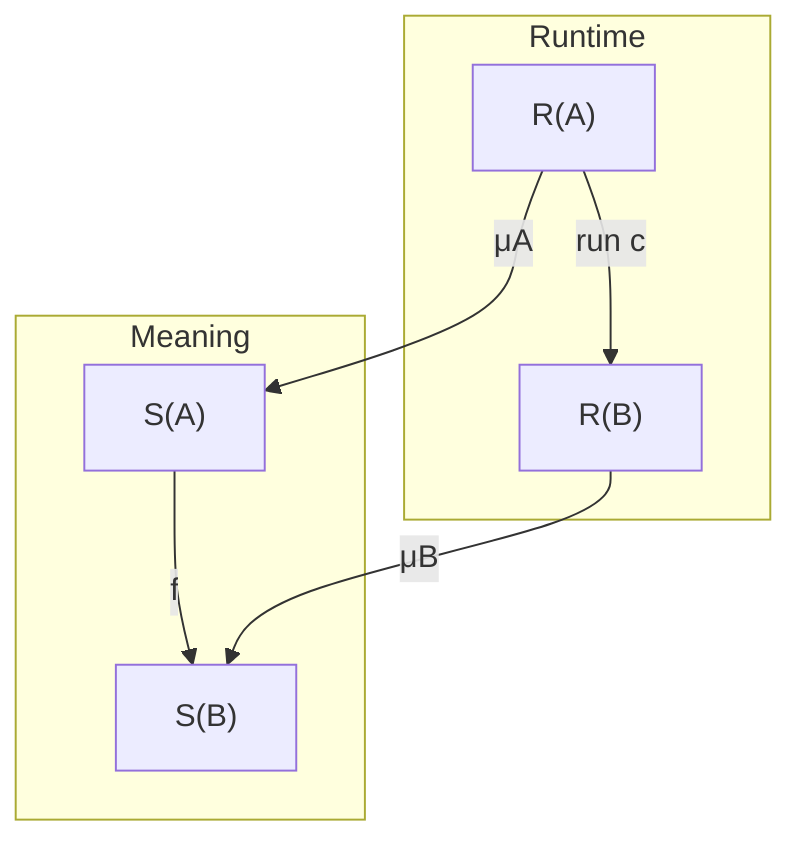

Prompt 1:
````md
Conal Elliot's "denotational design" has evolved over time. The latest incarnation is the Felix ([https://github.com/conal/felix](https://github.com/conal/felix)) library written in Agda. However, it is specialized for hardware design.

Conal never ported his "Compiling to Categories" paper and later work built on top of it to this new paradigm.

1. Let's do that. For a start, rewrite the content of the "Compiling to Categories" paper to the "commutative squares" style mentioned in [https://haskell.foundation/podcast/62/](https://haskell.foundation/podcast/62/) and used by Felix. Use Agda or Lean.
2. "Compiling to Categories" is based on the fact that the internal language of Cartesian closed categories is the simply typed lambda calculus. Can we make an analogous development for locally Cartesian closed categories and dependently typed languages?
````

Response 1:
````md
I implemented a first reconstruction in **Lean**, with a checked categorical compiler, explicit representation squares, and a dependent Π/Σ extension.

The main result is that **the compiler constructs a certified computation whose runtime behavior, source meaning, and data interpretations form a commutative square**. Extending this to dependent types requires those certificates to respect contexts, substitution, and dependent result types.

### Deliverables

- CompilingWithSquares.zip[CompilingWithSquares.zip](sandbox:/workspace/scratch/a7273b23e98a/deliverables/CompilingWithSquares.zip) — the complete source package, build script, verification output, and mathematical development.
- DESIGN.md[DESIGN.md](sandbox:/workspace/scratch/a7273b23e98a/deliverables/CompilingWithSquares/DESIGN.md) — the detailed mathematical write-up.

The six Lean files compile together with **Lean 4.19.0**, using only its bundled libraries. There are **no admitted proofs or user-declared axioms**. The included audit records the ordinary Lean foundational dependencies.

| Component | What is implemented and checked |
|---|---|
| `Squares.lean` | Representation maps, commuting squares, horizontal and vertical composition, products, sums, and the arrow-category exponential |
| `Compiler.lean` | An intrinsically typed source language, categorical compilation, a general preservation theorem, raw categorical syntax, and representative optimization laws |
| `SquareCompiler.lean` | The explicit runtime/source correctness square, including arbitrary noninvertible ground-type representations |
| `FirstOrder.lean` | A cartesian compiler and an additive-map backend, with a proof that this backend is not cartesian closed |
| `Dependent.lean` | A concrete split family model, substitution and context-extension certificates, and dependent Π/Σ certificate combinators |
| `Verification.lean` | Integrated imports, foundational-dependency audit, and executable examples |

The dependent component is a **semantic kernel with compositional certificate builders**. A general dependent syntax compiler, a proof of the LCCC/type-theory correspondence, and production application backends are beyond the implemented scope.

# 1. Recasting “Compiling to Categories”

## What changes—and what carries over

One premise needs adjusting: **Felix is now a general category-theory library**. Its README describes the separation of general categorical machinery from the older `denotational-hardware` library. [GitHub](https://github.com/conal/felix?utm_source=chatgpt.com)

The original paper already supplies the two central ingredients: translation from typed lambda syntax into categorical operations, followed by reinterpretation using structure-preservation laws. Its implementation works through GHC Core rewriting. [conal.net](https://conal.net/papers/compiling-to-categories/compiling-to-categories.pdf?utm_source=chatgpt.com)

The square formulation makes the relationship between representations and meanings explicit. This follows the podcast’s account of four arrows: implementation and specification horizontally, and the interpretations of input and output data vertically. [haskell.foundation](https://haskell.foundation/podcast/62/?utm_source=chatgpt.com)

The lambda-to-categorical translation therefore largely survives. What changes is the object into which we compile and the correctness interface we expose.

## 1.1 Start with representations

For each type \(A\), choose:

\[
R(A) \quad\text{runtime values},\qquad
S(A) \quad\text{ideal values},
\]

together with a meaning map

\[
\mu_A:R(A)\longrightarrow S(A).
\]

An implementation \(c\) correctly implements a specification \(f\) precisely when

\[
\boxed{
\mu_B\circ \operatorname{run}(c)
=
f\circ\mu_A.
}
\tag{1}
\]



The corresponding Lean definitions are small:

```lean
structure Rep where
  R : Type u
  S : Type u
  decode : R → S

structure Square (A B : Rep) where
  impl : A.R → B.R
  spec : A.S → B.S
  commutes : ∀ x, B.decode (impl x) = spec (A.decode x)
```

A correct computation now contains its implementation, its specification, and the evidence connecting them.

In this concrete function model, representations are objects of the **arrow category**, and squares are its morphisms. Felix’s [comma-category definition](https://github.com/conal/felix/blob/6f36d28097db7ea5f5df3263db3e8be08f74e490/src/Felix/Construct/Comma/Type.agda) gives the more general version. For functors

\[
F:\mathcal C_{\mathrm{impl}}\to\mathcal C,
\qquad
G:\mathcal C_{\mathrm{spec}}\to\mathcal C,
\]

the square condition is

\[
\mu_B\circ F(c)=G(f)\circ\mu_A.
\]

That formulation allows implementations and specifications to inhabit different categories, provided they can be compared in a common semantic category.

## 1.2 Composition constructs correctness

Suppose \(c\) implements \(f\), and \(d\) implements \(g\). Then

\[
\begin{aligned}
\mu_C\circ(d\circ c)
&=(g\circ\mu_B)\circ c\\
&=g\circ(f\circ\mu_A)\\
&=(g\circ f)\circ\mu_A.
\end{aligned}
\]

Thus composing implementations and specifications also composes their proofs. This is `Squares.compose`.

Vertical composition handles multiple representation stages. If runtime data denote an intermediate representation through \(\mu\), and that representation denotes the ideal through \(\nu\), the pasted square uses \(\nu\circ\mu\). This is `Squares.vertical`.

Products are equally direct:

\[
\mu_{A\times B}(a,b)
=
(\mu_A(a),\mu_B(b)).
\]

Projection and pairing squares follow from this definition. These operations already support a useful cartesian, first-order language.

## 1.3 The subtle part: function representations

A direct port encounters an important obstruction:

> Arbitrary meaning maps for values do not automatically extend to meaning maps for ordinary runtime functions.

Given

\[
\mu_A:A_R\to A_S,\qquad
\mu_B:B_R\to B_S,
\]

there is generally no application-preserving decoder

\[
(A_R\to B_R)\longrightarrow(A_S\to B_S).
\]

The input position of a function is contravariant.

A minimal counterexample makes the problem concrete. Let

\[
A_R=\mathrm{Bool},\qquad A_S=1,
\]

with \(\mu_A\) forgetting the Boolean, and let \(B_R=B_S=\mathrm{Bool}\), decoded identically. If the runtime identity function represented some \(g:1\to\mathrm{Bool}\), its square would require

\[
\mathrm{false}=g(*)=\mathrm{true}.
\]

`Squares.no_boolean_identity_square` proves this contradiction.

This is also a practical upstream extension point: the inspected Felix source still leaves closed-structure lifting unfinished in [Homomorphism.agda](https://github.com/conal/felix/blob/6f36d28097db7ea5f5df3263db3e8be08f74e490/src/Felix/Homomorphism.agda) and [MakeLawful.agda](https://github.com/conal/felix/blob/6f36d28097db7ea5f5df3263db3e8be08f74e490/src/Felix/MakeLawful.agda).

### The actual arrow-category exponential

The checked construction uses the following runtime carrier for functions:

\[
P(A,B)=
\left\{
(f_R,f_S)
\;\middle|\;
\forall a_R,\;
\mu_B(f_R(a_R))
=
f_S(\mu_A(a_R))
\right\}.
\tag{2}
\]

Its ideal carrier is \(A_S\to B_S\), and its decoder selects \(f_S\).

A represented function therefore contains:

- a runtime function;
- a semantic function;
- their compatibility proof.

Evaluation uses the runtime function. Its correctness is exactly the stored compatibility proof.

For a square \(h:X\times A\to B\), currying at runtime environment \(x_R\) constructs

\[
\left(
a_R\mapsto h_R(x_R,a_R),
\quad
a_S\mapsto h_S(\mu_X(x_R),a_S),
\quad
\text{the specialized proof for }h
\right).
\]

The files prove the exponential universal property, both \(\beta\) and \(\eta\), and naturality in the environment.

**There is a deliberate implementation boundary here.** The semantic function is data in `Type`; the compatibility proof is in `Prop`. Lean can erase the proof, but this construction does not establish that it can erase the semantic function. Efficient closure representations require a further correctness argument.

Two other sound approaches are available:

- With genuine representation isomorphisms, decode functions by conjugation,
  \[
  \mu_{A\to B}(h)=\mu_B\circ h\circ\mu_A^{-1}.
  \]
- With redundant representations or abstraction, use logical relations that constrain which runtime functions represent which ideal functions.

The dependent development uses the second approach.

## 1.4 Compile source syntax into these certified operations

The implemented source language has a parameterized ground type, unit, products, functions, binary sums, variables, lambda, application, let, and primitive arrows.

A term is intrinsically typed:

```lean
Term Prim Γ A
```

Interpret its context as a nested product:

\[
E(\varnothing)=1,\qquad
E(\Gamma,A)=E(\Gamma)\times A.
\]

Compilation produces an arrow \(E(\Gamma)\to A\). Writing \(C(t)\) for compilation, the constructor rules are:

| Source form | Categorical implementation |
|---|---|
| Newest variable | \(\pi_2\) |
| Older variable \(v\), under one added binding | \(C(v)\circ\pi_1\) |
| Unit | \(!\) |
| Pair \((s,t)\) | \(\langle C(s),C(t)\rangle\) |
| Projection | \(\pi_i\circ C(t)\) |
| Lambda \(\lambda x.t\) | \(\operatorname{curry}(C(t))\) |
| Application \(f\,a\) | \(\operatorname{eval}\circ\langle C(f),C(a)\rangle\) |
| Let \(x=a\) in \(b\) | \(C(b)\circ\langle\operatorname{id},C(a)\rangle\) |
| Injection | \(\operatorname{inl}/\operatorname{inr}\circ C(t)\) |
| Case \(s\) with bodies \(l,r\) | \([C(l),C(r)]\circ\operatorname{dist}\circ\langle\operatorname{id},C(s)\rangle\) |
| Primitive application \(p(a)\) | \(p_R\circ C(a)\) |

A literal is a primitive \(1\to A\) composed with \(!\).

The case rule needs

\[
\operatorname{dist}:
E(\Gamma)\times(A+B)
\longrightarrow
(E(\Gamma)\times A)+(E(\Gamma)\times B),
\]

because each branch receives both its payload and the surrounding environment.

### Separate operations from their meaning

The implementation has two interfaces:

**`Target`** supplies operations such as composition, pairing, currying, evaluation, and primitives.

**`Sound`** supplies their denotation and local preservation equations. For example,

\[
\begin{aligned}
D(g\circ f)(x)&=D(g)(D(f)(x)),\\
D(\langle f,g\rangle)(x)&=(D(f)(x),D(g)(x)),\\
D(\operatorname{curry}h)(x)(a)&=D(h)(x,a).
\end{aligned}
\]

The general theorem is

\[
\boxed{
D(C(t))(\rho)=\llbracket t\rrbracket(\rho).
}
\tag{3}
\]

`compile_sound` proves this for every term and environment. `compileCertified` packages the implementation with its proof.

Instantiating the target with actual squares yields the theorem most directly answering your request:

\[
\boxed{
\mu_A\bigl(C(t)_R(\rho_R)\bigr)
=
\llbracket t\rrbracket
\bigl(\mu_\Gamma(\rho_R)\bigr).
}
\tag{4}
\]

This is `SquareCompiler.compile_commutes`. It assumes correctness of the chosen primitive implementations, and no injectivity, surjectivity, or inverse for the ground-type decoder.

There is also `compile_apply_commutes`, which verifies **actual runtime application** of a compiled function. This matters because merely identifying its stored semantic companion would be a weaker result.

A qualification about generality: the structural compiler works for every target supplying its operations. The particular Set-valued theorem requires the stated `Sound` interface; it does not assert that every abstract CCC has a suitable closed interpretation into Set.

## 1.5 A nonidentity representation example

The square compiler includes

\[
R(\mathbb N)=\mathbb N\times\mathrm{Bool},
\qquad
\mu(n,b)=n.
\]

Its increment primitive increments the natural and flips the hidden tag:

\[
(n,b)\longmapsto(n+1,\neg b).
\]

The source cannot observe the tag. The compiled function

```text
λx. increment (increment x)
```

executes as

```text
(41, false) ↦ (43, false)
```

and the general theorem proves that decoding its result yields \(n+1+1\) for every \(n\) and tag.

Other checked examples include \(x^2+y^2\), higher-order application, lambdas capturing an environment, let bindings, and case branches accessing captured variables.

## 1.6 Preserve the paper’s useful nonclosed targets

A monolithic CCC interface would exclude important targets. The package therefore includes a **separate first-order compiler requiring only cartesian structure**.

Its concrete backend consists of maps between finite products of naturals that preserve zero and addition:

\[
f(0)=0,\qquad f(x+y)=f(x)+f(y).
\]

The primitive signature contains zero, addition, and scaling by a fixed natural. Every compiled term preserves those invariants.

The backend is proved **not cartesian closed**. Every additive map from the unit object is the zero map, but maps \(1\times\mathbb N\to\mathbb N\) include distinct projection and zero maps. A currying bijection would force those maps equal.

Thus the first-order compiler demonstrably works with a target that cannot implement the full closed interface. Compiling a higher-order source into such a target would require an additional justified transformation or source restriction.

## 1.7 Optimization and the other application families

Raw categorical syntax does not satisfy category laws by literal constructor equality. The implementation instead defines semantic equivalence:

\[
c\simeq d
\iff
\forall x,\;\operatorname{run}(c)(x)=\operatorname{run}(d)(x).
\]

It proves representative optimization equations, including

\[
\operatorname{eval}\circ
\langle\operatorname{curry}(h),g\rangle
\simeq
h\circ\langle\operatorname{id},g\rangle.
\]

A transformation preserving denotation transports an existing correctness certificate. A performance improvement still needs a cost argument.

The write-up reconstructs the application families through their particular contracts:

| Application | Required correctness statement |
|---|---|
| Graphs/netlists | Graph execution respects data interpretation and valid-port invariants |
| Matrices | Matrix action denotes the intended linear map |
| Automatic differentiation | Both the primal result and derivative are correct |
| Incremental computation | The returned change updates the old result to the new result |
| Interval analysis | Every represented concrete result lies in the output enclosure |
| Stack programs | Execution realizes the specified stack effect |
| Multiple interpretations | Each component carries its certificate for the common specification |

These contracts lead to concrete calculations. For matrices,

\[
\mu(NM)(x)=N(Mx),
\]

so matrix multiplication implements composition.

For differentiable maps, the contract is

\[
\widehat f(a)=(f(a),Df(a)),
\]

and composition uses the chain rule. Preserving only the primal result would accept an incorrect derivative. Elliott’s later AD work develops this application family further. [conal.net](https://conal.net/papers/essence-of-ad/?utm_source=chatgpt.com)

For incremental computation,

\[
f(a\oplus\delta a)=f(a)\oplus df(a,\delta a),
\]

and the derived composition rule is

\[
d(g\circ f)(a,\delta a)
=
dg(f(a),df(a,\delta a)).
\]

Intervals require a relation:

\[
x\in I\Longrightarrow f(x)\in\widehat f(I).
\]

For example, ordinary interval evaluation maps \(x-x\) on \([-1,1]\) to \([-2,2]\), while it maps \(0\) to \([0,0]\). The scalar functions are extensionally equal, so the interval interpretation cannot preserve every equality of scalar functions. Its relevant correctness notion is enclosure.

Finally, representation conversions must retain their actual laws. The equation

\[
\operatorname{abst}\circ\operatorname{repr}=\operatorname{id}
\]

gives a **retraction**. It does not justify treating every representation as canonical or using an inverse in the other direction.

# 2. The analogous development for dependent types

**Yes. The appropriate generalization compiles contexts, dependent families, terms, and substitutions together.** The semantic interface is naturally a category with families or a suitable comprehension model.

The standard LCCC correspondence concerns **extensional dependent type theory with Π, Σ, and extensional identity types**, formulated using democratic categories with families and appropriate coherent morphisms. Clairambault–Dybjer give the corrected biequivalence formulation. [arxiv.org](https://arxiv.org/abs/1112.3456?utm_source=chatgpt.com)

This distinction matters: an LCCC can supply an extensional model of an appropriate intensional fragment, but that is not an equivalence with the full languages of Agda or Lean.

## 2.1 What replaces the simply typed interpretation?

| Type-theoretic item | Categorical interpretation |
|---|---|
| Context \(\Gamma\) | An object of \(\mathcal C\) |
| Substitution \(\sigma:\Delta\to\Gamma\) | An arrow |
| Type \(A\) over \(\Gamma\) | A display map \(p_A:\Gamma.A\to\Gamma\), hence an object of \(\mathcal C/\Gamma\) |
| Term \(\Gamma\vdash t:A\) | A section \(s_t:\Gamma\to\Gamma.A\) |
| Type substitution \(A[\sigma]\) | Pullback \(\sigma^*A\) |
| Dependent sum | Left adjoint to pullback |
| Dependent product | Right adjoint to pullback |

A term’s section satisfies

\[
p_A\circ s_t=\operatorname{id}_\Gamma.
\]

That condition replaces treating every term as a map to a fixed, context-independent type.

For \(p:E\to\Gamma\), the important adjunctions are

\[
\boxed{
\Sigma_p\dashv p^*\dashv\Pi_p.
}
\tag{5}
\]

Given \(q:F\to E\), the dependent sum \(\Sigma_p(q)\) is composition \(p\circ q\).

A lambda body is a section of \(q\). Transposition under \(p^*\dashv\Pi_p\) gives a section of \(\Pi_p(q)\). Evaluation comes from the counit:

\[
\operatorname{ev}:
E\times_\Gamma\Pi_p(F)\longrightarrow F.
\]

For function section \(f\) and argument section \(a:\Gamma\to E\), application has underlying map

\[
u=\operatorname{ev}\circ\langle a,f\rangle:\Gamma\to F,
\]

satisfying \(q\circ u=a\). Its actual term is the section

\[
\langle\operatorname{id}_\Gamma,u\rangle:
\Gamma\longrightarrow\Gamma\times_E F.
\]

Thus its result type is the pullback \(a^*q\). This is precisely the dependency in

\[
f:\Pi_{x:A}B(x),\quad a:A
\quad\Longrightarrow\quad
f\,a:B(a).
\]

## 2.2 Substitution coherence is part of compiler correctness

It is insufficient to equip each slice with function objects independently.

Syntactic substitution obeys equations such as

\[
A[\sigma][\tau]=A[\sigma\circ\tau].
\]

Arbitrarily chosen categorical pullbacks generally realize this relationship only up to isomorphism. We must either track coherent comparison isomorphisms or work with a suitably split model. Coherence constructions such as the local-universes construction provide strict models under stated hypotheses. [arxiv.org](https://arxiv.org/abs/1411.1736?utm_source=chatgpt.com)

The dependent analogue of preserving CCC operations includes

\[
\begin{aligned}
C(\Gamma.A)&=C\Gamma.CA,\\
C(A[\sigma])&=CA[C\sigma],\\
C(t[\sigma])&=Ct[C\sigma],\\
C(\Pi(A,B))&=\Pi(CA,CB),\\
C(\lambda b)&=\lambda(Cb),\\
C(\operatorname{app}(f,a))
&=\operatorname{app}(Cf,Ca).
\end{aligned}
\tag{6}
\]

For a pseudo morphism, these become specified isomorphisms and transported equations.

The last equation is well typed because the result-type equation is also preserved:

\[
C(B[\langle\operatorname{id},a\rangle])
=
CB[\langle\operatorname{id},Ca\rangle].
\]

Categorically, the critical compatibility for dependent products is Beck–Chevalley:

\[
\sigma^*(\Pi_p B)
\cong
\Pi_{p'}((\sigma^+)^*B),
\tag{7}
\]

where \(p'\) and \(\sigma^+\) are the pullback legs associated with substitution.

This is why “replace exponentials with dependent products” is only the beginning of the extension.

## 2.3 The dependent correctness square

Choose a representation of contexts:

\[
\mu_\Gamma:\Gamma_R\to\Gamma.
\]

A representation of \(A:\Gamma\to\mathrm{Type}\) consists of

\[
A_R:\Gamma_R\to\mathrm{Type}
\]

and a family of meaning maps

\[
\mu_A(\rho):
A_R(\rho)\to A(\mu_\Gamma(\rho)).
\]

It induces a meaning map on context extensions:

\[
\mu_{\Gamma.A}(\rho,a)
=
(\mu_\Gamma(\rho),\mu_A(\rho)(a)).
\]

For a term implementation \(t_R\), the required square is

\[
\boxed{
\mu_{\Gamma.A}\circ\langle\operatorname{id},t_R\rangle
=
\langle\operatorname{id},t\rangle\circ\mu_\Gamma.
}
\tag{8}
\]

Pointwise:

\[
\boxed{
\mu_A(\rho)(t_R(\rho))
=
t(\mu_\Gamma(\rho)).
}
\tag{9}
\]

This is implemented directly:

```lean
structure CtxRep (Γ : Type u) where
  Carrier : Type u
  meaning : Carrier → Γ

structure TyRep (RΓ : CtxRep Γ) (A : Γ → Type u) where
  Carrier : RΓ.Carrier → Type u
  meaning :
    (ρ : RΓ.Carrier) → Carrier ρ → A (RΓ.meaning ρ)
```

`TermCert` adds the term implementation and equation (9). `SubCert` certifies substitutions. The module supplies certificate constructors for projection, the newest variable, context extension, substitution composition, lifting, and reindexing.

### Transport cannot be omitted

Suppose a represented substitution has a certificate

\[
h_\delta:
\mu_\Gamma(\sigma_R\delta)
=
\sigma(\mu_\Delta\delta).
\]

The reindexed runtime family has carrier \(A_R(\sigma_R\delta)\). Its decoder must be

\[
\operatorname{transport}_A(h_\delta)
\bigl(\mu_A(\sigma_R\delta)(a)\bigr).
\]

Without transport, the decoded value is in the wrong fiber.

`reindexRep` and `TermCert.reindex` retain this operation explicitly. Substitution in the underlying family model can be strict while comparison between representations still needs propositional transport.

## 2.4 Dependent functions via logical relations

The earlier function-decoding obstruction persists with dependent functions. The implementation therefore uses a relation between runtime and ideal environments, and relations between values over related environments.

Let:

- \(h:R_\Gamma(\rho_R,\rho_S)\) relate environments;
- \(R_A(h,a_R,a_S)\) relate arguments;
- \(R_B((h,h_a),b_R,b_S)\) relate results over related environment–argument pairs.

Define

\[
\boxed{
R_\Pi(h,f_R,f_S)
\iff
\forall a_R,a_S,\;
\forall h_a:R_A(h,a_R,a_S),\;
R_B((h,h_a),f_R(a_R),f_S(a_S)).
}
\tag{10}
\]

The proofs follow the typing rules:

**Lambda:** introduce related arguments and apply the body certificate.

**Application:** apply the function certificate to the argument and its certificate.

The dependent Σ relation first relates the first components, then relates the second components in the resulting dependent fibers.

`Dependent.lean` implements these constructions and their certificate combinators, together with the concrete family-model Π/Σ \(\beta\), \(\eta\), and substitution laws.

Exact squares are a special case obtained from **graph relations**. For example,

\[
R_\Gamma(\rho,\gamma)
\iff
\mu_\Gamma(\rho)=\gamma.
\]

The module checks conversions between its map-square certificates and the corresponding graph-relation certificates.

Relations also retain a literal squares interpretation: regard related pairs and their witnesses as a total relation object, with projections to runtime and ideal values. A relation-preserving computation induces a map between relation objects, and both projection squares commute. Gluing and displayed models provide a general categorical setting for this construction. [drops.dagstuhl.de](https://drops.dagstuhl.de/entities/document/10.4230/LIPIcs.FSCD.2019.25?utm_source=chatgpt.com)

## 2.5 The checked dependent example

The example is

```text
tighten :
  (n : Nat) →
  (i : Fin (n + 1)) →
  Fin (i.val + 1)
```

It returns `i.val` with the indicated bound. The result type depends on the **actual argument value**, not just on a static type parameter.

Runtime inputs and outputs carry an extra Boolean tag, ignored by the relation. The generic lambda and application combinators produce its certificate. A dependent pair is then assembled and both projections certified.

The integrated verification executes:

```text
compiled ordinary lambda:  (43, false)
dependent application:     8
dependent pair projections: (8, 8)
```

These evaluations illustrate the implementation. The general certificate theorems establish the relevant correctness properties for arbitrary inputs.

## 2.6 What a full dependent compiler would add

The general construction is now identifiable:

1. Define explicit dependent syntax or checked typing derivations.
2. Interpret its contexts, types, terms, substitutions, and conversion evidence in a split CwF.
3. Lift that interpretation into a model of certified squares or relations.
4. Prove preservation by induction on the supplied derivations.

Additional language features bring additional obligations:

| Feature | Additional structure or proof |
|---|---|
| Intensional identity types | Stable identity introduction/elimination and preservation of that structure |
| Universes | Codes, decoding, closure, and substitution compatibility |
| Inductive types | The appropriate initial-algebra or inductive-type structure |
| General recursion/effects | A semantics accounting for those computations |
| Runtime erasure | Preservation of meaning when removing indices, proofs, or semantic companions |
| Host-language integration | A checked connection from elaborated syntax to the compiler’s explicit source |

A bare LCCC does not supply all this structure.

There is also a useful boundary on optimization: equality in the relevant free LCCC is undecidable. This concerns the general extensional theory; it does not prevent compiling supplied typed derivations or checking individual rewrite proofs. [pageperso.lis-lab.fr](https://pageperso.lis-lab.fr/pierre.clairambault/papers/lmcs-2017.pdf?utm_source=chatgpt.com)

The extension to dependent types is therefore a structure-preserving translation of **contexts, families, sections, and substitutions**, with correctness indexed over their representations. The supplied Lean development checks those local obligations in the concrete family model, while the ordinary and first-order components already provide complete syntax-directed compilers for their stated languages.
````

Prompt 2:
````md
This looks amazing!

Let's try to translate the applications and extensions given by Conal into our new framework. This should provide a good test for how composable and general it really is.

For your convenience, an agent compiled related work by Conal:

```markdown
| Work | Recommended source for an agent | Relationship and reason for choosing it |
|---|---|---|
| **Compiling to categories** — 2017 | **[Full author-hosted PDF](https://conal.net/papers/compiling-to-categories/compiling-to-categories.pdf)**, together with the **[ConCat implementation](https://github.com/compiling-to-categories/concat)** | **Foundation.** The full paper supplies the translation, categorical interfaces, and interpretations. I did not locate a public source manuscript for this paper; the implementation repository is the useful code companion. The original `conal/concat` link now redirects to the organization repository linked here. ([conal.net][1]) |
| **Generic Functional Parallel Algorithms: Scan and FFT** — 2017; called *Generic parallel functional programming* on the website | **[Full manuscript, `generic-parallel-functional.lhs`](https://raw.githubusercontent.com/conal/generic-parallel-functional/master/generic-parallel-functional.lhs)** · [Repository](https://github.com/conal/generic-parallel-functional) · [Rendered PDF](https://conal.net/papers/generic-parallel-functional/generic-parallel-functional.pdf) | **Companion application.** This is the complete literate manuscript, rather than the shorter talk. The paper uses the categorical compiler to generate diagrams from its Haskell algorithms and describes generation of synthesizable Verilog. ([conal.net][2]) |
| **The simple essence of automatic differentiation** — 2018 | **[Full manuscript, `essence-of-ad.lhs`](https://raw.githubusercontent.com/conal/essence-of-ad/master/essence-of-ad.lhs)** **plus [the author’s errata](https://conal.net/papers/essence-of-ad/#errata-and-clarifications)** · [Repository](https://github.com/conal/essence-of-ad) | **Direct extension.** Develops the category of differentiable functions and its specializations to forward and reverse mode AD. The manuscript source includes the extended proof sections. **The errata are a required companion:** the public source still contains some superseded definitions. See the version notes below. ([GitHub][3]) |
| **Calculating compilers categorically** — July 2018 draft | **[Full draft PDF](https://conal.net/papers/calculating-compilers-categorically/ccc.pdf)**, supplemented by **[the 2020 *Compiling gracefully* literate source](https://raw.githubusercontent.com/conal/talk-2020-calculating-compilers-categorically/master/compiling-gracefully.lhs)** · [Talk repository](https://github.com/conal/talk-2020-calculating-compilers-categorically) | **Direct extension.** Calculates a stack-machine interpretation of the categorical vocabulary. The PDF is the fullest verified manuscript; the later talk source gives the calculations and Haskell definitions in text form. *Compiling gracefully* and *Calculating compilers categorically* are two presentations of this development. The paper remains an incomplete draft. ([conal.net][4]) |
| **Generalized Convolution and Efficient Language Recognition** — 2019 | **[Extended manuscript, `convolution.lhs`](https://raw.githubusercontent.com/conal/convolution-paper/master/convolution.lhs)** · **[Repository with implementation and tests](https://github.com/conal/convolution-paper)** · [Author’s extended PDF](https://conal.net/papers/convolution/convolution-long.pdf) | **Related algebraic branch.** Derives implementations through semiring and semimodule homomorphisms, connecting convolution, language recognition, tries, and polynomial arithmetic. The repository contains both the manuscript and its Haskell implementation. Prefer this author-maintained source set over the older arXiv snapshot. ([GitHub][5]) |
| **Higher-order, higher-order automatic differentiation** — 2019–2020 incomplete draft | **[Full manuscript, `hoad.lhs`](https://raw.githubusercontent.com/conal/paper-2020-higher-order-ad/master/hoad.lhs)** · **[Repository](https://github.com/conal/paper-2020-higher-order-ad)** · [Author’s landing page](https://conal.net/papers/higher-order-ad/) | **Follow-on to the AD work.** Investigates both higher-order derivatives and higher-order functions. This is a useful development omitted from the main publications index. Preserve its status as an **early, incomplete draft**. The author dates it November 2019, although the repository name contains `2020`. ([GitHub][6]) |
| **Symbolic and Automatic Differentiation of Languages** — 2021 | **[Complete Agda and manuscript repository](https://github.com/conal/paper-2021-language-derivatives)**; manuscript entry point: [raw `paper.tex`](https://raw.githubusercontent.com/conal/paper-2021-language-derivatives/main/paper.tex) | **Related continuation through differentiation and language recognition.** This is especially suitable for proof-oriented agent work because it includes the actual Agda definitions and proofs. **Supply the whole repository:** `paper.tex` incorporates material from the `.lagda` modules and is not a complete standalone input. ([GitHub][7]) |
| **Timely Computation** — 2023 | **[Full author-hosted PDF](https://conal.net/papers/timely-computation/paper.pdf)** · [Supporting Felix category library](https://github.com/conal/felix) | **Direct continuation of the categorical hardware direction.** Adds the treatment of timing and correctness proofs that the paper explicitly says the 2017 work lacked. I could not verify a public complete source bundle for this paper, so the PDF is the strongest verified full source. **Felix is its supporting category library; it is not the complete paper artifact.** ([conal.net][8]) |

[1]: https://conal.net/papers/compiling-to-categories/compiling-to-categories.pdf?utm_source=chatgpt.com "Compiling to Categories"

[2]: https://conal.net/papers/generic-parallel-functional/?utm_source=chatgpt.com "Generic parallel functional programming: Scan and FFT"

[3]: https://github.com/conal/essence-of-ad?utm_source=chatgpt.com "GitHub - conal/essence-of-ad: Paper: The simple essence of automatic differentiation"

[4]: https://conal.net/papers/calculating-compilers-categorically/?utm_source=chatgpt.com "Calculating compilers categorically"

[5]: https://github.com/conal/convolution-paper?utm_source=chatgpt.com "GitHub - conal/convolution-paper: Generalized Convolution and Efficient Language Recognition"

[6]: https://github.com/conal/paper-2020-higher-order-ad?utm_source=chatgpt.com "GitHub - conal/paper-2020-higher-order-ad: Higher-order, higher-order automatic differentiation"

[7]: https://github.com/conal/paper-2021-language-derivatives?utm_source=chatgpt.com "GitHub - conal/paper-2021-language-derivatives: Paper and talk"

[8]: https://conal.net/papers/timely-computation/paper.pdf?utm_source=chatgpt.com "Timely Computation"
```

Make sure that all proofs are in the code.

Include ADRs.

Please structure the code in reasonable libraries or at least modules.

If it is not too much of an inconvenience, please use Git so that we can track which application and modification came in what order.
````

Response 2:
````md
I extended the Lean development and checked the complete project.

**CompilingWithSquares.zip[Download CompilingWithSquares.zip](sandbox:/workspace/scratch/a7273b23e98a/deliverables/CompilingWithSquares.zip)**

The archive contains:

- **52 Lean modules**, comprising 8,400 lines of Lean source.
- **Ten ADRs** explaining the architecture, alternatives, and proof boundaries.
- **Universal composition theorems** connecting independently implemented backends.
- A reproducible build and an **exhaustive axiom audit**.
- A **Git bundle with 14 commits**, preserving the original foundation and the application extension as separate tags.
- `APPLICATIONS.md`, a detailed coverage guide, and `docs/SOURCES.md`, with primary sources, source revisions, and manuscript fingerprints.

The implementations cover all eight source families you supplied. Their precise domains matter: higher derivatives are complete for polynomial expressions; higher-order functions are handled through a curve logical relation; convolution uses finite words; and the FFT supports arbitrary composition trees built from one- and two-element factors. The incomplete drafts retain their status as incomplete drafts in the documentation.

## 1. What has been translated

| Work | Implementation in this development | Main correctness result |
|---|---|---|
| **Compiling to Categories** | The original typed compiler, extended with matrix, circuit, AD, incremental, and interval interpretations. A new relational interpretation supports the full simply typed source language. | Correctness for every term of each supported source fragment. |
| **Generic Functional Parallel Algorithms: Scan and FFT** | Generic monoid scans; distinct product/composition recipes; powers and polynomial evaluation; recursive Cooley–Tukey FFT; exact complex interpretation and executable finite-field examples. | Every supported scan recipe agrees with sequential scan; every supported FFT factor tree agrees with the direct DFT. |
| **The Simple Essence of Automatic Differentiation** | Analytically certified differentiable maps; forward seeds; reverse continuations; adjoints; direct compilation into generalized derivative representations. | Compiled derivatives satisfy `HasFDerivAt`; independently compiled forward and reverse representations agree. |
| **Calculating Compilers Categorically / Compiling Gracefully** | Typed stack instructions, instruction sequences, execution, and compilation from the existing first-order source. | Every compiled program produces the source result and preserves an arbitrary stack tail exactly. |
| **Generalized Convolution and Efficient Language Recognition** | Weighted word series; convolution semiring laws; sparse polynomials with duplicate keys; normalization; coefficient and support homomorphisms. | The representation operations preserve denotation, including convolution and normalization. |
| **Higher-order, Higher-order Automatic Differentiation** | A fundamental curve-relation theorem for the full simply typed source, including captured functions; polynomial representations of complete derivative towers. | Higher-order source evaluation preserves true derivatives; every polynomial tower component equals the corresponding analytic iterated derivative. |
| **Symbolic and Automatic Differentiation of Languages** | Optimized regex derivatives; recognition; finite trie observations; proof-relevant language isomorphisms; total witness parsing. | Recognition is correct; the independent Boolean recognizer and witness parser agree for every regex and word. |
| **Timely Computation** | Stable-signal relations; the setup/hold interval semiring; independent value and linear timing maps; timing matrices; typed circuit syntax; compiled adders and a carry hazard. | Every compiled source circuit preserves stability at all times covered by its calculated output intervals. |

I incorporated the AD errata, including the corrected `onDot` result type and the variance of the continuation/opposite constructions. The stack development follows the completed first-order calculations, while the higher-order AD work is explicitly treated as the author’s early, incomplete November 2019 draft. [conal.net](https://conal.net/papers/essence-of-ad/?utm_source=chatgpt.com)

## 2. The main architectural result: squares need relational interpretations too

The applications exposed a useful distinction in the original framework.

For an exact representation, we have a decoder and a commuting equation:

\[
\operatorname{decode}_B(\operatorname{impl}(r))
=
\operatorname{spec}(\operatorname{decode}_A(r)).
\]

That works well for stack execution, coordinate representations, shaped containers, and many language representations.

Other applications naturally give a **relation**:

- An interval can contain many points.
- A signal can represent a Boolean value during a particular interval.
- A transformed higher-order function must preserve a relation on arguments.
- A derivative representation must correspond to an actual analytic derivative.

The shared relational contract is therefore:

\[
R_A(r,s)
\Longrightarrow
R_B(\operatorname{impl}(r),\operatorname{spec}(s)).
\]

`SquareKit/Relations.lean` implements that contract and proves its composition, identity, product, application, and currying laws.

This remains connected to literal commutative squares. For a relation \(R_A\), form its witness space

\[
W_A=\{(r,s)\mid R_A(r,s)\},
\]

with decoder \((r,s,h)\mapsto s\). A relation-preserving implementation maps witnesses by

\[
(r,s,h)\longmapsto
\bigl(f_R(r),f_S(s),\operatorname{preserves}(h)\bigr).
\]

The resulting ordinary square commutes. Both the construction and its compatibility with composition are proved.

There is an important representation boundary here: **this witness construction stores the semantic value as data**. Its existence does not prove that the semantic component can be erased. The documentation keeps that distinction explicit.

### Higher-order functions

The function relation is:

\[
R_{A\to B}(F,f)
\iff
\forall r,s.\;
R_A(r,s)\Longrightarrow R_B(F(r),f(s)).
\]

This supports ordinary runtime functions without inventing a decoder from every arbitrary runtime function to a semantic function.

`SquareKit/STLCRelations.lean` instantiates the **existing full simply typed compiler** with this interpretation. Its theorem covers:

- Products and projections.
- Lambdas and application.
- Let bindings.
- Sums and case analysis.
- Captured environments.
- Primitives with locally proved contracts.

The principal results are `STLCRelations.compile_preserves` and `compile_apply_preserves`.

The matrix, stack, and circuit backends use the existing first-order cartesian interface. Their implementations need the operations their source fragments actually use; the framework does not impose an exponential structure on them.

## 3. The strongest tests are compositions between backends

The integration modules establish agreement between implementations constructed independently.

### A. One arithmetic source: AD, stack execution, finite changes, and intervals

`SquareKit/Arithmetic.lean` defines a common primitive signature. The same source term can be interpreted over different scalar types and compiled into several backends.

For example:

```text
let z = x*y in z*z+x
```

denotes

\[
f(x,y)=(xy)^2+x.
\]

Over the reals, the AD interpretation proves the actual directional derivative:

\[
Df(x,y)(dx,dy)
=
(2xy^2+1)\,dx+(2x^2y)\,dy.
\]

Over the rationals, the independently compiled stack, incremental, and interval implementations are connected by general theorems.

`Examples.ArithmeticPipeline.stack_after_update` proves that:

> Running the stack program on an updated input gives the same result as applying the compiled finite change to its previous output—and preserves the supplied stack tail.

`stack_enclosed` transfers the interval theorem to the actual bytecode result.

`incremental_output_enclosed` then combines all three contracts:

> If a box encloses the updated input, the independently compiled interval result encloses the incrementally updated output.

The premise refers to the **updated input**. The theorem does not silently reuse an old box after the input has moved outside it.

These results quantify over every typed term, context, input, change, and stack tail in the common fragment. The concrete execution of the shared example at \(x=3,y=2\) returns **39**.

The real AD interpretation and rational execution interpretations remain separate mathematical instances of the common syntax; there is no implicit identification of real and rational machine arithmetic.

### B. Matrices and stack programs agree for every linear source term

`Applications/Linear/Compiler.lean` emits actual matrices. Its primitive language contains zero, addition, and constant scaling.

`Examples/MatrixStack.lean` compiles the same linear source through the stack backend and proves agreement for:

- Every source term in that fragment.
- Every commutative semiring of scalars.
- Every input coordinate vector.
- Every arbitrary stack tail.

The joint implementation is itself a square, `jointSquare`. Its output is a pair of backend results together with a proof that they decode to the same value.

The stronger theorem, `agree_preserving_tail`, equates the complete stack result with the decoded matrix result and the original tail.

For the source expression \(2x+3y\), the generated matrix coefficients are proved to be **2 and 3**.

### C. Higher derivatives compose with scan-based evaluation

`Examples/JetScan.lean` connects two previously separate libraries:

1. Compile a polynomial expression to its polynomial representation.
2. Differentiate that representation any number of times.
3. Convert its coefficients into shaped data.
4. Evaluate it using the scan-derived polynomial evaluator.

The prepared runtime representation is genuinely dependent:

```lean
structure Prepared (R : Type) where
  plan : ScanPlan
  data : plan.shape.Data R
```

The chosen plan determines the type of the stored coefficients.

The module proves correctness for **any sufficiently large scan plan**. It also provides a total adapter that selects `natDegree + 1` slots, so the basic pipeline does not leave a size obligation to the caller.

The final theorem is:

```text
Examples.JetScan.source_jet_scan
```

It states that the scan-based result equals the analytic iterated derivative of the independent source evaluator, for **every polynomial expression, derivative order, and evaluation point**.

The default adapter uses a right-associated plan. Alternative plans are covered by the sufficient-size theorem. Real-polynomial preparation is noncomputable Lean mathematics; the generic scan evaluator is executable when its scalar operations are executable.

### D. Convolution, normalization, regexes, and tries compose

The language pipeline connects:

\[
\text{sparse weighted polynomials}
\;\longrightarrow\;
\text{convolution and normalization}
\;\longrightarrow\;
\text{support languages}
\;\longrightarrow\;
\text{regexes}
\;\longrightarrow\;
\text{trie observations}.
\]

`LanguageDerivatives.normalized_product_snapshot` proves that the final lookup succeeds exactly when the original convolution coefficient is nonzero, for every word within the observation depth.

The coefficient-forgetting step is explicit: it uses natural-number weights and the proved support homomorphism. That qualification matters because arbitrary coefficient semirings can have cancellation.

This follows the source work’s homomorphism-based approach, with the implemented convolution specialized to finite words and their finite prefix/suffix decompositions. [GitHub](https://github.com/conal/convolution-paper?utm_source=chatgpt.com)

### E. Timing reuses the general matrix library

The timing branch imports `Applications/Linear/Matrix.lean` directly.

`Digital.timingMatrixSquare` represents the circuit’s interval-linear timing map using the same finite-coordinate construction used for ordinary scalar linear maps. `Circuit.compile_matrix_stable` then transports the circuit’s stability guarantee through matrix evaluation.

This is a concrete reuse of the algebraic interface: the scalar semiring changes from ordinary arithmetic to timing intervals, while the matrix representation theorem remains applicable.

## 4. AD correctness is stronger than preserving the primal result

A square that forgets the tangent can commute even when the tangent is wrong. The AD implementation therefore carries the stronger analytic invariant.

Its central fields are:

```lean
primal : E → F
derivative : E → E →L[ℝ] F
correct : ∀ x, HasFDerivAt primal (derivative x) x
```

Identity, composition, products, constants, addition, negation, scaling, and multiplication discharge their actual analytic obligations. The resulting source compiler theorem refers to the independent source evaluator.

The generalized compiler also constructs the selected derivative representation **directly**:

- One instance produces continuous linear maps.
- Another produces reverse continuations.

Its runtime result contains the primal value and the selected derivative code. The existence of a true mathematical derivative related to that code is a witness in `Prop`.

`Applications.AD.Generalized.modes_agree` compares these independently compiled implementations for every source term, covector, and direction.

For higher-order functions, the curve relation tracks the variation of both captured data and arguments. The checked example

```text
twice (lambda y => x*y+x) x
```

has derivative

\[
3x^2+2x+1.
\]

This result does not require treating the set of all function-space values as a normed vector space.

For higher derivatives, the polynomial library represents the entire infinite derivative tower with a finite polynomial. `jet_correct` identifies every component with analytic `iteratedDeriv`, and `towerMulSquare` implements the binomial convolution of tower components through the proved all-order Leibniz rule.

The remaining general lazy smooth-function tower and higher-order reverse-mode constructions from the unfinished draft are explicitly outside this completed fragment. [conal.net](https://conal.net/papers/higher-order-ad/?utm_source=chatgpt.com)

## 5. Several counterexamples sharpen the framework

These translations produced useful examples of properties that a generic interface must distinguish.

### Finite changes need the cross term

For multiplication, the exact update is:

\[
\Delta(xy)
=
x\,\Delta y+\Delta x\,y+\Delta x\,\Delta y.
\]

The incremental implementation includes the last term. A checked counterexample shows that an infinitesimal tangent cannot replace the finite-change operation.

The cache implementation also preserves an explicit dependent invariant connecting stored input and output. Its correctness theorem does not assert an asymptotic speedup or caching of every intermediate result.

### Interval analysis does not preserve all equalities of point functions

Pointwise,

\[
x+(-x)=0.
\]

But interval evaluation of those operations on \([-1,1]\) produces \([-2,2]\).

Both facts are proved. They show why an equality valid in point semantics cannot automatically become an equality between interval implementations.

The higher-order interval tests expose the same issue. Compiling fourth power on \([-1,2]\) produces the sound enclosure **\([-8,16]\)**. The negative lower bound records lost dependency information, not an incorrect pointwise result.

The interval contracts prove enclosure over exact rational arithmetic. They do not claim optimal precision, unknown-branch joins, or floating-point outward rounding.

### Parse-valued language derivatives retain information that Boolean recognition forgets

The proof-relevant language library establishes:

\[
\operatorname{Star}(P)([])
\cong
\operatorname{List}(P([])),
\]

and

\[
\operatorname{Star}(P)(a::w)
\cong
\operatorname{List}(P([]))
\times
\operatorname{Concat}(D_aP,\operatorname{Star}(P))(w).
\]

The leading list records empty parses before the first consuming parse. The code includes both directions and both inverse proofs.

A Boolean recognizer can forget those witnesses. A witness-preserving translation must retain them. That distinction is central to the 2021 work’s treatment of language meanings as types. [GitHub](https://github.com/conal/paper-2021-language-derivatives?utm_source=chatgpt.com)

The resulting total parser returns either a successful witness or a refutation of all witnesses. `recognizers_agree` proves its agreement with the independently implemented optimized Boolean recognizer for every regex and word. It selects a successful parse; it does not enumerate all ambiguity.

### Isomorphic shapes can retain different algorithms

The scan implementation keeps product and functor-composition choices in `ScanPlan`, even when their resulting containers are isomorphic.

This preserves the source paper’s distinction between left-associated, right-associated, and bush-shaped algorithm families. The correctness theorem works over arbitrary monoids, including noncommutative ones; word-scanning examples make accidental reordering observable. [conal.net](https://conal.net/papers/generic-parallel-functional/generic-parallel-functional.pdf?utm_source=chatgpt.com)

The FFT similarly retains recursive factorization and twiddle operations. Exact finite-field executions include:

- Four points over \(\mathbb Z/17\mathbb Z\), root 4: **`[10, 7, 15, 6]`**.
- Eight points, root 2: **`[2, 8, 14, 6, 13, 3, 12, 1]`**.

The general proofs establish agreement with the direct transform. Work/span, scheduling, optimized circuit counts, and floating-point error remain separate obligations.

## 6. The full-adder test checks more than Boolean arithmetic

The timing development preserves the paper’s separation between:

- An analog signal transformation.
- A Boolean value function.
- A timing function independent of those Boolean values.
- A proof that stable inputs produce stable outputs throughout the calculated intervals.

The timing function is linear over the setup/hold interval semiring. Both endpoints are retained, including inverted bounds. This follows the construction in *Timely Computation*. [conal.net](https://conal.net/papers/timely-computation/paper.pdf?utm_source=chatgpt.com)

The full adder is an actual source term with two let bindings. `compiled_fullAdder` proves equality with the explicitly factored circuit on **analog behavior, Boolean behavior, and timing**.

The calculated matrix is:

| Output | Input `a` | Input `b` | Input `c` |
|---|---:|---:|---:|
| Sum | \([1/4,1/4]\) | \([1/2,1/2]\) | \([1/2,1/2]\) |
| Carry | \([3/5,3/5]\) | \([17/20,3/5]\) | \([17/20,3/5]\) |

The entries are proved equal to the matrix extracted from the circuit implementation.

The carry coefficients for `b` and `c` have negative width. The code proves that multiplying such a coefficient by an input interval yields a nonempty observation interval exactly when the input stability width is at least \(1/4\).

It also proves why all inverted intervals cannot be collapsed to a single empty-set representation: endpoint multiplication can turn different inverted bounds into different useful output intervals.

Finally, the hazard is checked in the same analog semantics. Set `a = c = true`, and let `b` fall at time zero. The Boolean carry remains true, while the modeled circuit produces these observations:

| Time | Circuit carry |
|---:|:---|
| \(0\) | `true` |
| \(1/2\) | `true` |
| \(7/10\) | **`false`** |
| \(9/10\) | `true` |
| \(1\) | `true` |

The arithmetic result, the low carry at \(7/10\), and the surrounding high values have Lean proofs. This recreates the paper’s reconvergent-path issue and demonstrates why Boolean equivalence alone is insufficient for a timing-preserving circuit transformation. [conal.net](https://conal.net/papers/timely-computation/paper.pdf?utm_source=chatgpt.com)

The model uses exact rational delays. Physical characterization, metastability, stateful feedback, RTL export, and timing-preserving netlist optimization are outside its established contract.

## 7. Verification, modules, ADRs, and Git

### Verification

The final build:

1. Checks that the public entrypoint covers every local source module.
2. Rejects source-level admissions, extra axioms, unsafe/partial definitions, native-decision trust, and skipped kernel checking.
3. Rechecks all **52 modules from source**.
4. Audits all project-owned kernel-safe declarations and their transitive dependencies.

The final audit reports:

| Item | Result |
|---|---:|
| Kernel-safe declarations audited | **3,760** |
| Theorem declarations, including generated auxiliaries | **1,837** |
| Permitted transitive axiom union | `propext`, `Classical.choice`, `Quot.sound` |
| Additional axioms or admitted proofs | **None** |

Lean-generated unsafe runtime artifacts are counted separately from mathematical proof roots. Source-written unsafe declarations are rejected. The audit’s dependency traversal still rejects any forbidden axiom reached from a mathematical declaration.

Negative controls confirmed that the gate rejects an admitted private proof, an unrelated-name axiom, `Lean.ofReduceBool`, and a source-written unsafe definition.

`verification.txt` contains the actual build output, executable results, and audit report.

### Organization and decisions

The reusable layers are:

- The original root compiler and square modules.
- `SquareKit/` for relations, representation combinators, and compiler adapters.
- `Applications/<domain>/` for each implementation and its proofs.
- `Examples/` for cross-application theorems and executable displays.

The ten ADRs cover:

1. Module boundaries and proof dependencies.
2. Relations and synchronized representations.
3. Analytic and generalized AD.
4. Convolution, recognition, and parse witnesses.
5. Parallel shapes and algorithm recipes.
6. Typed stack compilation.
7. Finite changes and interval enclosure.
8. Stable signals, timing, and circuits.
9. Semiring-valued matrices.
10. Cross-application composition and exhaustive auditing.

### Git and reproduction

The bundle contains the complete history, including these markers:

| Marker | Commit |
|---|---|
| `foundation-v1` | `60533ed` |
| `applications-v2` and current `main` | `ceb4d6a` |

The commits record implementation and integration order. I verified a fresh clone of the bundle, its default `main` branch, both tags, and the archived source checksums.

After extracting the archive and entering its `CompilingWithSquares` directory:

```sh
git clone CompilingWithSquares.bundle ../CompilingWithSquares-history
cd ../CompilingWithSquares-history

git log --reverse --oneline
git diff foundation-v1..applications-v2 --stat

lake exe cache get
./check.sh
```

The project pins **Lean 4.19.0** and **Mathlib v4.19.0**, with the exact Mathlib and transitive package revisions in the manifest. `check-foundation.sh` still checks the original dependency-free foundation separately.

## 8. What this establishes about generality—and the dependent extension

The most reusable part of the design is the separation between **the source language, the representation contract, and the local operations that preserve that contract**.

New backends generally required local certified operations and a target instance. The source correctness theorem then lifted those obligations to every term. Cross-application results reused those compiler theorems and square composition.

The difficult cases exposed meaningful differences in the contracts: finite changes versus derivatives, enclosure versus equality, Boolean membership versus parse witnesses, and truth tables versus timed signal behavior. Making those differences explicit allowed the implementations to compose without asserting false equivalences.

The dependent side now has concrete applications: coefficient data indexed by a selected scan plan, circuit ports indexed by source types, derivative orders, and cached values with invariants. The original split-family model remains intact.

A **generic dependent-language compiler** is still beyond this extension. It would require an explicit dependent syntax or typing derivations, substitution and conversion preservation, and the chosen universe, identity-type, and inductive-type structure. The present applications exercise dependent representations and their proofs; they do not claim that the full LCCC-to-dependent-language development has already been completed.
````
