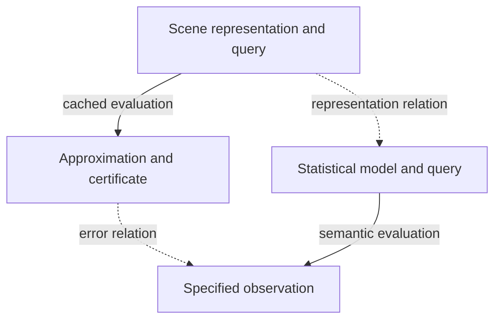

Prompt 1:
````md
In 3D rendering, the standard approach for rendering objects at different distances are different "levels of detail" versions of those objects. I find this deeply mathematically unsatisfying. What different approaches do exist?
````

Response 1:
````md
Several alternatives exist, and the most interesting ones change the question from **“Which version of this object should I draw?”** to **“How should I evaluate one scene at the spatial resolution of this image?”**

There are two different objections to conventional LOD worth separating: having several independently simplified objects, and discarding fine geometry without correctly accounting for its visual contribution. Continuous surfaces and adaptive refinement address the first; appearance filtering addresses the second. They are not the same problem. [OpenSubdiv](https://opensubdiv.org/docs/subdivision_surfaces.html)

## The mathematical starting point: a pixel is an integral

In a simplified imaging model, a pixel’s value is

\[
I_p=\int_{\mathbb R^2}h_p(u,v)\,L(u,v)\,du\,dv,
\]

where \(L\) is the radiance arriving at the image plane and \(h_p\) is the pixel’s normalized spatial filter. Rendering should approximate this integral, not merely evaluate the scene along one infinitely thin ray. [PBR Book](https://www.pbr-book.org/4ed/Sampling_and_Reconstruction/Image_Reconstruction)

Distance matters because it changes the region of the scene covered by that filter. For a small transverse geometric feature of size \(\delta\), its projected size is approximately

\[
\delta_{\text{pixels}}\approx \frac{f_{\text{pixels}}\delta}{z}.
\]

Thus, distance alone is not the appropriate control variable: focal length, output resolution, orientation, and the shape of the projected footprint matter too. Ray differentials are one established way of tracking such footprints rather than relying on distance heuristics. [Stanford Graphics](https://graphics.stanford.edu/papers/trd/)

With that distinction in mind, here are the main alternatives.

## 1. Represent one continuous surface, and evaluate it as accurately as needed

Instead of treating a triangle mesh as the object, represent the object as a surface

\[
\mathbf{x}=S(u,v).
\]

Bézier patches, B-splines, NURBS, and subdivision limit surfaces belong to this family. A mesh generated for rendering is then a *temporary discretization of the surface*, not a separately authored replacement object. OpenSubdiv’s documentation explicitly distinguishes the underlying limit surface from the polygonal approximations used to display it. [OpenSubdiv](https://opensubdiv.org/docs/subdivision_surfaces.html)

An adaptive tessellator samples that surface more densely where necessary. A nearly flat region can use large polygons; a curved silhouette needs smaller ones. The conceptual target is an approximation tolerance, rather than “use mesh number three.”

**Reyes-style micropolygon rendering** is a particularly important version of this idea. It recursively splits higher-order surfaces and then “dices” them into approximately pixel-sized polygons. The resolution is determined during rendering, rather than being fixed when the asset is made. [Anjul Patney](https://anjulpatney.com/docs/papers/2008_Patney_RRA.pdf?utm_source=chatgpt.com)

This is mathematically much cleaner than maintaining several loosely related models: there is one underlying surface, and different numerical approximations to it.

### An even more direct version: analytic and implicit surfaces

A sphere can simply remain

\[
\|\mathbf{x}-\mathbf{c}\|^2-r^2=0
\]

at every distance. Ray–sphere intersections are found by solving a quadratic; there is no reason to construct a polygonal sphere at all.

More general implicit surfaces are represented by \(F(\mathbf{x})=0\). **Signed distance fields and sphere tracing** provide a practical route to rendering many such surfaces: a distance function, or a conservative distance bound, tells the renderer how far it can safely advance along a ray. Hart’s original sphere-tracing work also discusses approximating cone tracing for antialiasing. [ResearchGate](https://www.researchgate.net/publication/2792108_Sphere_Tracing_A_Geometric_Method_for_the_Antialiased_Ray_Tracing_of_Implicit_Surfaces?utm_source=chatgpt.com)

The limitation is important: **a continuous representation is not automatically an efficiently filterable representation**. A complicated implicit surface can be expensive to intersect, and a perfectly accurate intersection along one ray still does not tell you the average visibility across a pixel. Surface evaluation and pixel integration remain separate tasks. [ResearchGate](https://www.researchgate.net/publication/2792108_Sphere_Tracing_A_Geometric_Method_for_the_Antialiased_Ray_Tracing_of_Implicit_Surfaces?utm_source=chatgpt.com)

## 2. Keep the original geometry at every distance, and change only the sampling effort

The most literal alternative is simply not to simplify the geometry.

A ray tracer can intersect the same full-resolution mesh regardless of camera distance. A bounding-volume hierarchy accelerates those queries by ruling out groups of primitives; it does **not** replace them with lower-resolution surfaces. In that sense, spatial acceleration and LOD are fundamentally different operations. [PBR Book](https://www.pbr-book.org/4ed/Primitives_and_Intersection_Acceleration/Bounding_Volume_Hierarchies)

For a box-filtered pixel, the basic Monte Carlo estimator is

\[
\widehat I_p=\frac{1}{N}\sum_{i=1}^{N}L(U_i),
\]

with \(U_i\) uniformly distributed over the pixel. Under correct sampling and evaluation, its expectation is the desired pixel average. The scene stays unchanged; uncertainty comes from finite sampling rather than substituting another object. This is the sampling-and-integration viewpoint developed throughout physically based rendering. [PBR Book](https://www.pbr-book.org/4ed/Sampling_and_Reconstruction)

This addresses your objection rather directly. A distant piece of geometry does not mysteriously become a different shape.

But it does not make complexity disappear. Detailed geometry still consumes memory and intersection work, and difficult subpixel visibility or sharp reflections may require many samples. Explicitly representing microscopic roughness is an especially severe case: it is costly both geometrically and statistically. [PBR Book](https://www.pbr-book.org/4ed/Primitives_and_Intersection_Acceleration/Bounding_Volume_Hierarchies)

So “just ray trace everything” is a legitimate answer to *geometric consistency*, but not a complete answer to *efficient rendering across scales*.

## 3. Use a coherent multiresolution representation instead of a few separate meshes

This is still LOD in the broad sense, but it is substantially less arbitrary.

### Progressive meshes and view-dependent refinement

A progressive mesh stores a coarse mesh plus a sequence of refinements. The renderer can select a fine-grained degree of refinement, and geomorphing can smooth the transitions. View-dependent variants refine different parts of the same object according to screen-space geometric error, orientation, and visibility criteria. These ideas were developed in Hoppe’s *Progressive Meshes* and *View-dependent Refinement of Progressive Meshes*. [Hugues Hoppe](https://hhoppe.com/proj/pm/)

Instead of switching an entire mountain from one mesh to another, you refine the nearby ridge while leaving remote or unimportant regions coarse.

“Continuous” here should not be taken too literally: triangle counts and topology are discrete. It means a much finer continuum of practical choices, often with continuously moving vertices during transitions.

**Nanite belongs largely in this category**, rather than being an escape from LOD. Its mesh pipeline builds hierarchical triangle clusters and selects among them according to the camera view. It removes much of the manual LOD workflow, but still uses multiresolution geometry internally. [Epic Games Developers](https://dev.epicgames.com/documentation/en-us/unreal-engine/nanite-virtualized-geometry-in-unreal-engine)

### Wavelet and multiresolution surface representations

A more explicitly mathematical version represents a parameterized surface schematically as

\[
S=S_0+\sum_{j,k}c_{j,k}\,\psi_{j,k},
\]

where \(S_0\) is a coarse surface and the \(\psi_{j,k}\) are localized detail functions at different scales.

This gives you a common representation in which approximation means retaining, attenuating, or omitting particular detail coefficients. It is closely analogous to multiresolution image processing. Eck and colleagues’ *Multiresolution Analysis of Arbitrary Meshes* develops a wavelet-based approach, including conversion of arbitrary meshes into a suitable representation within a specified tolerance. [Hugues Hoppe](https://hhoppe.com/proj/mra/)

I would distinguish this from a collection of artist-made LODs in the same way I would distinguish truncating a convergent expansion from swapping in an unrelated approximation.

However, even an excellent geometric approximation can be a poor *appearance* approximation. That is the deeper issue.

## 4. Convert unresolved geometry into its statistical optical effect

**This is probably the alternative most closely aligned with your mathematical dissatisfaction.**

The central problem is that simplifying geometry and filtering the rendered image generally do not commute:

\[
\operatorname{Render}\!\left(\operatorname{Simplify}(S)\right)
\ne
\operatorname{Filter}\!\left(\operatorname{Render}(S)\right).
\]

The rendering operation depends on normals, visibility, shadowing, and reflection—not just point positions. Work on antialiased displacement and reflectance mapping explicitly addresses this mismatch. [Self Shadow](https://blog.selfshadow.com/publications/s2014-shading-course/dupuy/s2014_pbs_leadr_slides.pdf)

Here is a useful mathematical example. Consider a corrugated surface with height

\[
z(x)=a\sin(kx).
\]

Its average height is zero, so a positional averaging scheme tends toward a flat plane. But its slope is

\[
z'(x)=ak\cos(kx),
\]

whose mean square over complete periods is

\[
\mathbb E[(z')^2]=\frac{a^2k^2}{2}.
\]

Now set \(a=1/k\). The height variation tends to zero as \(k\) increases, but the slope variation does not.

Consequently, within a geometric-optics model, the surface can converge arbitrarily closely to a plane in positional distance **without its reflective behavior converging to that of a smooth plane**. This is why a small geometric error alone cannot guarantee a small shading error.

The right coarse representation may be a flat surface **plus a distribution of microscopic orientations**, not just a flat surface.

### Microfacet models, LEAN, and LEADR

Microfacet theory already uses this principle: instead of explicitly rendering vast numbers of microscopic facets, it represents their aggregate scattering statistically. The material’s roughness and directional reflection encode some of the effects of unresolved geometry. Masking and shadowing also require modeling; a normal distribution alone is not the whole story. [PBR Book](https://www.pbr-book.org/4ed/Reflection_Models/Roughness_Using_Microfacet_Theory)

**LEAN mapping** stores filterable statistics of surface slopes, rather than merely averaging normal vectors. **LEADR mapping** extends this line of thinking to displacement and reflectance, combining geometric detail with statistical shading so that detail becoming unresolved is accounted for in the effective reflection model. These are approximations with particular distribution and shadowing assumptions, not exact solutions for arbitrary geometry. [Self Shadow](https://blog.selfshadow.com/publications/s2014-shading-course/dupuy/s2014_pbs_leadr_slides.pdf)

The conceptual progression is:

> Resolved structure is geometry; unresolved structure becomes an effective scattering model.

There is a related volumetric approach in **microflake models**. The **SGGX microflake distribution**, for example, represents directional scattering properties in a form designed to support interpolation and prefiltering. Rather than retaining every little surface independently, an aggregate can retain information about its directional optical behavior. [NVIDIA](https://research.nvidia.com/publication/2015-08_sggx-microflake-distribution)

This is closer to statistical mechanics or homogenization than to ordinary mesh decimation. You are not saying that the small structures cease to exist. You are replacing explicit structures with a model of their collective effect.

## 5. Use spatial fields or splats with built-in spatial extent

Triangle surfaces are not the only possible rendering primitives. Fields and kernels can make multiscale filtering more natural, although neither eliminates approximation by itself.

### Voxel fields and cone tracing

A volumetric representation can store quantities such as density, opacity, radiance, or scattering parameters over spatial regions. A hierarchy then provides progressively larger aggregates.

Instead of following an infinitesimal ray, **cone tracing** queries an expanding footprint. Larger portions of the cone can use coarser aggregate data. Crassin and colleagues’ voxel-cone-tracing work combines hierarchical voxel octrees with approximate visibility and incoming-light queries for indirect illumination. [NVIDIA](https://research.nvidia.com/publication/2011-09_interactive-indirect-illumination-using-voxel-cone-tracing)

Conceptually, this is closer to “integrate what this bundle of rays encounters” than “replace this object with a smaller mesh.”

There is still a hierarchy of detail, but its entries summarize spatial regions rather than necessarily being substitute objects. Crucially, coarse summaries must retain the right quantities: averaging occupancy or color indiscriminately cannot preserve every arrangement of opaque barriers, gaps, and surfaces. The distinction between an approximate cone query and an exact bundle-of-rays integral matters. [NVIDIA](https://research.nvidia.com/publication/2011-09_interactive-indirect-illumination-using-voxel-cone-tracing)

### Surfels and Gaussian splatting

Point-based rendering need not mean drawing dimensionless points. A **surfel** or **splat** represents a finite surface element or spatial kernel.

In **EWA splatting**, reconstruction kernels are projected and combined with a low-pass filter. This is explicitly formulated as a resampling problem. For Gaussian kernels, the mathematics is particularly convenient: Gaussian convolution adds covariance matrices. Under a local linearization of projection, one obtains a relationship of the form

\[
\Sigma_{\text{screen}}
\approx
J\Sigma_{\text{3D}}J^\mathsf{T}
+\Sigma_{\text{pixel}},
\]

where \(J\) is the projection Jacobian. The appropriate normalization is also needed to preserve the kernel’s contribution. [Department of Computer Science](https://www.cs.umd.edu/~zwicker/publications/EWASplatting-TVCG02.pdf)

This means a primitive’s screen contribution can broaden continuously as the pixel footprint changes, rather than being either retained or deleted.

But **Gaussian primitives do not automatically make an entire renderer alias-free**. The original 3D Gaussian Splatting formulation exhibits sampling-rate-dependent artifacts; *Mip-Splatting* introduces additional 3D and 2D filtering to address them. Nor does filtering each splat automatically reduce the number of splats you must process. Representation, filtering, and computational scaling are distinct concerns. [Zehao Yu](https://niujinshuchong.github.io/mip-splatting/)

## 6. Make the scene representation explicitly aware of the query scale

A particularly direct expression of the “one scene, different footprints” idea is **mip-NeRF**.

Rather than querying a neural field only at individual points along a ray, it represents conical-frustum regions using Gaussian approximations. The representation therefore receives information about both *where* it is being queried and *over what spatial extent*. It learns a continuously scale-dependent scene representation. [Jon Barron](https://jonbarron.info/mipnerf/)

The underlying filtering identity is elegant. For

\[
X\sim\mathcal N(\mu,\Sigma),
\]

a sinusoidal positional-encoding component has expectation

\[
\mathbb E[\sin(\mathbf{k}^{\mathsf T}X)]
=
e^{-\frac12\mathbf{k}^{\mathsf T}\Sigma\mathbf{k}}
\sin(\mathbf{k}^{\mathsf T}\mu).
\]

As the footprint grows, high-frequency components are suppressed smoothly. There is no need to choose between several independently defined objects. [Jon Barron](https://jonbarron.info/mipnerf/)

The qualification is that analytically integrating these input features does **not** analytically integrate the entire nonlinear renderer. The learned output remains an approximation. Nevertheless, the interface itself—**query a region at a scale, rather than a point without scale**—is a strong alternative to conventional LOD thinking.

## Which approaches actually resolve the objection?

I would distinguish three goals.

**For one unambiguous geometric object:** analytic surfaces, subdivision limit surfaces, and implicit surfaces are the cleanest starting point. Rendering becomes numerical evaluation of that object rather than selecting a replacement. Full-resolution ray tracing also preserves one fixed geometry, though it may be expensive. [OpenSubdiv](https://opensubdiv.org/docs/subdivision_surfaces.html)

**For practical, error-controlled adaptation:** progressive meshes and wavelet-based surfaces replace a few arbitrary LOD choices with a coherent approximation hierarchy. This is still multiresolution rendering, but there need be nothing mathematically disreputable about it. [Hugues Hoppe](https://hhoppe.com/proj/vdrpm/)

**For consistent appearance across scales:** the most relevant direction is joint geometry-and-appearance filtering—particularly LEADR, microfacet/microflake aggregation, footprint-aware splatting, and scale-aware radiance fields. These address what happens to detail’s *contribution*, not just its polygon count. [Self Shadow](https://blog.selfshadow.com/publications/s2014-shading-course/dupuy/s2014_pbs_leadr_slides.pdf)

My own synthesis is that the desirable replacement is not “infinite geometric detail everywhere.” It is:

> **Keep one coherent scene description, resolve the structure that matters at the current sampling scale, and integrate—or statistically account for—the structure that does not.**

The main obstacle is not representing continuous shapes. It is that **visibility and light transport are not generally preserved by averaging shapes**. Once you take that seriously, “LOD” becomes less a collection of alternate meshes and more a problem in numerical integration, multiresolution analysis, and effective physical models.
````

Prompt 2:
````md
Most of these are very interesting directions.

I am not that interested in progressive meshes and view-dependent refinement.

Overall, I want to take a compositional approach. This is both a personal preference and compliance with the philosophy of the library I want to be building on top of. [https://github.com/VladimirMarko/conaled](https://github.com/VladimirMarko/conaled)

Exact surfaces / geometry are a special case, whose importance depends on the application. I don't want to exclude them, but neither do I want to make them central. My main problem with them is that in many practical cases distant or microscopic geometry *cannot* be stored or known exactly. So our primitives already need to contain statistical data that approximates that information.

`conaled` is all about composition and it is also about composition of properties or features. It also allows us to have different levels of obligations for different situations, depending on the setting we are working in. And I want to make use of that in rendering.

We've been working on orbifolds there and I would like to be able to render scenes in them using (some of) these approaches.

I would also like to keep track of errors in these renderings, at least at the denotational level of our commuting squares.

Also the issue of caching. `conaled` has some work in this direction. But we will be working with visual caching here, so it will likely involve arrow bounds as well.

I've been also thinking about objects at infinity. If these do not move statics, then caching them is simple - the movement of the camera does not change the appearance. I was wondering whether there is a way to extend this to objects that are not at infinity. Then objects at infinity would be a limiting case. Further, as the `conaled` supports automatic differentiation, we could compute an approximation (and its bound) of the changes in perspective when the camera does move. So, I am imagining that we should be able to compute the cached appearance of an object at a relatively great distance (but not just infinity) and still allow us to cheaply approximate slight movements of the camera relative to it using its derivative. This would allow us to render a variety of animations with landscapes as a backdrop very efficiently, while not sacrificing the ability to move the camera through said landscape. To me this would seem to cover a lot of usual use cases for rendering.
````

Response 2:
````md
Yes, I can read my earlier response in this chat; you don’t need to paste it. The additional context lookup was for earlier `conaled` work outside this conversation.

Having now read the relevant repository code, I would center this design on **compositional optical responses with certified local approximations**. A primitive’s meaning could already be statistical. A cache would retain an approximation to how that primitive responds to a region of queries, together with the conditions and bounds under which that approximation is usable.

Your finite-distance caching idea fits this well. The two qualifications that shape the design are:

- **AD supplies derivatives; a useful cache radius requires additional regularity and remainder bounds.**
- **The behavior of objects at infinity depends on the ambient geometry.** The translation invariance familiar from Euclidean rendering does not carry over unchanged to the hyperbolic geometry already developed in `conaled`.

The second point is particularly interesting: it suggests making the action of camera motion on appearance compositional too.

## 1. Let primitives denote optical behavior directly

I agree with your objection to making exact geometry the semantic foundation. If the information we possess is a scattering distribution, a random field, a measured response, or a collection of moments, that can be the primitive’s mathematical meaning.

For a fixed scene model, a useful observation interface is schematically

\[
F:\mathrm{Query}\longrightarrow\mathrm{Observation}.
\]

A query might contain camera position and frame, a pixel or ray footprint, time, wavelength, and relevant illumination parameters. The observation could be expected radiance, a distribution of radiance, an enclosure, or a value from one persistent random realization. These alternatives have different contracts; they need not all be bundled into every primitive.

For components that must interact with their surroundings, a richer interface is useful. For example, a region can describe its outgoing light as a response to incoming light:

\[
L_{\mathrm{out}}=e+K L_{\mathrm{in}},
\]

where \(e\) is emission and \(K\) is a transfer operator. This is one useful specialization for linear optical transport. A statistical primitive could describe a distribution of such responses, or provide a response kernel directly.

An exact surface can supply such a response. So can a participating medium or a measured scattering model. **The common interface concerns what the component does to light, with geometric representation supplied only where a particular realization needs it.**

This is close to the motivation behind light-field rendering: views can be generated from a representation of the light flowing through space without requiring a reconstructed surface. The classical light-field formulation has specific assumptions—static scene, fixed illumination, and unobstructed propagation in the region used to parameterize rays—but it supplies an important precedent for treating optical response as primary. [graphics.stanford.edu](https://graphics.stanford.edu/papers/light/?utm_source=chatgpt.com)

### Composition must retain the information that later operations use

Consider a simple front-to-back layer with response

\[
\Phi_{(e,T)}(L)=e+TL.
\]

Putting a front layer \(A\) before a back layer \(B\) gives

\[
\Phi_A(\Phi_B(L))
=
e_A+T_Ae_B+T_AT_BL.
\]

Thus the combined response is

\[
(e_A,T_A)\star(e_B,T_B)
=
(e_A+T_Ae_B,\;T_AT_B).
\]

Associativity follows from function composition. This works with scalar transmittance, suitable vector quantities, or operators. It makes a useful small compositional theory.

But statistical compression introduces a substantive obligation. In general,

\[
\mathbb E[T_Ae_B]\ne
\mathbb E[T_A]\,\mathbb E[e_B].
\]

For an even simpler example, take two layers whose transmittances are the **same** fair Bernoulli variable \(B\). Their joint transmittance has mean

\[
\mathbb E[B^2]=\frac12.
\]

If we keep only each layer’s mean and multiply them, we obtain \(1/4\). The missing information is correlation—for instance, whether holes in the two layers are aligned.

Consequently, a statistical representation needs one of the following, depending on the intended composition:

- Sufficient joint or conditional information.
- An independence hypothesis that is actually justified.
- A bound on the error introduced by replacing the joint response with a simpler closure.

This is already aligned with `conaled`’s probability work. Its finite-kernel interpretation preserves the whole joint law, and its documentation explicitly distinguishes copying one sampled value from sampling independently. It also explains why arbitrary stochastic arrows cannot simply inherit the existing cartesian compiler’s laws. See [the probability interface](https://github.com/VladimirMarko/conaled/blob/master/docs/probability.md) and [the finite-kernel implementation](https://github.com/VladimirMarko/conaled/blob/master/Applications/Probability/FiniteKernel.lean).

### Temporal coherence is part of the statistical meaning

For your landscape application, I would distinguish:

1. Rendering the expected appearance.
2. Rendering a distribution of possible appearances.
3. Rendering one coherent realization of a statistical landscape.

The third needs joint consistency across positions, views, times, and resolutions. Independently generating statistically correct trees for every camera position could satisfy individual image statistics while producing a landscape that changes whenever you move.

A shared latent random field is one way to provide consistency. A compatible family of distributions under restriction or refinement is another. Neither requires storing every microscopic feature. It does require specifying how newly requested information relates to information already observed.

That also gives a principled account of approaching a distant statistical object: reveal or generate further detail **conditionally on the retained model**, maintaining the chosen consistency contract.

## 2. Make guarantees optional structure on the response

I would follow `conaled`’s separation of operations, semantic equivalence, and laws here. Different constructions should request different capabilities.

For example:

| Construction | Additional structure it needs |
|---|---|
| Compose optical responses | Compatible input/output interfaces and the relevant composition laws |
| Take expected observations | An appropriate integration operation and integrability assumptions |
| Transport a response between charts | Equivariance or transition compatibility |
| Differentiate a response | Differentiability on the admitted domain |
| Reuse a first-order approximation over a region | A bound on derivative variation or a second derivative |
| Propagate numerical approximation | An observation distance and sensitivity bounds |
| Reuse a stochastic approximation adaptively | An appropriate joint or conditional confidence contract |
| Close a network with multiple scattering | A justified solution operation, with any needed convergence or stability assumptions |

In particular, a primitive can participate in rendering without supporting differentiation. It might support exact evaluation, a Lipschitz enclosure, or a conservative visibility bound instead.

Likewise, a scene composition that includes interreflection needs more than independent image compositing. In a linear specialization, gluing component responses can produce an equation

\[
L=e+KL.
\]

If a chosen norm gives \(\|K\|\le\alpha<1\), then an approximate solution \(\widehat L\) with residual

\[
r=\widehat L-e-K\widehat L
\]

satisfies

\[
\|\widehat L-L\|\le\frac{\|r\|}{1-\alpha}.
\]

That is a useful compositional error contract. It also exposes why merely adding component errors is inadequate near a strongly amplifying feedback configuration. The contraction assumption belongs to this particular construction; it need not become a requirement on every rendering primitive.

## 3. Your arrow-bound idea has a direct foundation in the repository

The most immediately relevant code I found is [`SquareKit/Numerical/Error.lean`](https://github.com/VladimirMarko/conaled/blob/master/SquareKit/Numerical/Error.lean).

It already defines

\[
\operatorname{Bound}=(L,\varepsilon),
\]

with error action

\[
e\longmapsto Le+\varepsilon.
\]

Here \(L\) is sensitivity and \(\varepsilon\) is local approximation error. Its chronological composition is

\[
(L_f,\varepsilon_f)\ ;\ (L_g,\varepsilon_g)
=
\left(
L_gL_f,\;
L_g\varepsilon_f+\varepsilon_g
\right).
\]

This is exactly the basic structure I would want for rendering.

The module’s `UniformOn` assertion is also relevant: it bounds two **specified functions over a domain**, rather than only their outputs at one sampled input. Its composition theorem requires both exact and approximate intermediate values to remain in the next certified domain. That domain condition is essential for a camera cache.

### The square should preserve an error relation

For example, a rendering realization can have this shape:



A typical output relation is

\[
\operatorname{Related}((\widehat y,\varepsilon),y)
\quad\Longleftrightarrow\quad
d_Y(\widehat y,y)\le\varepsilon.
\]

The theorem says that related inputs produce related outputs. This fits the existing [`Relational.RelSquare`](https://github.com/VladimirMarko/conaled/blob/master/SquareKit/Relations.lean) approach. The relation-preservation claim is exact; the relation itself expresses approximation. Its witness-space construction also gives an ordinary commuting-square presentation.

For a reusable cache entry \(C\), I would want a contract of the form

\[
\forall q\in U_C,\qquad
d_Y\bigl(\operatorname{eval}(C,q),F(q)\bigr)
\le\varepsilon_C(q).
\]

**The quantified region \(U_C\) is the important change from caching a single image.** The cached value is a local approximation to an arrow.

### The observation determines what the error means

A bound on screen displacement does not by itself bound radiance error. A bound on the current RGB image does not necessarily justify using the same approximation inside a relighting calculation.

The observation could be:

- A filtered pixel value.
- An entire image in a specified norm.
- A directional radiance function.
- An optical transfer operator.
- A probability law over one of these.

If a component is intended to be substituted under different incident illumination, an operator bound is particularly useful:

\[
\|\widehat K-K\|_{\mathrm{op}}\le\varepsilon_K
\quad\Longrightarrow\quad
\|\widehat K L-KL\|
\le\varepsilon_K\|L\|.
\]

A guarantee on one rendered image is weaker because it tests only one input.

I would also keep **model uncertainty** distinct from **rendering approximation**. If the chosen statistical model is \(\mu\), you can prove accurate rendering relative to \(\mu\). A claim about the unknown physical scene needs an additional relation between that scene and \(\mu\). The latter may be probabilistic, an uncertainty set, or an explicit modeling assumption.

For randomized cache construction, a further distinction matters: confidence at each fixed query does not automatically justify adaptively selecting queries after inspecting the cache. A simultaneous guarantee over \(U_C\), or a valid conditional guarantee for the selection policy, gives the right reusable statement.

## 4. Finite-distance caching really does contain Euclidean infinity as a limit

Here is a concrete geometric specialization that makes your intuition precise. The calculation does not require making geometric points the universal primitive.

Take a pinhole camera with fixed orientation. A point has normalized image coordinate \(u\in\mathbb R^2\), depth \(z\), and inverse depth \(\rho=1/z\). Translate the camera by

\[
t=(t_\perp,t_z).
\]

Its new normalized image coordinate is exactly

\[
u_t
=
\frac{u-\rho t_\perp}{1-\rho t_z}
=
u+
\frac{\rho(ut_z-t_\perp)}{1-\rho t_z}.
\]

At \(\rho=0\), the translation disappears. Thus an ideal point at infinity is a clean limiting case of the same expression.

The first-order approximation is

\[
u_t^{(1)}=u+\rho(ut_z-t_\perp).
\]

If

\[
\|u\|\le U,\qquad z\ge D,\qquad \|t\|\le r<D,
\]

then direct calculation gives

\[
\|u_t-u_t^{(1)}\|
\le
\frac{\sqrt{1+U^2}\,r^2}{D(D-r)}.
\]

Multiplying by the appropriate focal-length factor converts this into pixels.

This gives the behavior you want: over a bounded camera neighborhood, the first-order geometric remainder decreases quadratically with relative displacement. For purely lateral translation, \(t_z=0\), this first-order projection formula is already exact.

There are two useful refinements.

### Compensating a representative depth can be more valuable than differentiating everything

Suppose a patch uses a representative inverse depth \(\rho_0\). Then

\[
u_t(\rho)-u_t(\rho_0)
=
\frac{(\rho-\rho_0)(ut_z-t_\perp)}
     {(1-\rho t_z)(1-\rho_0t_z)}.
\]

After compensating for the representative depth, the remaining error depends on **inverse-depth spread**.

A statistical patch could expose an inverse-depth interval or distribution. It need not retain every microscopic point. A narrow depth range can justify a useful warp even when the patch is not especially distant.

In practice, this rational warp is cheap enough that I would often evaluate it directly and use derivatives for the residual appearance change.

### The infinity limit is local in camera travel

The statement is:

> For bounded camera motion, translation sensitivity tends to zero as depth tends to infinity.

It is not uniform over camera travel comparable to the distance of the object. A mountain can be an almost stationary background now and later become nearby.

That is precisely why I would use a collection of local cache domains. A cache remains useful while its query stays inside its certified domain; moving through the landscape selects or constructs further domains.

Camera **rotation** also remains relevant at infinity. A Euclidean environment response \(E(\omega)\) can be retained once, but changing orientation changes which direction is sampled. Foreground occlusion is another component whose response may change even when the environment itself is translation invariant.

## 5. Use AD to construct local models, and bound their remainder separately

Let \(F\) be the selected appearance observation in local query coordinates. At a reference query \(q_0\), cache approximations to its value and derivative:

\[
\widehat F_0,\qquad \widehat J_0.
\]

The cached evaluator is

\[
P(q_0+\Delta)
=
\widehat F_0+\widehat J_0\Delta.
\]

Suppose the stored quantities satisfy

\[
\|\widehat F_0-F(q_0)\|\le\varepsilon_0,
\qquad
\|\widehat J_0-DF(q_0)\|_{\mathrm{op}}\le\varepsilon_J,
\]

and the entire segment from \(q_0\) to \(q_0+\Delta\) lies in an admitted region with

\[
\|D^2F(q)\|\le H.
\]

Then the desired contract is

\[
\boxed{
\|P(q_0+\Delta)-F(q_0+\Delta)\|
\le
\varepsilon_0+
\varepsilon_J\|\Delta\|+
\frac12H\|\Delta\|^2.
}
\]

The three terms account for the cached value, cached derivative, and finite extrapolation.

`conaled` already has genuine analytic derivative contracts in [`Applications/AD/Core.lean`](https://github.com/VladimirMarko/conaled/blob/master/Applications/AD/Core.lean), and local first- and second-order composition results in [`SecondOrderAt.lean`](https://github.com/VladimirMarko/conaled/blob/master/Applications/AD/SecondOrderAt.lean). These are stronger than merely propagating a formally designated “derivative” field.

The additional rendering work is to connect those derivatives to **bounds over a query region**. A derivative at the anchor point supplies neither a second-derivative bound nor a usable finite radius.

Possible sources of that evidence include analytic primitive bounds, validated interval evaluation of derivative expressions, known spectral constraints, or explicitly probabilistic estimates. They provide different obligations and should remain distinguishable.

### Derivative bounds can themselves compose

For suitably smooth \(f\) and \(g\), with derivative bounds \(L_f,L_g\) and second-derivative bounds \(H_f,H_g\) on the relevant domains, the chain rule gives

\[
L_{g\circ f}\le L_gL_f
\]

and

\[
H_{g\circ f}
\le
H_gL_f^2+L_gH_f.
\]

This is a particularly promising fit for your approach: primitive authors establish local regularity bounds, and composition derives bounds for the assembled response.

These bounds may be conservative, but their conservatism is an optimization problem that can be improved without changing the semantic contract.

### Factor known motion out of the approximation

I would usually prefer a decomposition such as

\[
I(c)
=
\mathcal W_{c\leftarrow c_0}[A_0]
+
R_{c_0}(c),
\]

where \(\mathcal W\) handles a known transformation—rotation, projective reprojection, depth-layer motion, or a geometric symmetry—and \(R\) is the remaining change.

A local derivative model of \(R\) can have a much larger useful domain than an additive Taylor approximation to raw pixels. A sharp edge moving across the image can be handled by transporting the edge, while the residual appearance remains comparatively smooth.

There is substantial precedent for this direction:

- **Radiance interpolants** cache functions over ray space, conservatively bound interpolation error relative to a specified base ray tracer, and reuse interpolants through viewpoint reprojection. This is especially close to the combination of caching and arrow bounds you describe. Its guarantees concern its supported rendering model, rather than arbitrary statistical scenes. [groups.csail.mit.edu](https://groups.csail.mit.edu/graphics/pubs/TOG99.pdf?utm_source=chatgpt.com)
- **Radiance caching** stores directional radiance coefficients and translational gradients, using them to interpolate illumination for suitable glossy responses. [cs.ucf.edu](https://www.cs.ucf.edu/~ceh/Publications/Papers/Rendering/IEEETVCG05KrivanekEtAl.pdf?utm_source=chatgpt.com)
- **Hessian-based irradiance and volumetric radiance caching** use second-order variation and occlusion information to control reuse. These are useful algorithmic references; the mathematical neighborhood certificate above should still be stated separately from a practical estimated error metric. [Disney Research Studios](https://studios.disneyresearch.com/2012/11/01/practical-hessian-based-error-control-for-irradiance-caching/?utm_source=chatgpt.com)

## 6. Visibility and missing information determine where reuse must stop

There are two different limitations here.

### Differentiating a fixed visibility branch can miss the actual image derivative

A rendering integral can change because a shadow boundary or silhouette moves, even when the integrand along each currently selected branch has an ordinary derivative.

Differentiating the selected branch alone omits the moving-boundary contribution. Differentiable rendering research explicitly handles these terms; Li and colleagues’ edge-sampling method is a direct example. [cseweb.ucsd.edu](https://cseweb.ucsd.edu/~tzli/diffrt/?utm_source=chatgpt.com)

Pixel filtering can make the final observation more regular than raw visibility, which is helpful. It does not automatically justify arbitrary smoothness or dropping boundary terms.

A local cache can therefore use different kinds of evidence:

- A region in which the relevant visibility configuration is stable.
- Explicit layers or boundaries whose contributions can be transported.
- A bound on the image area affected by visibility changes.
- A requirement to evaluate the primitive again where existing information is insufficient.

The chosen image norm matters. If an unsupported newly exposed region occupies image fraction \(a\), and radiance differences are bounded by \(B\), its contribution to normalized image \(L^1\) error is at most \(aB\). A maximum-pixel error bound may remain large. Neither norm is universally correct; they answer different questions.

### Derivatives cannot recover unseen information

Two scenes can have identical current images and identical local derivatives while containing different content behind an opaque wall. Once camera motion reveals that content, the images differ.

No amount of differentiation of the existing visible data resolves that ambiguity. The response model must obtain the missing information from additional retained layers, further observations, a statistical model, or fresh evaluation.

Layered depth images are a useful concrete precedent: they retain multiple samples along each reference line of sight and warp them into new views. This supports some disocclusions while retaining an image-based representation. [grail.cs.washington.edu](https://grail.cs.washington.edu/projects/ldi/?utm_source=chatgpt.com)

For a statistical primitive, “fresh evaluation” can mean querying a coherent procedural or probabilistic response. It does not have to mean reconstructing exact microgeometry.

## 7. Orbifolds make transport part of the cache contract

The repository’s geometry gives this discussion more substance than a generic “render in local coordinates” proposal.

The current code includes a hyperbolic disk metric and connection, curvature calculations, transport along admitted paths, and comparisons across a nonconstant frame atlas. In particular, [`DiskCurvature.lean`](https://github.com/VladimirMarko/conaled/blob/master/Applications/Orbifold/DiskCurvature.lean) proves the selected disk metric has curvature \(-1\), while [`ChartedTransport.lean`](https://github.com/VladimirMarko/conaled/blob/master/Applications/Orbifold/ChartedTransport.lean) establishes agreement across witnessed chart subdivisions.

I would build on those transport contracts.

### A camera needs a position and a frame

On a curved space, comparing directions at two positions requires a specified identification. A camera’s orientation is additional structure, and transporting it can depend on the path.

For a scalar observable \(F\), a local intrinsic approximation might be

\[
F(y)\approx F(x)+dF_x[\xi],
\qquad
\xi=\log_x y,
\]

where the selected logarithm and geodesic are defined on the admitted region.

For a bundle-valued observation, the outputs first need to be placed in the same fiber:

\[
P_\gamma^{-1}F(y)
\approx
F(x)+\nabla F_x[\xi].
\]

Here \(P_\gamma\) is the chosen transport along \(\gamma\). A corresponding covariant Hessian bound gives a remainder estimate.

A chart-local formulation can also work and may require less geometric infrastructure. Then chart-transition laws and norm-conversion bounds become the obligations.

At an orbifold singularity, the lifted data must respect the isotropy action. Scalar radiance, for example, should satisfy the appropriate invariance law, schematically

\[
L(gx,Dg\,v)=L(x,v).
\]

A derivative should transform with these data. Differentiating an arbitrary representative-selection function through its discontinuities would not establish an intrinsic derivative.

### Endpoint equality is insufficient for some cache entries

The repository already contains a discriminating example: in [`Examples/AtlasTransport.lean`](https://github.com/VladimirMarko/conaled/blob/master/Examples/AtlasTransport.lean), a selected closed loop transports a vector to its negative, whereas a hold with the same endpoints gives identity.

Thus a cache of transport cannot generally be keyed solely by endpoint positions. It needs sufficient path, frame, or equivalence information for its selected observation.

An ordinary scalar pixel cache may intentionally forget some of that information. The point is to prove that the forgetting is adequate for that consumer.

### Hyperbolic infinity behaves differently from Euclidean infinity

This is the most consequential qualification to your initial intuition.

Consider a fixed target \(y\) in constant curvature \(-\kappa^2\), and let \(u_y(x)\) be the unit direction from observer \(x\) toward \(y\). Compare observer frames by parallel transport. A Jacobi-field calculation gives

\[
\nabla_vu_y
=
-\kappa\coth(\kappa d(x,y))
\left(v-\langle v,u_y\rangle u_y\right).
\]

For transverse observer motion, the sensitivity coefficient is therefore

\[
\kappa\coth(\kappa d).
\]

In Euclidean space, the corresponding coefficient is \(1/d\), which tends to zero. In hyperbolic space,

\[
\kappa\coth(\kappa d)\longrightarrow\kappa.
\]

**Arbitrarily distant targets can retain nonzero directional sensitivity to observer motion.** This is a mathematical calculation relevant to the repository’s curvature-\(-1\) model, rather than a rendering theorem already implemented there.

It does not defeat caching at infinity. It changes what should be cached.

A field on the ideal boundary can remain fixed while camera motion acts nontrivially on its apparent directions. Where the chosen geometry supplies a usable boundary action, that action can be evaluated as the transport \(\mathcal W\), leaving only residual change to approximate.

The more general principle is consequently:

> Cache the response in coordinates where it is stable, and explicitly transport it under camera motion.

Euclidean translation-invariant sky imagery is one particularly simple specialization. Hyperbolic boundary imagery has a different motion action. A general orbifold may lack a suitable global infinity altogether, while still admitting useful local response caches.

## 8. How I would connect this to the existing caching code

The existing memoization interface is exact. In [`Applications/Memoization/Cache.lean`](https://github.com/VladimirMarko/conaled/blob/master/Applications/Memoization/Cache.lean), validity says that a populated entry at key \(k\) equals the specified value \(f(k)\). Its `repeat_hit` theorem establishes reuse of that same-key result without another body evaluation.

That is useful as it stands.

I would use exact memoization to retain the **construction of a certified local response**, then add a separate operation for evaluating that response at admitted nearby queries:

\[
\text{anchor key}
\longmapsto
\text{local response model and certificate}.
\]

The retained model would expose, conceptually:

\[
\begin{aligned}
&U_C &&\text{admitted query region},\\
&P_C &&\text{query evaluator},\\
&\varepsilon_C &&\text{error envelope},\\
&\forall q\in U_C,\ 
d(P_C(q),F(q))\le\varepsilon_C(q)
&&\text{semantic guarantee}.
\end{aligned}
\]

A Taylor model, a warped layered image, a directional basis, or a constant approximation with a Lipschitz bound could all realize this interface.

The query operation then:

1. Finds a candidate retained response.
2. Establishes that the requested query lies in its admitted region.
3. Propagates its error through the remaining computation.
4. Uses it if the resulting bound meets the requested tolerance.
5. Otherwise constructs or obtains a suitable response.

Scene, illumination, realization, and projection dependencies must be represented either in the key or in the cache invariant. The same camera position does not make a result valid after a relevant scene change.

For maintaining a larger render computation under edits, [`Applications/Incremental/Stateful.lean`](https://github.com/VladimirMarko/conaled/blob/master/Applications/Incremental/Stateful.lean) supplies another useful foundation: separate retained-state operations and laws, with composition passing the first component’s emitted change into the second component’s repair. Its current laws concern exact finite changes. An AD tangent can participate in an approximate repair construction once its remainder has been accounted for.

### The first formal experiment I would choose

I would begin with a small statistical optical response and prove that its local cache is safely substitutable inside a larger composition. Three cases would make that experiment informative:

| Case | What it should establish |
|---|---|
| A layered response with finite inverse-depth uncertainty | Composition, known-motion compensation, an explicit finite camera domain, and the \(\rho=0\) Euclidean specialization |
| A correlated statistical pair of layers | Preservation of the joint response, plus failure of unjustified multiplication of marginal means |
| A response in the existing hyperbolic disk with two frame presentations | Transport-compatible observations and derivatives, with the same cache guarantee after changing presentation |

A visibility-change example should also force either a larger error bound or a fresh query. That would test whether the interface actually exposes its information limits.

The central theorem would be a substitution theorem: **for every admitted camera query and surrounding rendering context, replacing the specified response by its cached local realization changes the chosen observation by at most the compositionally derived bound.** That would turn your caching proposal into a reusable part of `conaled`’s mathematics, while allowing statistical models, exact geometry, different ambient spaces, and different levels of obligation to remain genuine specializations.
````
