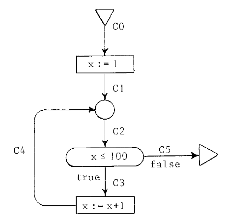
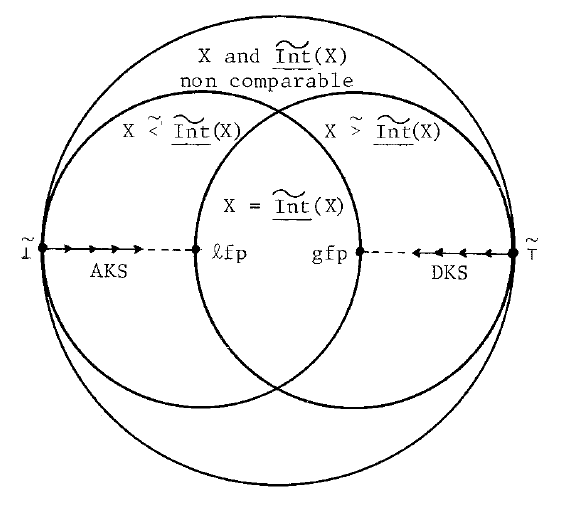
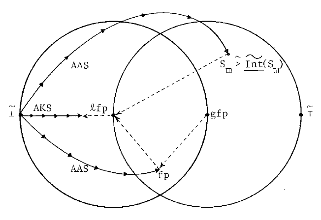
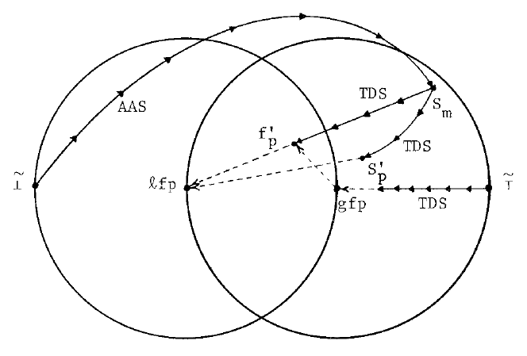
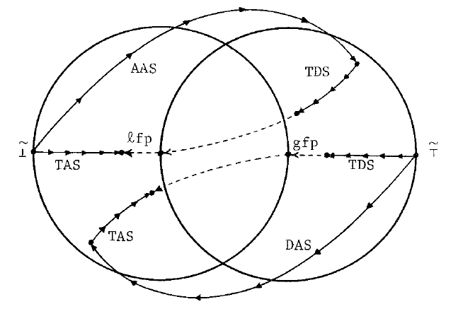

# Section 9: Fixpoints Approximation Methods

Editorial note: This is a transcription of §9, including its proofs, examples,
and five diagrams. Page headings and figure descriptions are editorial. Original
line breaks and end-of-line hyphenation are normalized. Underlining is retained
in mathematical identifiers and pseudocode keywords; overbars and tildes are
retained independently, without inferring that underlining is emphasis. The
completed arc domain is written $\mathrm{Arcs}^{0}$, following the definition
in §3.2. The widening and narrowing triangles are rendered
$\nabla$ and $\Delta$, respectively. The source's small-circle semilattice
operation is $\circ$, including its pointwise extension $\widetilde{\circ}$.
The interval examples' union-shaped symbol is rendered $\cup$ as printed,
without substituting modern interval-join notation. See the
[reference conventions](README.md) before relying on this text; the scan remains
authoritative.

## [Printed p.245](source.pdf#page=9)

### 9. Fixpoints Approximation Methods

When the extreme fixpoints of the system of equations established for an abstract
interpretation I of a program P cannot be computed in finitely many steps, they
can be approximated. A more abstract interpretation $\overline{\mathrm I}$
$(\mathrm I\leq\overline{\mathrm I})$ may be used for that purpose (e.g.
Tenenbaum[74]). It is often better to make approximations in I, for example by
"accelerating the convergence" of Kleene's sequences.

### 9.1 Finite Iterative and Increasing Approximation of the Least Fixpoint Starting from a Lower Bound

Let $\mathrm I=\langle\mathrm{A\text{-}Cont},\circ,\leq,\perp,\top,
\underline{\mathrm{Int}}\rangle$ be an interpretation of P. When the least
fixpoint $\overline{\underline{\mathrm{Cv}}}$ of
$\widetilde{\underline{\mathrm{Int}}}$ is unreachable, we look for an upper
bound $\overline{\underline{\mathrm{Ub}}}$ of
$\overline{\underline{\mathrm{Cv}}}$, since according to the correctness
requirement 6.0,
$\underline{\mathrm{Cv}}\mathrel{\widetilde{\leq}}
\widetilde{\gamma}(\overline{\underline{\mathrm{Cv}}})$ and
$\overline{\underline{\mathrm{Cv}}}\mathrel{\widetilde{\leq}}
\overline{\underline{\mathrm{Ub}}}$ implies
$\underline{\mathrm{Cv}}\mathrel{\widetilde{\leq}}
\widetilde{\gamma}(\overline{\underline{\mathrm{Ub}}})$.

#### 9.1.1 Increasing Approximation Sequence

Let $\widetilde{\underline{\mathrm{A\text{-}int}}}:
\widetilde{\mathrm{A\text{-}Cont}}\to\widetilde{\mathrm{A\text{-}Cont}}$
be such that:

**9.1.1.1**
$$
\{\forall n\geq0,\ C=\widetilde{\underline{\mathrm{A\text{-}int}}}^{n}
(\widetilde{\perp})\ \underline{\mathrm{and}}\
\underline{\mathrm{not}}(\widetilde{\underline{\mathrm{Int}}}(C)
\mathrel{\widetilde{\leq}}C)\}
\Longrightarrow
\{C\mathbin{\widetilde{\circ}}\widetilde{\underline{\mathrm{Int}}}(C)
\mathrel{\widetilde{\leq}}\widetilde{\underline{\mathrm{A\text{-}int}}}(C)\}.
$$

**9.1.1.2** Every infinite sequence $\widetilde{\perp}$,
$\widetilde{\underline{\mathrm{A\text{-}int}}}(\widetilde{\perp})$, …,
$\widetilde{\underline{\mathrm{A\text{-}int}}}^{n}(\widetilde{\perp})$, …
is not strictly increasing.

The approximation sequence $S_0,\ldots,S_n,\ldots$ is recursively defined by:

**9.1.1.3**
$$
\begin{aligned}
S_0&=\widetilde{\perp}\\
S_{n+1}&=\underline{\mathrm{if}}\
\underline{\mathrm{not}}(\widetilde{\underline{\mathrm{Int}}}(S_n)
\mathrel{\widetilde{\leq}}S_n)\ \underline{\mathrm{then}}\\
&\qquad\widetilde{\underline{\mathrm{A\text{-}int}}}(S_n)\\
&\quad\underline{\mathrm{else}}\ S_n\ \underline{\mathrm{fi}}.
\end{aligned}
$$

We now prove that $\exists m$ finite such that:

$$
S_0\mathrel{\widetilde{<}}S_1\mathrel{\widetilde{<}}\ldots
\mathrel{\widetilde{<}}S_m=S_{m+1}=\ldots
$$

Let m be the least natural number (eventually infinite) such that
$S_m=S_{m+1}$. $\forall k\in[0,m[$, we know from 9.1.1.3 that
$\underline{\mathrm{not}}(\widetilde{\underline{\mathrm{Int}}}(S_k)
\mathrel{\widetilde{\leq}}S_k)$. Whence by definition of the ordering
$\widetilde{\leq}$,
$S_k\ne\widetilde{\underline{\mathrm{Int}}}(S_k)
\mathbin{\widetilde{\circ}}S_k$.
Since $S_k\mathrel{\widetilde{\leq}}
\widetilde{\underline{\mathrm{Int}}}(S_k)\mathbin{\widetilde{\circ}}S_k$
is always true, we can state that
$S_k\mathrel{\widetilde{<}}\widetilde{\underline{\mathrm{Int}}}(S_k)
\mathbin{\widetilde{\circ}}S_k$.
Besides $\underline{\mathrm{not}}(\widetilde{\underline{\mathrm{Int}}}(S_k)
\mathrel{\widetilde{\leq}}S_k)$ and 9.1.1.1 imply:

$$
S_{k+1}=\widetilde{\underline{\mathrm{A\text{-}int}}}(S_k)
\mathrel{\widetilde{\geq}}\widetilde{\underline{\mathrm{Int}}}(S_k)
\mathbin{\widetilde{\circ}}S_k
$$

and therefore we conclude $S_{k+1}\mathrel{\widetilde{>}}S_k$,
$\forall k\in[1,m[$. Moreover 9.1.1.2 implies that m is finite. Q.E.D.

Let $\overline{\underline{\mathrm{Cv}}}$ be the least fixpoint of
$\widetilde{\underline{\mathrm{Int}}}$, it is the greatest lower bound of
the set of $X\in\widetilde{\mathrm{A\text{-}Cont}}$ such that
$\widetilde{\underline{\mathrm{Int}}}(X)\mathrel{\widetilde{\leq}}X$
(Tarski[55]) hence:

$$
\forall X\in\widetilde{\mathrm{A\text{-}Cont}},\
\{\widetilde{\underline{\mathrm{Int}}}(X)\mathrel{\widetilde{\leq}}X\}
\Longrightarrow
\{\overline{\underline{\mathrm{Cv}}}\mathrel{\widetilde{\leq}}X\}
$$

Since $S_m=S_{m+1}$ we have
$\widetilde{\underline{\mathrm{Int}}}(S_m)\mathrel{\widetilde{\leq}}S_m$
and therefore $\overline{\underline{\mathrm{Cv}}}\mathrel{\widetilde{\leq}}S_m$,
$S_m$ is a correct approximation of $\overline{\underline{\mathrm{Cv}}}$.

## [Printed p.246](source.pdf#page=10)

#### 9.1.2 Generalization of Kleene's Ascending Sequence

When A-Cont satisfies the ascending chain condition one can choose
$\widetilde{\underline{\mathrm{A\text{-}int}}}$ to be
$\widetilde{\underline{\mathrm{Int}}}$ and therefore the approximation
sequence generalizes Kleene's sequence and the related methods.

#### 9.1.3 Widening in Increasing Approximation sequences

The definition of the approximate interpretation
$\widetilde{\underline{\mathrm{A\text{-}int}}}$ in 9.1.1 is global. We
now indicate a way to construct
$\widetilde{\underline{\mathrm{A\text{-}int}}}$ by local modifications
to $\underline{\mathrm{Int}}$.

Let $(q,r)\in\mathrm{Arcs}^{2}$, we say that the context associated to q is
dependent on the context associated to r, if and only if:

$$
\{\exists\underline{\mathrm{Cv}}\in\widetilde{\mathrm{A\text{-}Cont}},
\exists C\in\mathrm{A\text{-}Cont}\mid
\underline{\mathrm{Int}}(q,\underline{\mathrm{Cv}})\ne
\underline{\mathrm{Int}}(q,\underline{\mathrm{Cv}}[C/r])\}
$$

(e.g. in a forward system of equations the context associated to q may only
depend on the contexts associated with the immediate predecessor arcs of q).
In the system of equations
$\underline{\mathrm{Cv}}=\widetilde{\underline{\mathrm{Int}}}
(\underline{\mathrm{Cv}})$ we define a cycle to be a sequence
$\langle q_1,\ldots,q_n\rangle$ of arcs, such that $\forall i\in[1,n[$,
$\underline{\mathrm{Cv}}(q_{i+1})$ depends on
$\underline{\mathrm{Cv}}(q_i)$ and $\underline{\mathrm{Cv}}(q_1)$ depends
on $\underline{\mathrm{Cv}}(q_n)$. (e.g. in a forward interpretation a cycle
corresponds to a loop in the program).

In any infinite strictly increasing Kleene's sequence
$\underline{\mathrm{Cv}}_1,\ldots,\underline{\mathrm{Cv}}_m,\ldots$ since
Arcs is finite there is some arc q for which the sequence
$\underline{\mathrm{Cv}}_1(q),\ldots,\underline{\mathrm{Cv}}_m(q),\ldots$
never stabilizes. Therefore q must belong to a cycle or the contexts associated
to q transitively depend on the contexts associated to some other arc r which
itself belongs to a cycle. The sequence of contexts associated to any arc of
that cycle never stabilizes. In order to avoid this phenomenon, we introduce:

- The binary operation $\nabla$ called widening defined by:

  **9.1.3.1** $\nabla:\mathrm{A\text{-}Cont}\times\mathrm{A\text{-}Cont}
  \to\mathrm{A\text{-}Cont}$

  **9.1.3.2** $\forall(C,C')\in\mathrm{A\text{-}Cont}^{2},\
  C\circ C'\leq C\nabla C'$

  **9.1.3.3** Every infinite sequence $S_0,\ldots,S_n,\ldots$ of the form
  $S_0=C_0,\ldots,S_n=S_{n-1}\nabla C_n,\ldots$ (where
  $C_0,\ldots,C_n,\ldots$ are arbitrary abstract contexts) is not strictly
  increasing.

- The set W-arcs of widening arcs, which is one of the minimal sets of arcs
  such that any cycle $\langle q_1,\ldots,q_n\rangle$ of the system of
  equations $\underline{\mathrm{Cv}}=\widetilde{\underline{\mathrm{Int}}}
  (\underline{\mathrm{Cv}})$ contains at least a widening arc:
  $\exists i\in[1,n]\mid q_i\in\mathrm{W\text{-}arcs}$. (e.g. in a
  forward interpretation on a reducible program graph, W-arcs may be chosen to
  be the set of exit arcs of the junction nodes which are interval headers.
  On irreducible graphs an arbitrary choice has to be made so that any loop
  of the program goes through a widening arc).

- The approximate interpretation
  $\underline{\mathrm{A\text{-}int}}:\mathrm{Arcs}^{0}\times
  \widetilde{\mathrm{A\text{-}Cont}}\to\mathrm{A\text{-}Cont}$ defined by:

**9.1.3.4**
$$
\begin{aligned}
\underline{\mathrm{A\text{-}int}}={}&\lambda(q,\underline{\mathrm{Cv}}).
\ \underline{\mathrm{if}}\ q\in\mathrm{W\text{-}arcs}\
\underline{\mathrm{then}}\\
&\quad\underline{\mathrm{Cv}}(q)\nabla
\underline{\mathrm{Int}}(q,\underline{\mathrm{Cv}})\\
&\underline{\mathrm{else}}\
\underline{\mathrm{Int}}(q,\underline{\mathrm{Cv}})\ \underline{\mathrm{fi}}
\end{aligned}
$$

As before, we define:

**9.1.3.5**
$$
\widetilde{\underline{\mathrm{A\text{-}int}}}=
\lambda\underline{\mathrm{Cv}}.
(\lambda q.\underline{\mathrm{A\text{-}int}}(q,\underline{\mathrm{Cv}}))
$$

Now we have to show that this definition of
$\widetilde{\underline{\mathrm{A\text{-}int}}}$ satisfies the requirements
9.1.1.2 and 9.1.1.1.

Let us consider a sequence $S_0=\widetilde{\perp},\ldots,
S_{n+1}=\widetilde{\underline{\mathrm{A\text{-}int}}}(S_n),\ldots$.
We show that this sequence is increasing that is to say:

**9.1.3.6**
$$
S_n\mathrel{\widetilde{\leq}}\widetilde{\underline{\mathrm{A\text{-}int}}}(S_n),
\quad\forall n\geq0.
$$

Trivially for $n=0$,
$S_0=\widetilde{\perp}\mathrel{\widetilde{\leq}}
\widetilde{\underline{\mathrm{A\text{-}int}}}(S_0)$.
For the induction step, suppose the result to be true for $n\leq m$.
Let us prove that:

$$
\begin{aligned}
&S_{m+1}\mathrel{\widetilde{\leq}}
\widetilde{\underline{\mathrm{A\text{-}int}}}(S_{m+1})\\
\Longleftrightarrow\quad
&S_{m+1}(q)\leq\underline{\mathrm{A\text{-}int}}(q,S_{m+1}),
\ \forall q\in\mathrm{Arcs}.
\end{aligned}
$$

If $q\in\mathrm{W\text{-}arcs}$, then
$\underline{\mathrm{A\text{-}int}}(q,S_{m+1})=
S_{m+1}(q)\nabla\underline{\mathrm{Int}}(q,S_{m+1})\geq
S_{m+1}(q)\circ\underline{\mathrm{Int}}(q,S_{m+1})\geq S_{m+1}(q)$.

If $q\notin\mathrm{W\text{-}arcs}$, then

$$
\begin{aligned}
&\underline{\mathrm{A\text{-}int}}(q,S_{m+1})=
\underline{\mathrm{Int}}(q,S_{m+1})\\
\Longrightarrow\quad
&\underline{\mathrm{Int}}(q,S_m)\leq
\underline{\mathrm{A\text{-}int}}(q,S_{m+1})
\end{aligned}
$$

since $S_m\mathrel{\widetilde{\leq}}S_{m+1}$ and
$\underline{\mathrm{Int}}$ is order preserving. Moreover from
$q\notin\mathrm{W\text{-}arcs}$ and 9.1.3.4 we get
$\underline{\mathrm{Int}}(q,S_m)=\underline{\mathrm{A\text{-}int}}(q,S_m)$
and therefore
$S_{m+1}(q)=\underline{\mathrm{A\text{-}int}}(q,S_m)\leq
\underline{\mathrm{A\text{-}int}}(q,S_{m+1})$.
Finally $S_{m+1}\mathrel{\widetilde{\leq}}
\widetilde{\underline{\mathrm{A\text{-}int}}}(S_{m+1})$, Q.E.D.

An infinite sequence $S_0=\widetilde{\perp},\ldots,
S_n=\widetilde{\underline{\mathrm{A\text{-}int}}}^{n}(\widetilde{\perp}),
\ldots$ cannot be strictly increasing since otherwise there would exist some
widening arc q for which the sequence $S_0(q),\ldots,S_n(q),\ldots$ would
never stabilize thus contradicting 9.1.3.3.

We now prove 9.1.1.1 that is to say that:

$$
\forall n\geq0,\ S_n=
\widetilde{\underline{\mathrm{A\text{-}int}}}^{n}(\widetilde{\perp})
$$

implies

$$
\begin{aligned}
&S_n\mathbin{\widetilde{\circ}}\widetilde{\underline{\mathrm{Int}}}(S_n)
\mathrel{\widetilde{\leq}}\widetilde{\underline{\mathrm{A\text{-}int}}}(S_n)\\
\Longleftrightarrow\quad
&(S_n\mathbin{\widetilde{\circ}}\widetilde{\underline{\mathrm{Int}}}(S_n))(q)
\mathrel{\widetilde{\leq}}\widetilde{\underline{\mathrm{A\text{-}int}}}(S_n)(q),
\ \forall q\in\mathrm{Arcs}\\
\Longleftrightarrow\quad
&S_n(q)\circ\underline{\mathrm{Int}}(q,S_n)\leq
\underline{\mathrm{A\text{-}int}}(q,S_n)\quad\text{(see 9.1.3.5)}
\end{aligned}
$$

If $q\in\mathrm{W\text{-}arcs}$, we have
$\underline{\mathrm{A\text{-}int}}(q,S_n)=
S_n(q)\nabla\underline{\mathrm{Int}}(q,S_n)\geq
S_n(q)\circ\underline{\mathrm{Int}}(q,S_n)$ by 9.1.3.2.
If now $q\notin\mathrm{W\text{-}arcs}$ we must show:

$$
\begin{aligned}
&S_n(q)\circ\underline{\mathrm{Int}}(q,S_n)\leq\underline{\mathrm{Int}}(q,S_n)\\
\Longleftrightarrow\quad
&S_n(q)\circ\underline{\mathrm{Int}}(q,S_n)=\underline{\mathrm{Int}}(q,S_n)\\
\Longleftrightarrow\quad
&S_n(q)\leq\underline{\mathrm{Int}}(q,S_n)\\
\Longleftrightarrow\quad
&S_n(q)\leq\underline{\mathrm{A\text{-}int}}(q,S_n)\quad\text{by 9.1.3.4}
\end{aligned}
$$

which is true, from 9.1.3.6, Q.E.D.

### 9.2 Example: Bounds of Integer Variables

In a PASCAL program operating on arrays, the compiler should ensure that arrays
are subscripted only by indices within bounds. For that purpose one can use the
lattice $\mathrm I_p$ of section 7. Let us take an obvious example:

## [Printed p.247](source.pdf#page=11)

Editorial figure transcription: An entry triangle leads along C0 to `x := 1`,
then along C1 to a junction. The junction's outgoing C2 leads to the test
`x ≤ 100`. Its `true` branch C3 leads to `x := x + 1`; C4 returns to the
junction. Its `false` branch C5 leads to an exit triangle. The crop is from
printed p.247, left column, top.

Let us note $[a,b]$ where $a\leq b$ the predicate $a\leq x\leq b$.
The system of equations corresponding to the example is:

$$
\begin{array}{rl}
(0)&\mathrm{C0}=[\ ,\ ]\\
(1)&\mathrm{C1}=[1,1]\\
(2)&\mathrm{C2}=\mathrm{C1}\cup\mathrm{C4}\\
(3)&\mathrm{C3}=\mathrm{C2}\cap[-\infty,100]\\
(4)&\mathrm{C4}=\mathrm{C3}+[1,1]\\
(5)&\mathrm{C5}=\mathrm{C2}\cap[101,+\infty]
\end{array}
$$

Assignment statements are treated using an interval arithmetic (e.g.
$[i,j]+[k,\ell]=[i+k,j+\ell]$ naturally extended to include the case of the
empty interval). Similarly tests are treated using an "interval logic".
Since there exist infinite Kleene's sequences (e.g.
$[\ ,\ ]<[0,0]<[0,1]<\ldots<[0,+\infty]$ for the program
$x:=0\ ;\ \underline{\mathrm{while}}\ \underline{\mathrm{true}}\
\underline{\mathrm{do}}\ x:=x+1$), we must use an approximation sequence.
Hence the results will be somewhat inaccurate but runtime subscript tests may
be inserted in the absence of certainty.

Let us define the widening $\nabla$ of intervals by:

- $[\ ,\ ]$ is the null element of $\nabla$
- $[i,j]\nabla[k,\ell]=$
  $[\underline{\mathrm{if}}\ k<i\ \underline{\mathrm{then}}\ -\infty\
  \underline{\mathrm{else}}\ i\ \underline{\mathrm{fi}},$
  $\underline{\mathrm{if}}\ \ell>j\ \underline{\mathrm{then}}\ +\infty\
  \underline{\mathrm{else}}\ j\ \underline{\mathrm{fi}}]$

$\nabla$ satisfies the requirements of 9.1.3. According to 9.1.3.4 the system
of equations is modified by:

$$
(2)\quad\mathrm{C2}=\mathrm{C2}\nabla(\mathrm{C1}\cup\mathrm{C4})
$$

The corresponding approximation sequence is:

$$
\begin{array}{rl}
&\mathrm{Ci}=[\ ,\ ]\text{ for }i\in[0,5]\\
*&\mathrm{C1}=[1,1]\\
&\mathrm{C2}=\mathrm{C2}\nabla(\mathrm{C1}\cup\mathrm{C4})\\
&\phantom{\mathrm{C2}}=[\ ,\ ]\nabla([1,1]\cup[\ ,\ ])\\
&\phantom{\mathrm{C2}}=[\ ,\ ]\nabla[1,1]\\
&\phantom{\mathrm{C2}}=[1,1]\\
&\mathrm{C3}=\mathrm{C2}\cap[-\infty,100]\\
&\phantom{\mathrm{C3}}=[1,1]\cap[-\infty,100]\\
&\phantom{\mathrm{C3}}=[1,1]\\
&\mathrm{C4}=\mathrm{C3}+[1,1]\\
&\phantom{\mathrm{C4}}=[1,1]+[1,1]\\
&\phantom{\mathrm{C4}}=[2,2]\\
&\mathrm{C2}=\mathrm{C2}\nabla(\mathrm{C1}\cup\mathrm{C4})\\
&\phantom{\mathrm{C2}}=[1,1]\nabla([1,1]\cup[2,2])\\
&\phantom{\mathrm{C2}}=[1,1]\nabla[1,2]\\
*&\mathrm{C2}=[1,+\infty]\\
&\mathrm{C3}=\mathrm{C2}\cap[-\infty,100]\\
&\phantom{\mathrm{C3}}=[1,+\infty]\cap[-\infty,100]\\
*&\mathrm{C3}=[1,100]\\
&\mathrm{C4}=\mathrm{C3}+[1,1]\\
&\phantom{\mathrm{C4}}=[1,100]+[1,1]\\
*&\mathrm{C4}=[2,101]\\
&\text{Note: }\mathrm{C1}\cup\mathrm{C4}=[1,101]\leq\mathrm{C2}=[1,+\infty]\\
&\qquad\text{stop on that path.}\\
&\mathrm{C5}=\mathrm{C2}\cap[101,+\infty]\\
&\phantom{\mathrm{C5}}=[1,+\infty]\cap[101,+\infty]\\
*&\mathrm{C5}=[101,+\infty]\\
&\text{exit, stop.}
\end{array}
$$

The final context on each arc is marked by a star *. Note that the results are
approximate ones, (e.g. C5).

In this example the widening is a very rough operation which introduces a great
loss of information. However it can be seen in the trace that tests behave like
filters. Furthermore, for PASCAL like languages, one can first use the bounds
given in the declaration of x before widening to infinite limits.

### 9.3 Finite Iterative and Decreasing Approximation of the Least Fixpoint Starting from an Upper Bound

The ascending approximation sequence leads to an upper bound
$S_m=\widetilde{\underline{\mathrm{A\text{-}int}}}^{m}(\widetilde{\perp})$
of the least fixpoint $\overline{\underline{\mathrm{Cv}}}$ of
$\widetilde{\underline{\mathrm{Int}}}$:
$\overline{\underline{\mathrm{Cv}}}\mathrel{\widetilde{\leq}}S_m$.
Moreover $\widetilde{\underline{\mathrm{Int}}}(S_m)
\mathrel{\widetilde{\leq}}S_m$.
Since $\widetilde{\underline{\mathrm{Int}}}$ is order preserving, this
implies that:

$$
S_m\mathrel{\widetilde{\geq}}\widetilde{\underline{\mathrm{Int}}}(S_m)
\mathrel{\widetilde{\geq}}\ldots\mathrel{\widetilde{\geq}}
\widetilde{\underline{\mathrm{Int}}}^{n}(S_m)
\mathrel{\widetilde{\geq}}\ldots\mathrel{\widetilde{\geq}}
\overline{\underline{\mathrm{Cv}}}.
$$

If $S_m$ is not a fixpoint of $\widetilde{\underline{\mathrm{Int}}}$ and
the above descending sequence is finite (e.g. the lattice A-Cont satisfies the
descending chain condition) its limit is a better approximation of
$\overline{\underline{\mathrm{Cv}}}$ than $S_m$.
When the sequence is infinite or slowly converging, one can among other
solutions approximate its limit.

#### 9.3.1 Decreasing Approximation Sequence

At step n in the descending sequence, we have:

$$
\widetilde{\underline{\mathrm{Int}}}^{n-1}(S_m)
\mathrel{\widetilde{>}}\widetilde{\underline{\mathrm{Int}}}^{n}(S_m)
\mathrel{\widetilde{>}}\overline{\underline{\mathrm{Cv}}}
$$

In order to accelerate the convergence, we should for the next step find an
approximation D such that
$\widetilde{\underline{\mathrm{Int}}}^{n+1}(S_m)
\mathrel{\widetilde{>}}D\mathrel{\widetilde{\geq}}
\overline{\underline{\mathrm{Cv}}}$.
But not knowing $\overline{\underline{\mathrm{Cv}}}$, this characterization
is very weak since D could be chosen incorrectly that is to say less than
$\overline{\underline{\mathrm{Cv}}}$ or non comparable with
$\overline{\underline{\mathrm{Cv}}}$.
The fact that $\overline{\underline{\mathrm{Cv}}}$ is the greatest lower
bound of the set of $X\in\widetilde{\mathrm{A\text{-}Cont}}$ such that
$\widetilde{\underline{\mathrm{Int}}}(X)\mathrel{\widetilde{\leq}}X$
gives a correctness criterion for the choice of D when
$\overline{\underline{\mathrm{Cv}}}$ is unknown, we must have:

$$
\widetilde{\underline{\mathrm{Int}}}^{n+1}(S_m)\mathrel{\widetilde{>}}D
\mathrel{\widetilde{\geq}}\widetilde{\underline{\mathrm{Int}}}(D)
$$

On the contrary to 9.1.1, this characterization does not provide an efficient
construction of D.

#### 9.3.2 Truncated Decreasing Sequence

In front of these difficulties we will enforce convergence by choosing D such
that:

$$
\exists n\geq0\mid\widetilde{\underline{\mathrm{Int}}}(S_m)
\mathrel{\widetilde{>}}D\mathrel{\widetilde{\geq}}
\widetilde{\underline{\mathrm{Int}}}^{n+1}(S_m)
$$

## [Printed p.248](source.pdf#page=12)

(However, we will not artificially truncate the decreasing sequence by imposing
an arbitrary upper bound on n).

Let $\widetilde{\underline{\mathrm{D\text{-}int}}}:
\widetilde{\mathrm{A\text{-}Cont}}\to\widetilde{\mathrm{A\text{-}Cont}}$
be such that:

**9.3.2.1**
$$
\{\forall C\in\widetilde{\mathrm{A\text{-}Cont}}\}\quad
\{C\mathrel{\widetilde{>}}\widetilde{\underline{\mathrm{Int}}}(C)\}
\Longrightarrow
\{C\mathrel{\widetilde{\geq}}\widetilde{\underline{\mathrm{D\text{-}int}}}(C)
\mathrel{\widetilde{\geq}}\widetilde{\underline{\mathrm{Int}}}(C)\}
$$

**9.3.2.2** $\forall C\in\widetilde{\mathrm{A\text{-}Cont}}$, every
infinite sequence C,
$\widetilde{\underline{\mathrm{D\text{-}int}}}(C)$, …,
$\widetilde{\underline{\mathrm{D\text{-}int}}}^{n}(C)$, … is not
strictly decreasing.

The truncated decreasing sequence $S'_0,\ldots,S'_n,\ldots$ is recursively
defined by:

**9.3.2.3**
$$
\begin{aligned}
S'_0&=S_m\\
S'_{n+1}&=\underline{\mathrm{if}}\
(S'_n\ne\widetilde{\underline{\mathrm{Int}}}(S'_n))\
\underline{\mathrm{and}}\
(S'_n\ne\widetilde{\underline{\mathrm{D\text{-}int}}}(S'_n))\\
&\qquad\underline{\mathrm{then}}\
\widetilde{\underline{\mathrm{D\text{-}int}}}(S'_n)\\
&\quad\underline{\mathrm{else}}\ S'_n\ \underline{\mathrm{fi}}
\end{aligned}
$$

Let us now prove that the truncated decreasing sequence is a finite strictly
decreasing chain which terms are greater than
$\overline{\underline{\mathrm{Cv}}}$ the least fixpoint of
$\widetilde{\underline{\mathrm{Int}}}$.

Let p be the least natural number (eventually infinite) such that
$S'_p=S'_{p+1}$. Trivially from 9.1.1:

$$
S'_0=S_m\mathrel{\widetilde{\geq}}
\widetilde{\underline{\mathrm{Int}}}(S'_0)
\mathrel{\widetilde{\geq}}\overline{\underline{\mathrm{Cv}}}
$$

If $p>0$ then $S'_0\ne\widetilde{\underline{\mathrm{Int}}}(S'_0)$,
therefore $S'_0\mathrel{\widetilde{>}}
\widetilde{\underline{\mathrm{Int}}}(S'_0)$.
Then applying 9.3.2.1 we have:

$$
S'_0\mathrel{\widetilde{\geq}}
\widetilde{\underline{\mathrm{D\text{-}int}}}(S'_0)=S'_1
\mathrel{\widetilde{\geq}}\widetilde{\underline{\mathrm{Int}}}(S'_0)
\mathrel{\widetilde{\geq}}\overline{\underline{\mathrm{Cv}}}
$$

But 9.3.2.3 implies
$S'_0\ne\widetilde{\underline{\mathrm{D\text{-}int}}}(S'_0)$, hence:

$$
S'_0\mathrel{\widetilde{>}}S'_1\mathrel{\widetilde{\geq}}
\widetilde{\underline{\mathrm{Int}}}(S'_0)
\mathrel{\widetilde{\geq}}\overline{\underline{\mathrm{Cv}}}
$$

For the induction step, let us suppose that for $k<p$, we have:

$$
S'_{k-1}\mathrel{\widetilde{>}}S'_k\mathrel{\widetilde{\geq}}
\widetilde{\underline{\mathrm{Int}}}(S'_{k-1})
\mathrel{\widetilde{\geq}}\overline{\underline{\mathrm{Cv}}}
$$

Since $\widetilde{\underline{\mathrm{Int}}}$ is order preserving we have:

$$
\widetilde{\underline{\mathrm{Int}}}(S'_{k-1})\mathrel{\widetilde{\geq}}
\widetilde{\underline{\mathrm{Int}}}(S'_k)\mathrel{\widetilde{\geq}}
\widetilde{\underline{\mathrm{Int}}}^{2}(S'_{k-1})\mathrel{\widetilde{\geq}}
\widetilde{\underline{\mathrm{Int}}}(\overline{\underline{\mathrm{Cv}}})
=\overline{\underline{\mathrm{Cv}}}
$$

By transitivity $S'_k\mathrel{\widetilde{\geq}}
\widetilde{\underline{\mathrm{Int}}}(S'_k)$ and since 9.3.2.3 implies
$S'_k\ne\widetilde{\underline{\mathrm{Int}}}(S'_k)$ we have from 9.3.2.1:

$$
S'_k\mathrel{\widetilde{\geq}}
\widetilde{\underline{\mathrm{D\text{-}int}}}(S'_k)=S'_{k+1}
\mathrel{\widetilde{\geq}}\widetilde{\underline{\mathrm{Int}}}(S'_k)
$$

Since 9.3.2.3 implies
$S'_k\ne\widetilde{\underline{\mathrm{D\text{-}int}}}(S'_k)$ we have:

$$
S'_k\mathrel{\widetilde{>}}S'_{k+1}\mathrel{\widetilde{\geq}}
\widetilde{\underline{\mathrm{Int}}}(S'_k)
\mathrel{\widetilde{\geq}}\overline{\underline{\mathrm{Cv}}}
$$

By recurrence on k the result is true for $k\leq p$.
Moreover 9.3.2.2 implies that p is finite. Q.E.D.

#### 9.3.3 Generalization of Kleene's Descending Sequence

When A-Cont satisfies the descending chain condition, one can choose
$\widetilde{\underline{\mathrm{D\text{-}int}}}$ to be
$\widetilde{\underline{\mathrm{Int}}}$, in which case the final result
$S'_p=\widetilde{\underline{\mathrm{Int}}}^{p}(S_m)$ is a fixpoint greater
or equal to the least fixpoint $\overline{\underline{\mathrm{Cv}}}$ of
$\widetilde{\underline{\mathrm{Int}}}$.

The limit of the descending sequence $S'_0=\widetilde{\top},\ldots,
S'_p=\widetilde{\underline{\mathrm{D\text{-}int}}}^{p}(\widetilde{\top}),
\ldots$ is an upper bound of the greatest fixpoint of
$\widetilde{\underline{\mathrm{Int}}}$.

#### 9.3.4 Narrowing in Truncated Decreasing Sequences

By analogy with 9.1.3 we define now the narrowing operation in order to built a
possible construction of $\widetilde{\underline{\mathrm{D\text{-}int}}}$
by local modifications to $\underline{\mathrm{Int}}$:

**9.3.4.1** $\Delta:\mathrm{A\text{-}Cont}\times\mathrm{A\text{-}Cont}
\to\mathrm{A\text{-}Cont}$

**9.3.4.2**
$$
\forall(C,C')\in\mathrm{A\text{-}Cont}^{2},\quad
\{C\geq C'\}\Longrightarrow\{C\geq C\Delta C'\geq C'\}
$$

**9.3.4.3** Every infinite sequence $S_0,\ldots,S_n,\ldots$ of the form
$S_0=C_0$, $S_1=S_0\Delta C_1$, …, $S_n=S_{n-1}\Delta C_n$, … for
arbitrary abstract contexts $C_0,C_1,\ldots,C_n,\ldots$ is not strictly
decreasing.

The approximated interpretation
$\underline{\mathrm{D\text{-}int}}:\mathrm{Arcs}^{0}\times
\widetilde{\mathrm{A\text{-}Cont}}\to\mathrm{A\text{-}Cont}$ is defined by:

**9.3.4.4**
$$
\begin{aligned}
\underline{\mathrm{D\text{-}int}}={}&\lambda(q,\underline{\mathrm{Cv}}).
\ \underline{\mathrm{if}}\ q\in\mathrm{W\text{-}arcs}\
\underline{\mathrm{then}}\\
&\quad\underline{\mathrm{Cv}}(q)\Delta
\underline{\mathrm{Int}}(q,\underline{\mathrm{Cv}})\\
&\underline{\mathrm{else}}\
\underline{\mathrm{Int}}(q,\underline{\mathrm{Cv}})\ \underline{\mathrm{fi}}
\end{aligned}
$$

and

$$
\widetilde{\underline{\mathrm{D\text{-}int}}}=
\lambda\underline{\mathrm{Cv}}.
(\lambda q.\underline{\mathrm{D\text{-}int}}(q,\underline{\mathrm{Cv}}))
$$

This definition of $\widetilde{\underline{\mathrm{D\text{-}int}}}$
trivially satisfies the requirement 9.3.2.1 since
$\forall\underline{\mathrm{Cv}}\in\widetilde{\mathrm{A\text{-}Cont}}$
with property
$\underline{\mathrm{Cv}}\mathrel{\widetilde{>}}
\widetilde{\underline{\mathrm{Int}}}(\underline{\mathrm{Cv}})$ implies
$\underline{\mathrm{Cv}}(q)\geq\underline{\mathrm{Int}}
(q,\underline{\mathrm{Cv}})$, $\forall q\in\mathrm{Arcs}$.
If $q\in\mathrm{W\text{-}arcs}$ then 9.3.4.2 implies that
$\underline{\mathrm{Cv}}(q)\geq\underline{\mathrm{Cv}}(q)\Delta
\underline{\mathrm{Int}}(q,\underline{\mathrm{Cv}})=
\underline{\mathrm{D\text{-}int}}(q,\underline{\mathrm{Cv}})\geq
\underline{\mathrm{Int}}(q,\underline{\mathrm{Cv}})$.
Otherwise, if $q\notin\mathrm{W\text{-}arcs}$
$\underline{\mathrm{Cv}}(q)\geq\underline{\mathrm{Int}}
(q,\underline{\mathrm{Cv}})=\underline{\mathrm{D\text{-}int}}
(q,\underline{\mathrm{Cv}})$.
Hence $\underline{\mathrm{Cv}}\mathrel{\widetilde{\geq}}
\widetilde{\underline{\mathrm{D\text{-}int}}}(\underline{\mathrm{Cv}})
\mathrel{\widetilde{\geq}}\widetilde{\underline{\mathrm{Int}}}
(\underline{\mathrm{Cv}})$.

The proof of termination (requirement 9.3.2.2) is very similar to the one
outlined for $\widetilde{\underline{\mathrm{A\text{-}int}}}$ in section 9.1.3.

### 9.4 Example: Bounds of Integer Variables

Let us come back to example 9.2. The system of equations was:

$$
\begin{array}{rl}
(1)&\mathrm{C1}=[1,1]\\
(2)&\mathrm{C2}=\mathrm{C1}\cup\mathrm{C4}\\
(3)&\mathrm{C3}=\mathrm{C2}\cap[-\infty,100]\\
(4)&\mathrm{C4}=\mathrm{C3}+[1,1]\\
(5)&\mathrm{C5}=\mathrm{C2}\cap[101,+\infty]
\end{array}
$$

The ascending approximation sequence led to the approximate solution:

$$
\begin{array}{rl}
*&\mathrm{C1}=[1,1]\\
&\mathrm{C2}=[1,+\infty]\\
&\mathrm{C3}=[1,100]\\
*&\mathrm{C4}=[2,101]\\
&\mathrm{C5}=[101,+\infty]
\end{array}
$$

Let us define the narrowing $\Delta$ of intervals by:

- $[\ ,\ ]$ is the null element of $\Delta$.
- $[i,j]\Delta[k,\ell]=$
  $[\underline{\mathrm{if}}\ i=-\infty\ \underline{\mathrm{then}}\ k\
  \underline{\mathrm{else}}\ \underline{\min}(i,k)\ \underline{\mathrm{fi}},$
  $\underline{\mathrm{if}}\ j=+\infty\ \underline{\mathrm{then}}\ \ell\
  \underline{\mathrm{else}}\ \underline{\max}(j,\ell)\ \underline{\mathrm{fi}}]$

## [Printed p.249](source.pdf#page=13)

Thus narrowing just discards infinite bounds and makes no improvement on finite
bounds, it satisfies the requirements of 9.3.4. According to 9.3.4.4 the system
of equations is modified by:

$$
(2)\quad\mathrm{C2}=\mathrm{C2}\Delta(\mathrm{C1}\cup\mathrm{C4})
$$

The descending approximation sequence is:

$$
\begin{array}{rl}
&\mathrm{C2}=\mathrm{C2}\Delta(\mathrm{C1}\cup\mathrm{C4})\\
&\phantom{\mathrm{C2}}=[1,+\infty]\Delta([1,1]\cup[2,101])\\
&\phantom{\mathrm{C2}}=[1,+\infty]\Delta[1,101]\\
*&\mathrm{C2}=[1,101]\\
&\mathrm{C3}=\mathrm{C2}\cap[-\infty,100]\\
*&\mathrm{C3}=[1,101]\cap[-\infty,100]=[1,100]\\
&\text{stop on that path.}\\
&\mathrm{C5}=\mathrm{C2}\cap[101,+\infty]\\
*&\mathrm{C5}=[1,101]\cap[101,+\infty]=[101,101]\\
&\text{exit.}
\end{array}
$$

On that example the approximate solution has been improved so that the least
fixpoint is reached but this is not the case in general.

### 9.5 Dual Approximation Methods

The lattice $\widetilde{\mathrm{A\text{-}Cont}}$ may be partitionned as follows:

Editorial figure transcription (printed p.249, left column): The outer region
is labelled “X and $\widetilde{\underline{\mathrm{Int}}}(X)$ non comparable”.
The two inner circles overlap. Their left-only region is labelled
$X\mathrel{\widetilde{<}}\widetilde{\underline{\mathrm{Int}}}(X)$, their
right-only region $X\mathrel{\widetilde{>}}
\widetilde{\underline{\mathrm{Int}}}(X)$, and their intersection
$X=\widetilde{\underline{\mathrm{Int}}}(X)$.
The horizontal line marks, from left to right, $\widetilde{\perp}$, $\ell\mathrm{fp}$,
$\mathrm{gfp}$, $\widetilde{\top}$. AKS arrows run rightwards from
$\widetilde{\perp}$ toward $\ell\mathrm{fp}$; DKS arrows run leftwards
from $\widetilde{\top}$ toward $\mathrm{gfp}$. Dashed portions complete both
approaches. This description transcribes the diagram's labels and directions;
it does not supply extra assumptions about convergence.

$\ell\mathrm{fp}$ and $\mathrm{gfp}$ are the least and greatest fixpoints of
$\widetilde{\underline{\mathrm{Int}}}$. The ascending (AKS) and descending
(DKS) Kleene's sequences converge toward $\ell\mathrm{fp}$ and $\mathrm{gfp}$
respectively. These limits are reached when
$\widetilde{\underline{\mathrm{Int}}}$ is continuous. When AKS is infinite
we have proposed to use an ascending approximation sequence (AAS) to approximate
$\ell\mathrm{fp}$. Its limit may be some fixpoint fp, or some $S_m$ such that
$S_m\mathrel{\widetilde{>}}\widetilde{\underline{\mathrm{Int}}}(S_m)$ and
$S_m\mathrel{\widetilde{>}}\ell\mathrm{fp}$.

Editorial figure transcription (printed p.249, upper right): The horizontal
positions are $\widetilde{\perp}$, $\ell\mathrm{fp}$, $\mathrm{gfp}$,
$\widetilde{\top}$. AKS follows the horizontal line from
$\widetilde{\perp}$ toward $\ell\mathrm{fp}$. Two curved paths labelled AAS
leave $\widetilde{\perp}$: the upper path ends at
$S_m\mathrel{\widetilde{>}}\widetilde{\underline{\mathrm{Int}}}(S_m)$ in
the right-only region, and the lower path ends at fp in the overlap. Dashed
arrows encode $S_m\mathrel{\widetilde{\geq}}\ell\mathrm{fp}$,
$\mathrm{fp}\mathrel{\widetilde{\geq}}\ell\mathrm{fp}$, and
$\mathrm{gfp}\mathrel{\widetilde{\geq}}\mathrm{fp}$ using the source's
legend below.

When $X\mathrel{\widetilde{\geq}}Y$ we have noted
$X\ \bullet\mathrel{\dashrightarrow}\bullet\ Y$.
The truncated descending sequence TDS is fundamentally different from AAS, since
it ensures that the successive approximations starting from $S_m$ remain in the
partition $\{X\mid X\mathrel{\widetilde{\geq}}
\widetilde{\underline{\mathrm{Int}}}(X)\}$, so that their limit $S'_p$ is
greater than $\ell\mathrm{fp}$:

Editorial figure transcription (printed p.249, middle right): A curved AAS path
runs from $\widetilde{\perp}$ to $S_m$ in the right-only region. Two TDS
paths start at $S_m$, one ending at $\mathrm f'_p$ in the overlap and the
other ending at $S'_p$ in the right-only region. A horizontal TDS path runs
leftwards from $\widetilde{\top}$ toward $\mathrm{gfp}$. Dashed arrows encode
$\mathrm f'_p\mathrel{\widetilde{\geq}}\ell\mathrm{fp}$,
$S'_p\mathrel{\widetilde{\geq}}\ell\mathrm{fp}$, and
$\mathrm{gfp}\mathrel{\widetilde{\geq}}\mathrm f'_p$.

It is clear that the ascending approximation sequence AAS when starting from
$\widetilde{\perp}$ leads to an *upper* bound of the least fixpoint
$\ell\mathrm{fp}$ of $\widetilde{\underline{\mathrm{Int}}}$, and the
truncated descending sequence TDS when starting from $\widetilde{\top}$ leads
to an *upper* bound of the greatest fixpoint gfp. Hence the AAS and TDS methods
are not dual, therefore when considering their duals DAS and TAS we get a means
to surround both extreme fixpoints of $\widetilde{\underline{\mathrm{Int}}}$:

Editorial figure transcription (printed p.249, lower right): The marked
horizontal positions are $\widetilde{\perp}$, $\ell\mathrm{fp}$,
$\mathrm{gfp}$, $\widetilde{\top}$. An upper AAS path leaves
$\widetilde{\perp}$, ending in the right-only region; a TDS path moves back
from that endpoint toward $\ell\mathrm{fp}$, completed by a dashed arrow.
A lower DAS path leaves $\widetilde{\top}$, ending in the left-only region;
a TAS path moves back from that endpoint toward $\mathrm{gfp}$, completed
by a dashed arrow. Along the horizontal line, TAS runs rightwards from
$\widetilde{\perp}$ toward $\ell\mathrm{fp}$, and TDS runs leftwards from
$\widetilde{\top}$ toward $\mathrm{gfp}$. The crop preserves the exact
boundary crossings and arrowheads.

## [Printed p.250](source.pdf#page=14)

Any of the AAS, TDS, DAS, TAS methods may yields a fixpoint fp which is not the
fixpoint $\ell\mathrm{fp}$ or gfp of interest. None of these methods can improve
fp to reach $\ell\mathrm{fp}$ or gfp, therefore a "fixpoint improvement method"
is necessary. It is our feeling that such a method could be designed only when
considering that A-Cont possesses a richer structure (i.e. for particular
applications).

Furthermore, in the AAS, TDS, DAS, TAS sequences the term of rank n is computed
only as a function of the term of rank n - 1, hence these are "separate steps"
methods. One can as well imagine to use "bound steps" methods, where the term
of rank n is computed as a function of the terms of rank n - 1, n - 2, …, n - k.
In this last case the Kleene's sequences may be used to compute the first k
terms. After k steps more informations about the program would be available
to heuristicly accelerate the convergence so that the definition of
$\underline{\mathrm{A\text{-}int}}$ and $\underline{\mathrm{D\text{-}int}}$
could be more refined.

Finally, going deeply into the comparism with numerical analysis methods, it
is clear that some measure is necessary to control the accuracy of the result.
Its definition would certainly also necessitate some additional properties of
the abstract contexts.

## Editorial reading notes

- In the proof following 9.1.1.3, the concluding range is printed $[1,m[$,
  although the preceding argument starts with $k\in[0,m[$. Both ranges are
  retained, rather than silently replacing the concluding lower bound.
- In the proof of 9.1.1.1 on p.246, the first pointwise equivalence
  retains the printed $\widetilde{\leq}$ between values at q; the following
  equivalence uses plain $\leq$. The extra tilde is not silently removed.
- The source uses “greater than” in the prose of 9.3.2 while the displayed
  bounds on the least fixpoint are non-strict. Its prose and displayed
  relations are retained separately.
- The lifted strict order in 9.3.2.1 is $\widetilde{>}$, whereas the two
  bounds in its conclusion are $\widetilde{\geq}$. The pointwise hypothesis
  in 9.3.4.2 is non-strict $\geq$. These are not interchangeable glyphs.
- Source spellings and grammar, including “partitionned”, “may yields”,
  “informations”, “heuristicly”, “comparism”, and “in order to built”, are
  retained. They are not uncorrected OCR.
