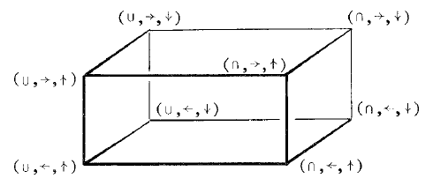
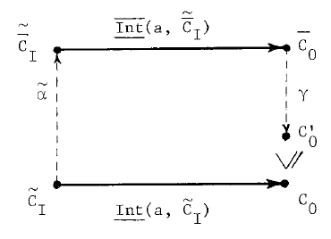

# Sections 5–6: abstract interpretation and consistency

Editorial note: This is a transcription of Patrick Cousot and Radhia Cousot,
*Abstract Interpretation: A Unified Lattice Model for Static Analysis of Programs
by Construction or Approximation of Fixpoints* (1977), §§5–6. The
[scan](source.pdf) is authoritative. Line wrapping and end-of-line word division
are normalized; mathematical underlining, overbars, and tildes are retained.
LaTeX `\mathrm` gives names their printed upright form; it does not replace
underlining. Editorial descriptions below the source diagrams are not source
prose. Source spelling and apparent source inconsistencies are retained.

## [Printed p. 240](source.pdf#page=4)

### 5. Abstract Interpretation of Programs

#### 5.1 Formal Definition

An abstract interpretation I of a program P is a tuple

$$
I=\langle\mathrm{A\text{-}Cont},\circ,\leq,\top,\bot,\underline{\mathrm{Int}}\rangle
$$

where the set of abstract contexts is a complete $\circ$-semilattice with
ordering $\leq$, ($\{x\leq y\}\Longleftrightarrow\{x\circ y=y\}$).
This implies that A-Cont has a supremum $\top$. We suppose also A-Cont to have
an infimum $\bot$.

## [Printed p. 241](source.pdf#page=5)

This implies that A-Cont is in fact a complete lattice, but we need only one of
the two join and meet operations. The set of context vectors is defined by
$\widetilde{\mathrm{A\text{-}Cont}}=\mathrm{Arcs}^{0}\to\mathrm{A\text{-}Cont}$.
Whatever $(\underline{\mathrm{Cv}'},\underline{\mathrm{Cv}''})\in
\widetilde{\mathrm{A\text{-}Cont}}^{2}$ may be, we define:

$$
\begin{aligned}
\underline{\mathrm{Cv}'}\mathbin{\widetilde\circ}\underline{\mathrm{Cv}''}
 &=\lambda r.\ \underline{\mathrm{Cv}'}(r)\circ\underline{\mathrm{Cv}''}(r)\\
\underline{\mathrm{Cv}'}\mathrel{\widetilde\leq}\underline{\mathrm{Cv}''}
 &=\{\forall r\in\mathrm{Arcs}^{0},\ \underline{\mathrm{Cv}'}(r)\leq\underline{\mathrm{Cv}''}(r)\}\\
\widetilde\top&=\lambda r.\ \top\quad\text{and}\quad\widetilde\bot=\lambda r.\ \bot.
\end{aligned}
$$

$\langle\widetilde{\mathrm{A\text{-}Cont}},\widetilde\circ,
\widetilde\leq,\widetilde\top,\widetilde\bot\rangle$ can be shown to be a
complete lattice. The function:

$$
\underline{\mathrm{Int}}:\mathrm{Arcs}^{0}\times\widetilde{\mathrm{A\text{-}Cont}}\to\mathrm{A\text{-}Cont}
$$

defines the interpretation of basic instructions.
If $\{C(q)\mid q\in\underline{\mathrm{a\text{-}pred}}(n)\}$ is the set of
input contexts of node n, then the output context on exit arc r of n
($r\in\underline{\mathrm{a\text{-}succ}}(n)$) is equal to
$\underline{\mathrm{Int}}(r,C)$.
$\underline{\mathrm{Int}}$ is supposed to be order-preserving:

$$
\forall a\in\mathrm{Arcs},\ \forall(\underline{\mathrm{Cv}'},\underline{\mathrm{Cv}''})\in\widetilde{\mathrm{A\text{-}Cont}}^{2},
\quad\{\underline{\mathrm{Cv}'}\mathrel{\widetilde\leq}\underline{\mathrm{Cv}''}\}
\Longrightarrow\{\underline{\mathrm{Int}}(a,\underline{\mathrm{Cv}'})\leq\underline{\mathrm{Int}}(a,\underline{\mathrm{Cv}''})\}.
$$

The local interpretation of elementary program constructs which is defined by
$\underline{\mathrm{Int}}$ is used to associate a system of equations with the
program. We define

$$
\widetilde{\underline{\mathrm{Int}}}:\widetilde{\mathrm{A\text{-}Cont}}\to\widetilde{\mathrm{A\text{-}Cont}}
\mid\widetilde{\underline{\mathrm{Int}}}(\underline{\mathrm{Cv}})=\lambda r.\ \underline{\mathrm{Int}}(r,\underline{\mathrm{Cv}})
$$

It is easy to show that $\widetilde{\underline{\mathrm{Int}}}$ is order-preserving.
Hence it has fixpoints, Tarski[55]. Therefore the context vector resulting from
the abstract interpretation I of program P, which defines the global properties
of P, may be chosen to be one of the extreme solutions to the system of equations
$\underline{\mathrm{Cv}}=\widetilde{\underline{\mathrm{Int}}}(\underline{\mathrm{Cv}})$.

#### 5.2 Typology of Abstract Interpretations

The restriction that "A-Cont" must be a complete semi-lattice is not drastic
since Mac Neille[37] showed that any partly ordered set S can be embedded in a
complete lattice so that inclusion is preserved, together with all greatest
lower bounds and lowest upper bounds existing in S. Hence in practice the set
of abstract contexts will be a lattice, which can be considered as a join
($\cup$) semi-lattice or a meet ($\cap$) semi-lattice, thus giving rise to two
dual abstract interpretations.

It is a pure coincidence that in most examples (see 5.3.2) the $\cap$ or $\cup$
operator represents the effect of path converging. The real need for this
operator is to define completeness which ensures $\widetilde{\underline{\mathrm{Int}}}$
to have extreme fixpoints (see 8.4).

The result of an abstract interpretation was defined as a solution to forward
($\to$) equations: the output contexts on exit arcs of node n are defined as a
function of the input contexts on entry arcs of node n. One can as well consider
a system of backward ($\leftarrow$) equations: a context may be related to its
successors. Both systems ($\leftarrow$, $\to$) may also be combined.

Finally we usually consider a maximal ($\uparrow$) or minimal ($\downarrow$)
solution to the system equations, (by agreement, maximal and minimal are related
to the ordering $\leq$ defined by $(x\leq y)\Longleftrightarrow(x\cup y=y)
\Longleftrightarrow(x\cap y=x)$). However known examples such as Manna and
Shamir[75] show that the suitable solution may be somewhere between the extreme
ones.

These choices give rise to the following types of abstract interpretations:

Editorial diagram description (printed p. 241, upper right): the cube has eight
vertices labeled by the combinations of join/meet, forward/backward, and
maximal/minimal: $(\cup,\to,\uparrow)$, $(\cap,\to,\uparrow)$,
$(\cup,\leftarrow,\uparrow)$, $(\cap,\leftarrow,\uparrow)$ on the front;
$(\cup,\to,\downarrow)$, $(\cap,\to,\downarrow)$,
$(\cup,\leftarrow,\downarrow)$, $(\cap,\leftarrow,\downarrow)$ on the back.
Edges change one coordinate.

*Examples:*

Kildall[73] uses $(\cap,\to,\uparrow)$, Wegbreit[75] uses
$(\cup,\to,\downarrow)$. Tenenbaum[74] uses both $(\cup,\to,\downarrow)$ and
$(\cap,\leftarrow,\uparrow)$.

#### 5.3 Examples

##### 5.3.1 Static Semantics of Programs

The static semantics of programs we defined in section 4 is an abstract
interpretation:

$$
I_{\mathrm{SS}}=\langle\mathrm{Contexts},\cup,\subseteq,\mathrm{Env},\emptyset,\underline{\mathrm{n\text{-}context}}\rangle
$$

where Contexts, $\cup$, $\subseteq$, Env, $\emptyset$,
$\underline{\mathrm{n\text{-}context}}$, Context-Vectors, $\widetilde\cup$,
$\widetilde{\subseteq}$, $\underline{\mathrm{F\text{-}Cont}}$
respectively correspond to A-Cont, $\circ$, $\leq$, $\top$, $\bot$,
$\underline{\mathrm{Int}}$, $\widetilde{\mathrm{A\text{-}Cont}}$,
$\widetilde\circ$, $\widetilde\leq$, $\widetilde{\underline{\mathrm{Int}}}$.

##### 5.3.2 Data Flow Analysis

Data flow analysis problems (see references in Ullman[75]) may be formalized as
abstract interpretations of programs.

"Available expressions" give a classical example. An expression is available
on arc r, if whenever control reaches r, the value of the expression has been
previously computed, and since the last computation of the expression, no
argument of the expression has had its value changed.

Let $\mathrm{Expr}_{P}$ be the set of expressions occurring in a program P.
Abstract contexts will be sets of available expressions, represented by boolean
vectors:

$$
\mathrm{B\text{-}vect}:\mathrm{Expr}_{P}\to\{\underline{\mathrm{true}},\underline{\mathrm{false}}\}
$$

B-vect is clearly a complete boolean lattice. The interpretation of basic nodes
is defined by:

$$
\begin{aligned}
&\underline{\mathrm{avail}}(r,\underline{\mathrm{Bv}})\\
&\quad\underline{\mathrm{let}}\ n\ \underline{\mathrm{be}}\ \underline{\mathrm{origin}}(r)\ \underline{\mathrm{within}}\\
&\qquad\underline{\mathrm{case}}\ n\ \underline{\mathrm{in}}\\
&\qquad\quad\mathrm{Entries}\Longrightarrow\lambda e.\ \underline{\mathrm{false}}\\
&\qquad\quad\mathrm{Assignments}\cup\mathrm{Tests}\cup\mathrm{Junctions}\Longrightarrow\\
&\qquad\qquad\lambda e.(\underline{\mathrm{generated}}(n)(e)\ \underline{\mathrm{or}}\
 ((\mathop{\underline{\mathrm{and}}}_{p\in\underline{\mathrm{a\text{-}pred}}(n)}\underline{\mathrm{Bv}}(p)(e))\\
&\hspace{16em}\underline{\mathrm{and}}\ \underline{\mathrm{transparent}}(n)(e)))\\
&\qquad\underline{\mathrm{esac}}
\end{aligned}
$$

(Nothing is available on entry arcs. An expression e is available on arc r
(exit of node n) if either the expression e is generated by n or for all
predecessors p of n, e is available on p and n does not modify arguments of e).

The available expressions are determined by the maximal solution (for ordering
$\lambda e.\ \underline{\mathrm{false}}\mathrel{\widetilde<}\lambda e.\ \underline{\mathrm{true}}$)
of the system of equations:

$$
\underline{\mathrm{Bv}}=\widetilde{\underline{\mathrm{avail}}}(\underline{\mathrm{Bv}})
$$

## [Printed p. 242](source.pdf#page=6)

The determination of available expressions, back-dominators, intervals, ...
requires a forward system of equations. Some global flow problems, notably the
live variables and very busy expressions require propagating information
backward through the program graph, they are examples of backward systems of
equations.

##### 5.3.3 Remarks

Our formal definition of abstract interpretations has the completeness property
since the model ensures the existence of a particular solution to the system of
equations and therefore defines at least some global property of the program.
It must also have the consistency property, that is define only correct
properties of programs.

One can distinguish between syntactic and semantic abstract interpretations of
a program. Syntactic interpretations are proved to be correct by reference to
the program syntax (e.g. the algorithm for finding available expressions is
justified by reasoning on paths of the program graph). By contrast semantic
abstract interpretations must be proved to be consistent with the formal
semantics of the language (e.g. constant propagation).

### 6. Consistent Abstract Interpretations

An "abstract" interpretation
$\overline I=\langle\overline{\mathrm{A\text{-}Cont}},\overline\circ,
\overline\leq,\overline\top,\overline\bot,\overline{\underline{\mathrm{Int}}}\rangle$
of a program is consistent with a "concrete" interpretation
$I=\langle\mathrm{C\text{-}Cont},\circ,\leq,\top,\bot,\underline{\mathrm{Int}}\rangle$
if the context vector $\overline{\underline{\mathrm{Cv}}}$ resulting from
$\overline I$ is a correct approximation of the context vector
$\underline{\mathrm{Cv}}$ resulting from the more refined interpretation I.
This may be rigorously defined by establishing a correspondence
($\widetilde\alpha$: abstraction) between concrete and abstract context vectors,
and inversely ($\widetilde\gamma$: concretization), and requiring:

$$
6.0\quad
\{\underline{\mathrm{Cv}}\mathrel{\widetilde\leq}\widetilde\gamma(\overline{\underline{\mathrm{Cv}}})\}
\quad\underline{\mathrm{and}}\quad
\{\widetilde\alpha(\underline{\mathrm{Cv}})\mathrel{\widetilde{\overline\leq}}\overline{\underline{\mathrm{Cv}}}\}
$$

In words the abstract context vector must at least contain the concrete one,
(but not only the concrete one).

If $f:D\to D'$ note $\widetilde D=\mathrm{Arcs}^{0}\to D$ and
$\widetilde{D'}=\mathrm{Arcs}^{0}\to D'$ and
$\widetilde f:\widetilde D\to\widetilde{D'}=\lambda d.(\lambda r.f(d(r)))$.
We will suppose $\alpha$ and $\gamma$ to satisfy the following hypothesis:

$$
\begin{aligned}
6.1\quad &\alpha:\mathrm{C\text{-}Cont}\to\overline{\mathrm{A\text{-}Cont}},\quad
 \gamma:\overline{\mathrm{A\text{-}Cont}}\to\mathrm{C\text{-}Cont}\\
6.2\quad &\alpha\text{ and }\gamma\text{ are order-preserving}\\
6.3\quad &\forall\overline x\in\overline{\mathrm{A\text{-}Cont}},\ \overline x=\alpha(\gamma(\overline x))\\
6.4\quad &\forall x\in\mathrm{C\text{-}Cont},\ x\leq\gamma(\alpha(x))
\end{aligned}
$$

Intuitively, hypothesis 6.2 is necessary because context inclusion (that is
property comparison) must be preserved by the abstraction or concretization
process. 6.3 requires that concretization introduces no loss of information.
It implies that $\alpha$ is surjective and $\gamma$ is injective. 6.4 introduces
the idea of approximation: the abstraction $\alpha(C)$ of a concrete context C
may introduce some loss of information so that when concretizing again
$\gamma(\alpha(C))$ we may get a larger context $\gamma(\alpha(C))\geq C$.
Note that it is easy to prove properties corresponding to 6.1–6.4 for
$\widetilde\alpha$ and $\widetilde\gamma$.

Instead of the global hypothesis 6.0 we will use the following local hypothesis
on the concrete and abstract interpretations of primitive language constructs:

$$
\begin{aligned}
&\{\forall(a,\overline x)\in\mathrm{Arcs}\times\widetilde{\overline{\mathrm{A\text{-}Cont}}},\\
&\qquad\gamma(\overline{\underline{\mathrm{Int}}}(a,\overline x))\geq\underline{\mathrm{Int}}(a,\widetilde\gamma(\overline x))\}\\
6.5\quad &\underline{\mathrm{and}}\\
&\{\forall(a,x)\in\mathrm{Arcs}\times\widetilde{\mathrm{C\text{-}Cont}},\\
&\qquad\overline{\underline{\mathrm{Int}}}(a,\widetilde\alpha(x))\mathrel{\overline\geq}\alpha(\underline{\mathrm{Int}}(a,x))\}
\end{aligned}
$$

These two hypothesis are in fact equivalent (lemma L2 in appendix 12). The
following schema illustrates 6.5, i.e. the idea of abstract simulation of concrete
computations:

Editorial diagram description (printed p. 242, right column): the lower arrow
maps $\widetilde C_I$ to $C_O$, labeled
$\underline{\mathrm{Int}}(a,\widetilde C_I)$. A dashed upward arrow
$\widetilde\alpha$ maps the lower left to $\widetilde{\overline C}_I$.
The upper horizontal arrow, labeled
$\overline{\underline{\mathrm{Int}}}(a,\widetilde{\overline C}_I)$,
ends at $\overline C_O$. A dashed downward $\gamma$ arrow reaches $C'_O$,
above $C_O$ with the source's rotated inclusion/order sign between them.
The adjacent prose specifies $C_O\leq C'_O$.

Suppose we want to compute the concrete output context $C_O$ (associated with
arc a) resulting from concrete input contexts $\widetilde C_I$:
$C_O=\underline{\mathrm{Int}}(a,\widetilde C_I)$. We can as well approximate
this computation in the abstract universe, and get
$C'_O=\gamma(\overline{\underline{\mathrm{Int}}}(a,\widetilde\alpha(\widetilde C_I)))$.
6.5 requires $C'_O$ to contain at least $C_O$, that is $C_O\leq C'_O$.
On the contrary we do not require $C'_O$ to contain at most $C_O$, that is
$C'_O\leq C_O$ is not compulsory.

$\underline{\mathrm{We}}$ will say that I is a refinement of $\overline I$,
or that $\overline I$ is an abstraction of I, denoted
$I\leq(\alpha,\gamma)\overline I$, if and only if there exist $\alpha$ and
$\gamma$ satisfying hypothesis 6.1 to 6.5.
Note that $I\leq(\alpha,\gamma)\overline I$ imposes a local consistency of
the interpretations I and $\overline I$, at the level of primitive language
constructs (6.5). Theorems T1 and T2 of Appendix 12 then prove 6.0 which defines
the global consistency of I and $\overline I$ at the program level.

In particular if we take

$$
I_{\mathrm{SS}}=\langle\mathrm{Contexts},\cup,\subseteq,\mathrm{Env},\emptyset,\underline{\mathrm{n\text{-}context}}\rangle
$$

any abstract interpretation $\overline I$ of P, consistent with
$I_{\mathrm{SS}}$ ($I_{\mathrm{SS}}\leq(\alpha,\gamma)\overline I$) is consistent
with the semantics of P, which implies:

$$
\begin{gathered}
\forall q\in\mathrm{Arcs},\ \text{let }\overline{\underline{\mathrm{Cv}}}\text{ be the result of }\overline I,\\
\{\exists n\in0,\ \exists i_s\in\mathrm{I\text{-}states}\mid
 \langle q,e\rangle=\underline{\mathrm{n\text{-}state}}^{n}(i_s)\}\\
\Longrightarrow\{e\in\gamma(\overline{\underline{\mathrm{Cv}}}(q))\}
\end{gathered}
$$

[Uncertain reading: the scan's condition after $\exists n$ appears as
$\in0$, rather than the $\geq0$ printed in the analogous formula on p. 243.
The transcription retains the visible reading.]

As previously noticed, the abstract interpretations will not in general be
powerful enough to establish the reciprocal.

*Example: Deductive Semantics of Programs*

Contexts will be predicates such as $P(x_1,\ldots,x_n)\in\mathrm{Pred}$ over
the program variables $(x_1,\ldots,x_n)\in\mathrm{Ident}^{n}$ which are the
free variables in the predicate. The abstract interpretation is then:

$$
I_{\mathrm{DS}}=\langle\mathrm{Pred},\underline{\mathrm{or}},\Longrightarrow,
\underline{\mathrm{true}},\underline{\mathrm{false}},\underline{\mathrm{n\text{-}pred}}\rangle
$$

## [Printed p. 243](source.pdf#page=7)

where $\underline{\mathrm{n\text{-}pred}}$ defines Floyd[67]'s strongest post
condition:

$$
\begin{aligned}
&\underline{\mathrm{n\text{-}pred}}(r,\underline{\mathrm{Pv}})=\\
&\quad\underline{\mathrm{let}}(n\ \underline{\mathrm{be}}\ \underline{\mathrm{origin}}(r)),
 (p\ \underline{\mathrm{be}}\ \underline{\mathrm{a\text{-}pred}}(\underline{\mathrm{origin}}(r)))\underline{\mathrm{within}}\\
&\qquad\underline{\mathrm{case}}\ n\ \underline{\mathrm{in}}\\
&\qquad\quad\mathrm{Entries}\Longrightarrow(\forall x\in\mathrm{Ident},\ x=\bot_{\mathrm{Values}})\\
&\qquad\quad\mathrm{Junctions}\Longrightarrow
 \mathop{\underline{\mathrm{or}}}_{q\in\underline{\mathrm{a\text{-}pred}}(n)}(\underline{\mathrm{Pv}}(q))\\
&\qquad\quad\mathrm{Tests}\Longrightarrow\underline{\mathrm{case}}\ r\ \underline{\mathrm{in}}\\
&\qquad\qquad\{\underline{\mathrm{a\text{-}succ\text{-}t}}(n)\}\Longrightarrow
 \underline{\mathrm{Pv}}(p)\ \underline{\mathrm{and}}\ \underline{\mathrm{test}}(n)\\
&\qquad\qquad\{\underline{\mathrm{a\text{-}succ\text{-}f}}(n)\}\Longrightarrow
 \underline{\mathrm{Pv}}(p)\ \underline{\mathrm{and}}\ \underline{\mathrm{not}}\ \underline{\mathrm{test}}(n)\\
&\qquad\qquad\underline{\mathrm{esac}}\\
&\qquad\quad\mathrm{Assignments}\Longrightarrow\\
&\qquad\qquad\underline{\mathrm{let}}\ (P\ \underline{\mathrm{be}}\ \underline{\mathrm{Pv}}(p)),
 (x\ \underline{\mathrm{be}}\ \underline{\mathrm{id}}(n)),\\
&\hspace{12em}(e\ \underline{\mathrm{be}}\ \underline{\mathrm{expr}}(n))\ \underline{\mathrm{within}}\\
&\qquad\qquad\quad(\exists v\in\mathrm{Values}\mid P[v/x]\ \underline{\mathrm{and}}\ x=e[v/x])\\
&\qquad\quad\underline{\mathrm{esac}}
\end{aligned}
$$

The "invariants" of the program are defined by the least fixpoint of
$\widetilde{\underline{\mathrm{n\text{-}pred}}}$ (least for ordering
$\mathrel{\widetilde\leq}(\widetilde{\Longrightarrow})$), so that
an invariant implies any other correct assertion.
The deductive semantics is easily validated by proving that
$I_{\mathrm{SS}}\leq(\alpha,\gamma)I_{\mathrm{DS}}$, where:

$$
\begin{aligned}
\alpha &: \mathrm{Contexts}\to\mathrm{Pred}\\
 &=\lambda C.(\mathop{\underline{\mathrm{or}}}_{e\in C}
 (\mathop{\underline{\mathrm{and}}}_{x\in\mathrm{Ident}}(x=e(x))))\\[1em]
\gamma &: \mathrm{Pred}\to\mathrm{Contexts}\\
 &=\lambda P.\{e\mid P[e(x)/x,\ x\in\mathrm{Ident}]\}
\end{aligned}
$$

The main point is to justify Hoare[67]'s proof rules by showing:

$$
\{\forall a\in\mathrm{Arcs},\ \forall\underline{\mathrm{Pv}}\in\widetilde{\mathrm{Pred}},\quad
\alpha(\underline{\mathrm{n\text{-}context}}(a,\widetilde\gamma(\underline{\mathrm{Pv}})))
\Longrightarrow\underline{\mathrm{n\text{-}pred}}(a,\underline{\mathrm{Pv}})\}
$$

See Hoare and Lauer[74], Ligler[75]. In particular Ligler[75] shows clearly
that the proof can be done only when considering realizable Contexts and
programs involving "clean" basic constructs (e.g. constructs excluding
non-termination, errors, side-effects, sharing between identifiers, ...).

Once $I_{\mathrm{SS}}\leq(\alpha,\beta)I_{\mathrm{DS}}$ has been proved,
we know that the deductive semantics gives a valid proof technique, which will
never permit a false theorem to be deduced:

$$
\begin{gathered}
\forall q\in\mathrm{Arcs},\ \text{let }\underline{\mathrm{Pv}}\text{ be the result of }I_{\mathrm{DS}},\\
\{\exists n\geq0,\ \exists i_s\in\mathrm{I\text{-}states}\mid
 \langle q,e\rangle=\underline{\mathrm{n\text{-}state}}^{n}(i_s)\}\\
\Longrightarrow\{\underline{\mathrm{Pv}}(q)\Longrightarrow\alpha(e)\}
\end{gathered}
$$

Editorial note: The preceding paragraph prints $(\alpha,\beta)$, whereas its
construction used $(\alpha,\gamma)$. The final displayed conclusion is retained
as printed, including $\alpha(e)$; this transcription does not repair its typing
or implication direction.
