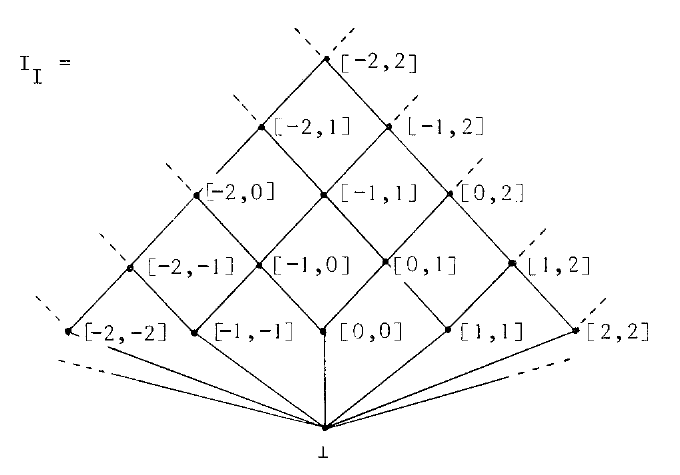
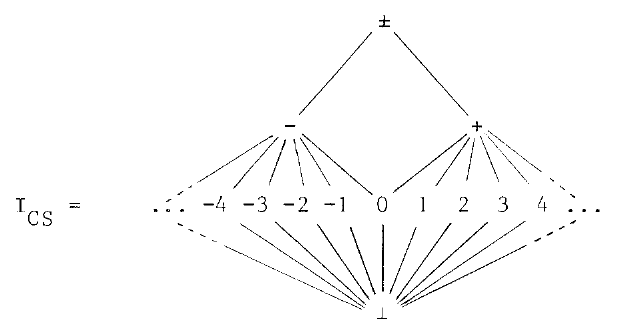
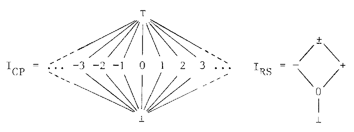
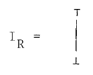
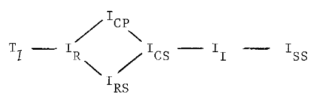

# Sections 7–8

Editorial note: This is a transcription of Patrick Cousot and Radhia Cousot, *Abstract Interpretation: A Unified Lattice Model for Static Analysis of Programs by Construction or Approximation of Fixpoints* (1977). The [scan](source.pdf) is authoritative. Source diagrams are retained as crops; their accompanying label and relation transcriptions are editorial. Typographic line breaks and end-of-line word divisions are normalized. Editorial notes are identified explicitly.

## [Printed p. 243](source.pdf#page=7)

### 7. The Lattice of Abstract Interpretations

The relation $\leq$ comparing the levels of abstraction of two intepretations is a quasi-ordering since it is :

- reflexive : $(I\leq(\iota,\iota)I)$ where $\iota=\lambda x.x$ is the identify function,
- transitive : $(I\leq(\alpha_1,\gamma_1)I')$ $\underline{\mathrm{and}}$ $(I'\leq(\alpha_2,\gamma_2)I'')$ imply $I\leq(\alpha_1\circ\alpha_2,\gamma_2\circ\gamma_1)I''$.

The relation $\equiv$ on abstract interpretations defined by :

$$
\{I\equiv I'\}\Longleftrightarrow\{(I\leq I')\ \underline{\mathrm{and}}\ (I'\leq I)\}
$$

is an equivalence relation. We have :

$$
\{I\equiv(\beta)I'\}\Longleftrightarrow
\{\beta\text{ is an isomorphism between the algebras }I\text{ and }I'\}
$$

The proof gives some insight in the abstraction process :

1 - $\{I\equiv(\beta)I'\}\Longrightarrow\{(I\leq(\beta,\beta^{-1})I')\ \underline{\mathrm{and}}\ (I'\leq(\beta^{-1},\beta)I)\}$

2 - reciprocally,

If $I\leq(\alpha_1,\gamma_1)I'$, let $\equiv(\alpha_1)$ be the equivalence relation defined on $I$ (properly speaking, on the set of abstract contexts of $I$) by :

$$
\{x\equiv(\alpha_1)y\}\Longleftrightarrow\{\alpha_1(x)=\alpha_1(y)\}
$$

$\forall x'\in I'$, each equivalence class $C_{x'}=\{x\in I\mid\alpha_1(x)=x'\}$ has a least upper bound which is $\gamma_1(x')$. Hence the projection $\alpha_1\mid\gamma_1(I')$ of $\alpha_1$ on $\gamma_1(I')$ is a bijection from the set $\gamma_1(I')$ of representers of the equivalence classes on $I$.
Let us show now that under the hypothesis $I\leq(\alpha_1,\gamma_1)I'$ and $I'\leq(\alpha_2,\gamma_2)I$, $\alpha_1$ is bijective.
$\alpha_1\mid\gamma_1(I')$ and $\alpha_2\mid\gamma_2(I)$ are bijections, hence $\forall x'\in I'$, $\exists!x$ (unique) $\in\gamma_1(I')$ such that $x'=(\alpha_1\mid\gamma_1(I'))(x)$. Likewise, $x\in\gamma_1(I')\Longrightarrow x\in I\Longrightarrow\exists!x''\in\gamma_2(I)\mid x=(\alpha_2\mid\gamma_2(I))(x'')$.
Therefore, $\forall x'\in I'$, $\exists!x''\in\gamma_2(I)\mid x'=(\alpha_1\mid\gamma_1(I'))\circ(\alpha_2\mid\gamma_2(I))(x'')$. Thus $(\alpha_1\mid\gamma_1(I'))\circ(\alpha_2\mid\gamma_2(I))$ is a bijection between $\gamma_2(I)$ and $I'$. Since $(\alpha_2\mid\gamma_2(I))^{-1}$ is a bijection between $I$ and $\gamma_2(I)$, the composition

$$
(\alpha_1\mid\gamma_1(I'))\circ(\alpha_2\mid\gamma_2(I))\circ(\alpha_2\mid\gamma_2(I))^{-1}
=(\alpha_1\mid\gamma_1(I'))
$$

is a bijection between $I$ and $I'$, hence $\alpha_1$ is a bijection between $I$ and $I'$ which is trivially an algebraic morphism. ($\alpha_1$ is isotone, its inverse $\alpha_1^{-1}=\gamma_1$ is isotone and $\alpha_1(\underline{\mathrm{Int}}(a,X))=\underline{\mathrm{Int}}'(a,\widetilde{\alpha_1}(X))$) Q.E.D.

Editorial note: “intepretations”, “identify function” and the order of composition in the transitivity formula are preserved from the scan. The restricted-map composition in the proof is also preserved, without repairing its domain reasoning.

Let $\mathcal I$ be the set of abstract interpretations of a program, if equivalent interpretations are identified, the quasi-ordering $\leq$ becomes a partial ordering.

In particular, we can restrict $\mathcal I$ to be set of interpretations which abstract $I_{\mathrm{SS}}$. $\mathcal I$ is then a lattice, (with ordering $\leq$) which is isomorphic with a subset of the lattice of equivalence relations on Contexts.

*Example :*

Let P be a program with a single integer variable, (the generalization is obvious). Environments will be integers (the value of the variable). Contexts are sets of integers (the set of values at some program point).

A context S may be abstracted by a closed interval $\alpha(S)=[\underline{\min}(S),\underline{\max}(S)]$. When S is infinite the bounds will eventually be $-\infty$ or $+\infty$.
$\gamma([a,b])=\{x\mid a\leq x\leq b\}$. The abstract contexts are then, (Cousot[76]) :

## [Printed p. 244](source.pdf#page=8)

Editorial diagram transcription: $I_{\mathrm I}$; bottom $\bot$; singleton intervals $[-2,-2],[-1,-1],[0,0],[1,1],[2,2]$; next rows $[-2,-1],[-1,0],[0,1],[1,2]$, then $[-2,0],[-1,1],[0,2]$, then $[-2,1],[-1,2]$, then $[-2,2]$. Lines join each interval to the immediately larger displayed intervals containing it, and each singleton to $\bot$. Dashed continuations extend beyond the displayed intervals. Source: p. 244, upper left.

A further abstraction may be :

$$
\begin{aligned}
\alpha([a,b])={}&\underline{\mathrm{if}}\ a=b\ \underline{\mathrm{then}}\ a\ \underline{\mathrm{elsif}}\ a\geq0\ \underline{\mathrm{then}}\ +\\
&\underline{\mathrm{elsif}}\ b\leq0\ \underline{\mathrm{then}}\ -\ \underline{\mathrm{else}}\ \pm\ \underline{\mathrm{fi}}.\ \gamma(n)=[n,n],\\
\gamma(+)={}&[0,+\infty],\quad\gamma(-)=[-\infty,0],\quad\gamma(\pm)=[-\infty,+\infty].
\end{aligned}
$$

The abstract contexts are then :

Editorial diagram transcription: $I_{\mathrm{CS}}$; top $\pm$; below it $-$ and $+$; below these the integers $\ldots,-4,-3,-2,-1,0,1,2,3,4,\ldots$; bottom $\bot$. Negative displayed integers connect to $-$, positive ones to $+$, and $0$ to both; every integer connects to $\bot$. Source: p. 244, middle left.

This interpretation may be abstracted by two non-comparable abstractions :

Editorial diagram transcription: $I_{\mathrm{CP}}$ has top $\top$, integers $\ldots,-3,-2,-1,0,1,2,3,\ldots$ each connected to top and bottom $\bot$. $I_{\mathrm{RS}}$ has top $\pm$, branches through $-$ and $+$ meeting at $0$, then $\bot$. Source: p. 244, lower left.

$I_{\mathrm{CP}}$ is used by Kildall[73] for constant propagation.
$I_{\mathrm{RS}}$ might be used to apply the rules of signs. Both interpretations may be abstracted by :

Editorial diagram transcription: $I_{\mathrm R}$ has two elements, $\bot$ below $\top$. Source: p. 244, lower left.

which may be used to check that any vertex in the program graph is reachable from the entry nodes.
Finally, the most abstract interpretation is the upper bound of $\mathcal I$ :

$$
\top_{\mathcal I}=\langle\{\mathrm I\},\lambda(x,y).\mathrm I,t,\mathrm I,\mathrm I,\lambda(a,C).\mathrm I\rangle
$$

where t is the relation which is always true. We have exhibited a sublattice of $\mathcal I$ which is :

Editorial diagram transcription: from left to right, $\top_{\mathcal I}$ connects to $I_{\mathrm R}$; $I_{\mathrm R}$ branches through $I_{\mathrm{CP}}$ above and $I_{\mathrm{RS}}$ below, both meeting at $I_{\mathrm{CS}}$; this connects to $I_{\mathrm I}$, then $I_{\mathrm{SS}}$. The leftmost upper-bound glyph is rendered $\top_{\mathcal I}$; its sole element in the preceding definition is roman $\mathrm I$. The enlarged scan distinguishes the T-shaped upper-bound glyph from that element. This is a typesetting interpretation of the glyph, not a new claim about the lattice. Source: p. 244, upper right.

### 8. Abstract Evaluation of Programs

The system of equations :

$$
\underline{\mathrm{Cv}}:\widetilde{\underline{\mathrm{Int}}}(\underline{\mathrm{Cv}})
$$

resulting from an interpretation $I=\langle\mathrm{A\text{-}Cont},\circ,\leq,\top,\bot,\underline{\mathrm{Int}}\rangle$ of a program P may be solved by "elimination" methods, (e.g. Tarjan[75]). Otherwise, one can use an "iterative" algorithm which computes Kleene's sequence (L4 of Appendix 12) :

$$
\underline{\mathrm{Cv}}:=(C:=\widetilde{\bot};\ \underline{\mathrm{until}}\ C=\widetilde{\underline{\mathrm{Int}}}(C)\ \underline{\mathrm{do}}\ C:=\widetilde{\underline{\mathrm{Int}}}(C)\ \underline{\mathrm{repeat}};C)
$$

Editorial note: The first display has a colon after Cv in the scan; it is preserved.

#### 8.1 Correctness

If $\underline{\mathrm{Int}}$ is supposed to be a complete morphism (i.e. infinitely distributive over $\circ$) then $\underline{\mathrm{Cv}}$ is the least fixpoint of $\widetilde{\underline{\mathrm{Int}}}$. (e.g. Kildall[73], since in a semi-lattice of finite length, any distributive function is a complete morphism). Under the weaker assumption that $\underline{\mathrm{Int}}$ is continuous, the limit Cv of Kleene's sequence can also be shown to be the least fixpoint of $\widetilde{\underline{\mathrm{Int}}}$ (e.g. Wegbreit[75], since in a well-founded semi-lattice, any isotone function is continuous). Finally, if $\underline{\mathrm{Int}}$ is only supposed to be isotone, $\underline{\mathrm{Cv}}$ is an approximation ($\widetilde{\leq}$) of the least fixpoint (e.g. Kam and Ullman[75]).

#### 8.2 Termination

The abstract evaluation terminates iff Kleene's sequence is finite. This may be the case because A-Cont is finite (e.g. type checking in ALGOL 60, Naur[65]), or a finite subset only is to be considered for any particular program (e.g. type checking in ALGOL 68), or A-Cont may be of finite length m (the length of any strictly increasing chain is bounded by m, Kildall[73], Wegbreit[75]) or A-Cont may satisfy the ascending chain condition (every strictly increasing chain is finite, although not bounded). A lattice may have infinite chains, although $\underline{\mathrm{Int}}$ is chosen so that Kleene's sequences are finite. Finally an infinite Kleene's sequence may be arbitrarily truncated (to get a lower bound of its limit), some induction principle (Sintzoff[75]) or heuristics (Katz and Manna[76]) may be used to pass to the limit, or approximate it, (Cousot[76]).

#### 8.3 Efficiency

In practice efficient versions of the Kleene's sequence are used. These consist in a symbolic execution of the program which propagates information along paths of the program until stabilization. A specification of order of information propagation may lead to optimal algorithms for specific applications (references in Tarjan[76]).

## [Printed p. 245](source.pdf#page=9)

#### 8.4 Example : Performance Analysis of Programs

The performance of programs may be analyzed by deriving for each program point the final value of an imaginary counter which is incremented each time control goes through that point.

Let A-Cont be the lattice $\mathbb R^+$ of positive real numbers augmented by the upper bound $\infty$, with natural ordering $\leq$. The abstract interpretation :

$$
I_{\mathrm P}=\langle\mathbb R^+,\underline{\max},\leq,0,\infty,\underline{\mathrm{Kir}}\rangle
$$

may be used to derive the mean values of the counters using Kirchhoff's law of conservation of flow :

$$
\begin{aligned}
&\underline{\mathrm{Kir}}(r,\underline{\mathrm{Cv}})=\\
&\quad\underline{\mathrm{let}}\ n\ \underline{\mathrm{be}}\ \underline{\mathrm{origin}}(r)\ \underline{\mathrm{within}}\\
&\qquad\underline{\mathrm{case}}\ n\ \underline{\mathrm{in}}\\
&\qquad\quad\mathrm{Entries}\Longrightarrow1\quad\{\text{unique entry node}\}\\
&\qquad\quad\mathrm{Junctions}\cup\mathrm{Assignments}\Longrightarrow\sum_{p\in\underline{\mathrm{a\text{-}pred}}(n)}\underline{\mathrm{Cv}}(p)\\
&\qquad\quad\mathrm{Tests}\Longrightarrow\\
&\qquad\qquad\underline{\mathrm{case}}\ r\ \underline{\mathrm{in}}\\
&\qquad\qquad\quad\{\underline{\mathrm{a\text{-}succ\text{-}t}}(n)\}\Longrightarrow\underline{\mathrm{Cv}}(\underline{\mathrm{a\text{-}pred}}(n))*\underline{\mathrm{Prob}}(\underline{\mathrm{test}}(n)=\underline{\mathrm{true}})\\
&\qquad\qquad\quad\{\underline{\mathrm{a\text{-}succ\text{-}f}}(n)\}\Longrightarrow\underline{\mathrm{Cv}}(\underline{\mathrm{a\text{-}pred}}(n))*(1-\underline{\mathrm{Prob}}(\underline{\mathrm{test}}(n)=\underline{\mathrm{true}}))\\
&\qquad\qquad\underline{\mathrm{esac}}\\
&\qquad\underline{\mathrm{esac}}
\end{aligned}
$$

The main difficulty is to obtain the probability $\underline{\mathrm{Prob}}(\underline{\mathrm{test}}(n)=\underline{\mathrm{true}})$ of taking the true path at a test node n. Suppose the values of these probabilities can be determined (from hypothesis on the input data).
For fixed probabilities, the function $\widetilde{\underline{\mathrm{Kir}}}$ is clearly continuous (although it is not a complete morphism) since

$$
\text{if }\underline{\mathrm{Cv}}_0\ \widetilde{\leq}\ \underline{\mathrm{Cv}}_1\ \widetilde{\leq}\ \ldots\ \widetilde{\leq}\ \underline{\mathrm{Cv}}_n\ \widetilde{\leq}\ \ldots
$$

$$
\text{then }\underset{i=0}{\overset{\infty}{\underline{\max}}}\left(\sum_{p\in\underline{\mathrm{a\text{-}pred}}(n)}\underline{\mathrm{Cv}}_i(p)\right)
=\sum_{p\in\underline{\mathrm{a\text{-}pred}}(n)}\left(\underset{i=0}{\overset{\infty}{\widetilde{\underline{\max}}}}(\underline{\mathrm{Cv}}_i)(p)\right)
$$

$$
\text{and }\underset{i\in\Delta}{\underline{\max}}(n_i*q)=\left(\underset{i\in\Delta}{\underline{\max}}(n_i)\right)*q.
$$

The least fixpoint of $\widetilde{\underline{\mathrm{Kir}}}$ is the limit of Kleene's sequence (the length of the sequence is in general infinite) :

- Let P be the program "$\underline{\mathrm{begin}}\ \mathrm L:\underline{\mathrm{go\ to}}\ \mathrm L\ \underline{\mathrm{end}}$". The number n of iterations in the loop is given by the minimal solution to the equation $n=n+1$ which is $\infty$ limit of $0+1+1+1+\ldots$
- Let P be the program "$\underline{\mathrm{begin\ while}}\ \mathrm T\ \underline{\mathrm{do}}\ \mathrm I\ \underline{\mathrm{end}}$". The number n of times the expression T is tested is given by the minimal solution to the equation $n=1+q*n$ where q is the probability of T to be true. n may be determined by the limit of Kleene's sequence :

$$
0+1+q+q^2+\ldots+q^\ell+\ldots
$$

which is an infinite series. Its sum is $\dfrac{1}{1-q}$.

This abstract interpretation leads to a system of linear equations. Kleene's sequence corresponds to the Jacobi's iterative method (for numerical coefficients).
