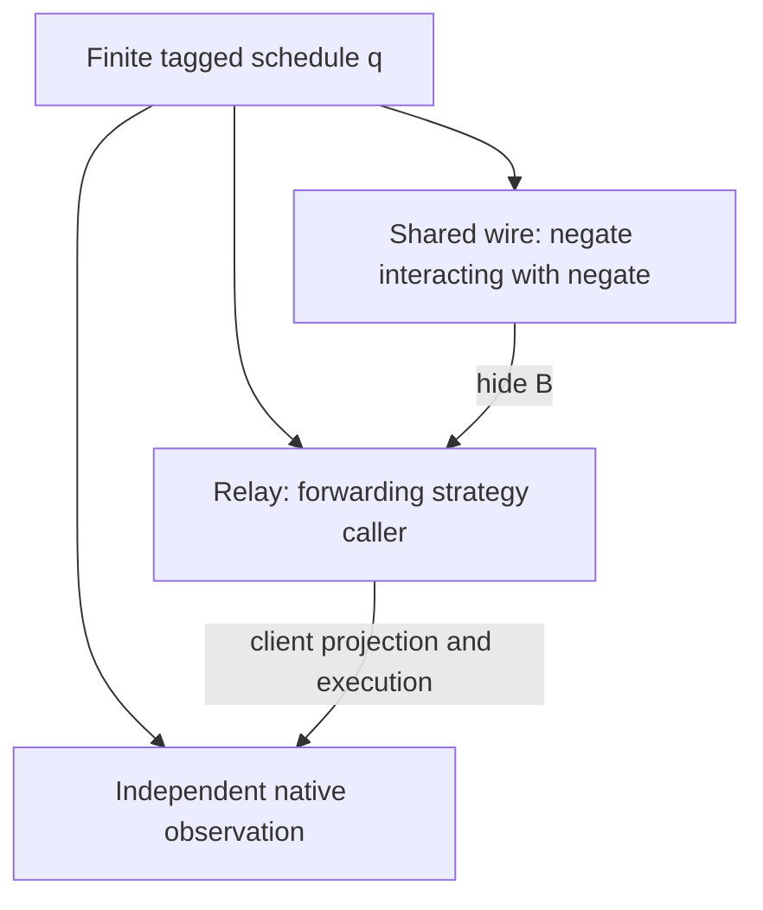
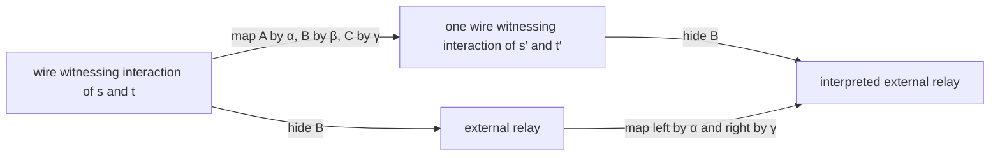

# Behavioral correctness across game-semantic levels

Issue [#463](https://github.com/VladimirMarko/conaled/issues/463) tests a fixed
consumer from accepted #440: a client that issues two tagged Boolean requests
before receiving either answer. The implementation uses two negation
strategies; its specification is the forwarding strategy. Both live in the
same arena. An arena specifies the protocol interface, while the selected
strategy specifies response behavior. This is a concrete use of those roles,
not a universal classification of games and strategies.

The [native contract](behavioral-game-contract.md) was committed before proof
implementation. The observed result remains rejection or acceptance with both
slot states, pending result, ordered response history and Boolean result. The
environment supplies a finite schedule. Every comparison below keeps that same
schedule unless an explicit boundary map changes its values. No fairness,
eventual reply or asynchronous runtime is assumed.

## Three levels and vertical composition

[BehavioralCaller.lean](../../Applications/Interaction/BehavioralCaller.lean)
implements these three levels:

| Level | Behavior at schedule q | Downward observation |
|---|---|---|
| Wire implementation | `network negate negate q` | `hide`, removing the shared B channel |
| Strategy specification | `caller forwarding q`, with `forwarding.Play` on accepted inputs | Client event projection, state execution and complete observation |
| Independent operational specification | `OverlappingQueries.native q` | The original `Option Observation` |

`double_negation` proves the composite response policy is forwarding.
`implementation_hides` recovers the exact relay trace, and
`forwarding_observation` recovers the independent native observation. These
maps discard different structure: hiding removes internal events; the client
observer removes service events and computes the state and result.

`first_correct` and `second_correct` instantiate `Interaction.Refines`. Its
direction covers every implementation-side target output by a permitted
specification-side source output. Here the evaluator-output sets are singleton
sets indexed by q, including rejected evaluations. They are not claims that
malformed raw traces belong to a legal strategy language. `vertical_coverage`
uses `Refines.trans` with the exact same relay output set as its middle.
`vertical_observation` separately proves that the actual composed observer
agrees with the native result. Transitivity by itself would not establish that
observation equation.

The evaluator squares fit `SquareKit.Comma.vertical` as well. `wireSquare`
has network generation and forwarding caller as its horizontal arrows, and
hiding as its output connector. `relaySquare` has that same forwarding caller
and the native evaluator as horizontal arrows, with the client observer as
connector. `pastedSquare` composes the connectors; `comma_pasting` checks its
identity with the existing exact specialization of `Comma.vertical`.
`pasted_recovers` consumes the pasted square's commutation proof. No directed
trace inclusion is identified with symmetric hom equivalence.

## Shared-witness compatibility with interaction

[BehavioralTransport.lean](../../Applications/Interaction/BehavioralTransport.lean)
proves a separate all-prefix result. A boundary map is a Boolean value map for
each correlation slot. For a strategy s and its interpretation s′, the local
correctness condition is

    s′ᵢ(βᵢ(b)) = αᵢ(sᵢ(b)).

The right component t uses β on its output boundary and γ on its input:

    t′ᵢ(γᵢ(b)) = βᵢ(tᵢ(b)).

The **same β** is required on both sides. `wire_local` proves the actual
transition equation, including states waiting for a reply or holding a reply
between propagation steps. `wire_path` lifts it by induction, and
`interaction_map` uses per-slot projection to handle every legal finite
interleaving. This includes intermediate administrative phases, not just the
atomic request/reply blocks generated by the selected caller.

`interaction_compatible` constructs that one wire. Its two projections equal
the separately translated component traces, and `hide_map` proves

    hide (mapWire α β γ w) = mapRelay α γ (hide w).

This proof does not assume a witness-lifting field. It derives admissibility
from local response equations and constructs the witness by translating each
actual wire event. Correlation identifiers remain in the same list positions
(`correlation`), and no events are reordered. Hiding removes only the original
internal channel events. All finite pending phases remain legal; no answer is
created to force a completed trace.

Two successive vertical stages compose their boundary maps pointwise.
`preserves_comp` composes the local correctness equations,
`wire_map_comp` identifies the actual twice-translated wire, and `interchange`
proves that hiding this vertically pasted witness agrees with the two outer
translations. The intermediate wire is shared by both component proofs. This
is compatibility of correctness interpretation with computational
interaction/hiding, not an appeal to associativity of strategy computation.

[BehavioralGames.lean](../../Examples/BehavioralGames.lean) supplies nonidentity
instances. A middle-only Boolean flip translates the double-negation network
to a forwarding/forwarding network while leaving both external boundaries
unchanged. A second middle flip restores the original network. The component
certificates, legal translated witnesses, exact two-stage recovery and
interchange are checked. A one-event prefix ending immediately after A asks
exercises an intermediate phase absent from caller block boundaries.

## Coverage, pending states and progress

`accepted_coverage` constructs both a legal forwarding relay and a legal
shared interaction for every schedule accepted by the original native client.
It proves their observations at that unchanged schedule. The implementation
therefore cannot satisfy this contract through empty behavior.
`original_prefixes` also recovers the **entire** original forwarding language
as the external language of double negation, using #440's sound and complete
`compose_exact`. It retains all legal pending relay prefixes under the same
assumptions as #440.

These are two different scopes. Complete observation recovery is at finite
caller schedule boundaries. All-prefix legality and exact event translation
cover general relay/wire prefixes, but do not claim that the original native
client evaluator accepts every intermediate propagation phase. No stronger
pending-phase observer is silently inferred from the schedule theorem.

`pending_recovery`, `response_recovery` and `rejection_recovery` retain both
pending requests, the answered right request after a supplied reply, and
rejection of a duplicate reply. `implementation_covers` supplies an actual
wire for every accepted finite environment. This proves finite response
recovery after an environment reply is supplied. It does not prove eventual
response from a silent environment, scheduler fairness or runtime termination.

## Rejected alternatives

- `legal_but_wrong` retains a legal negation/forwarding wire in the same arena
  whose client observation violates the forwarding contract. Correct service
  observation would not repair the wrong client value.
- `order_not_recoverable` compares two schedules with identical Boolean result
  and final slot states but opposite answer order. No observer of only those
  endpoint fields can recover both required complete observations.
- `unmatched_middle_rejected` retains the unchanged double-negation wire at a
  concrete accepted schedule. It cannot serve as a forwarding/forwarding
  interaction: the middle answer has the wrong Boolean value. The correct
  middle flip repairs the shared witness; independent mismatched boundary
  interpretations do not.
- `empty_fails_coverage` and `silent_fails_coverage` reject empty behavior and
  an implementation that always stops after issuing the requests. The latter
  fails when an actual response is supplied, without a fairness premise.

## Primary-source comparison

The inspected source is Vale, Melliès, Shao, Koenig and Stefanesco,
[*Layered and Object-Based Game Semantics*](https://flint.cs.yale.edu/flint/publications/layered-tr.pdf),
POPL 2022, extended Yale TR-1559. The coordinator's saved PDF has SHA-256
`b30f420a57529945e60119b370412befaf44b7c652bfdc5fbe4fa9854c39bef8`.
I inspected its extracted text at definitions 3.4, 3.11–3.14, 4.2 and 6.2.
Retrieval caveat: the coordinator obtained these bytes from the author-site
URL with TLS certificate verification disabled after authenticated retrieval
failed. The hash identifies the inspected bytes; it does not authenticate them.

Definition 3.4 requires nonempty, prefix-closed, receptive and deterministic
implementations. Definitions 3.11–3.12 use an object strategy to specify behavior
alongside an effect signature. Definition 3.14 covers overlay plays through
underlay plays realized by an implementation. These distinctions motivate
our separate arena, behavioral strategy and coverage obligations. They do not
prove our bounded response-policy theorem. Definition 4.2 quantifies over
underlay strategies before choosing an overlay strategy; this experiment does
not supply that general nondeterministic result. Definition 6.2 quotients a
coherence space by a coherent congruence. Our contract retains exact global
order, so its quotient construction is not imported as an observation equality.

## Reuse and decisions

| Route | Bounded decision | Author obligations and residuals |
|---|---|---|
| Native caller proofs | Retain | Prove actual hiding and client observation at the fixed environment. Existing #440 recovery lemmas remove reimplementation of the client. |
| `Refines.trans` | Adopt for evaluator-output coverage | Supply both concrete coverage witnesses and separately prove observation compatibility. It gives no liveness or nonemptiness by itself. |
| `Comma.vertical` | Adopt for exact evaluator squares | Supply the two commutation equations and matching middle caller. It composes observation connectors without redoing the equality chain. |
| Boundary response interpretation | Adopt within this finite policy application | Two local equations yield shared-wire/path preservation. No inverse or global framework is needed. |
| `RelationComposition.existentialSquare` | Defer for this consumer | It transports relations with matching middle maps but does not construct behavior coverage. The current functional observer plus `Refines` already covers the selected task. |
| Arbitrary strategy-valued specifications | Investigate | The checked example uses a deterministic slot-local policy and a selected client. General receptivity, nondeterminism and semantic quotients need separate contracts. |
| Endpoint-only observation or unmatched middle interpretation | Reject for the frozen contract | Checked counterexamples lose order or synchronized middle answers. |
| Universal double-category or repository-wide game ontology | Defer to owner direction | No such architectural decision is required or made here. |

Compared with the direct proof, the shared interfaces remove the middle-witness
coverage composition and the repeated exact-observation equality chain. The
adapters are three evaluator carrier types, two relations, and two exact
squares. The interaction proof still owes substantive local transition laws;
merely naming a square cannot supply them. This is a checked reuse comparison,
not an independent author trial or measured productivity result.

[#196](https://github.com/VladimirMarko/conaled/issues/196) retains behavioral
extensions beyond this bounded policy family, including general-prefix
semantic observers and broader progress models.
[#235](https://github.com/VladimirMarko/conaled/issues/235) owns any later
shared-interface migration justified by further consumers. #440's accepted
implementation and scope are unchanged.

## Validation and statement review

The implementation starts from accepted integration `767249cc`; later accepted
integration is incorporated before final candidate review. No existing strategy
or native evaluator definition is modified. The new modules are reached from
the public example import. Focused compilation exercises the new consumer and
transport modules; parent orchestration owns the final exact-candidate full
build, exhaustive proof audit and independent Standards/Spec reviews.

Statement review checks the direction of coverage, the fixed environment
index, the exact middle evaluator, actual shared-wire construction, preservation
of correlation and global order, and the distinction between accepted-schedule
observation and all-prefix legality. The instantiated response maps and accepted
schedules establish inhabitance. Negative results keep the original observer
and omitted middle-map obligation visible. No trace-inclusion theorem is used
as a substitute for finite response recovery or infinite-run liveness.
