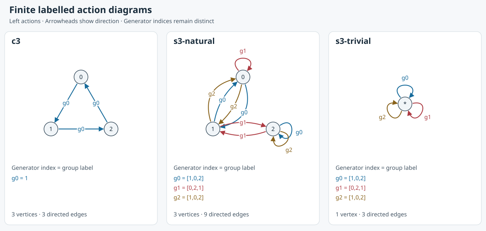

# Finite labelled action diagrams

The [generated SVG](../diagrams/schreier/actions.svg) and its
[JSON data](../diagrams/schreier/actions.json) are an original finite consumer of
[the Schreier interpretation](schreier-interpretation.md), implemented for #466.
The inspiration is Matthew Macauley's
[Visual Algebra](https://www.math.clemson.edu/~macaule/visualalgebra/index.html);
the [assessment](visual-algebra-assessment.md) records the source comparison.
No teaching images or slides were imported.



## Reading the diagrams

Vertices have explicit IDs. An edge marked `g0` means generator **index** 0;
the legend gives its group value. Follow arrowheads, including on parallel
curves. The same group value can have more than one index. The diagram retains
those indices because Mathlib's Schreier edges retain them. Coordinates,
curvature and colors are display choices, with no role in algebraic equality.

The action is on the left: a label `g` followed chronologically by `h` has
combined label `h * g`. In the natural S3 example, `g0 = (01)` followed by
`g1 = (12)` sends 0 to 1 to 2. `chronological_trace` uses the existing
`label_chronologicalPath` theorem. The checked `written_trace` shows that the
same written list passed directly to Mathlib's tail-first `pathFromWord`
instead sends 0 to 1. This is an observable convention difference.

- **C3:** vertices 0, 1, 2 are residues with addition, wrapped as a
  multiplicative group. Generator 1 gives the regular cycle 0→1→2→0.
  `cyclic_generated` proves generation, and `cyclic_stabilizer` proves the
  regular action's stabilizers trivial. Its only orbit contains all vertices.
- **Natural S3:** permutations act on the three points. Group labels are
  recorded by their images at 0, 1, 2, so `[1,0,2]` denotes (01). Indices 0
  and 2 both denote (01), while index 1 denotes (12). The repeated values give
  distinct edge rows, including the two loops at vertex 2. The loop at 2
  retains the nonidentity stabilizer element (01); a loop is not automatically
  an identity arrow. All three vertices lie in one orbit.
- **Trivial S3:** every element acts trivially on the single vertex `*`.
  Its stabilizer is the whole group. The three drawn loops have labels (01),
  (12), (01). The first and second interpret as different action arrows;
  the first and third have equal group values but different generator indices.
  Their interpreted arrows agree, although their edge rows remain distinct.

`permutations_generated` proves that the rendered S3 generator family generates
S3. The cyclic and natural examples consume `arrow_coverage`, so every group
arrow is represented by a symmetrified generator path. Symmetrification permits
inverse traversal; the export itself adds no synthetic inverse rows. The same
S3 generation theorem applies to the trivial action. Drawing generators does
not imply generation in general: the retained `nonempty_proper_subgroup_control`
shows that the subgroup generated by (01) misses (12). Reachability without a
full-generation premise describes only the generated subgroup's orbits.

## What is proved

[FiniteDiagram.lean](../../Applications/GroupActions/FiniteDiagram.lean) takes
an explicit vertex equivalence `Fin n ≃ X` and a generator map `Fin m → G`.
The vertex equivalence enumerates every vertex exactly once. Generator indices
are enumerated exactly once, but their group values may repeat. No finite-group
assumption is required when the acted-on set and generator family are finite.

`rows` exports one mathematical row per vertex/index pair in vertex-major order.
Each row contains source and target IDs, the generator index, and the group
value. `mem_rows` identifies all rows; `row_injective` keeps their pair IDs
unique; `length_rows` gives `n*m`, including loops and repeated values.
`target_correct` decodes each endpoint to the given action.
`edge_iff_row` proves both directions of correspondence to the original labelled
Schreier edge subtype, for every endpoint pair and index. `interpreted_label`
connects the row to the existing forward-edge interpreter in the action category.
These theorems concern labelled edges, not just endpoint adjacency.

[SchreierDiagrams.lean](../../Examples/SchreierDiagrams.lean) supplies the checked
consumers and generation proofs. Original #465 examples remain unchanged.
The exported data preserves the chosen generators and action; it does not make
an unlabelled graph or subgroup lattice a complete group invariant.

## Serialization, rendering and reproduction

[SchreierDiagramDriver.lean](../../Examples/SchreierDiagramDriver.lean) observes
the mathematical rows as JSON. Source/index pairs become strings such as `2:0`.
Permutation values become image arrays; vertex display text never supplies an
identity. The standard-library [renderer](../../scripts/render-schreier-diagrams.py)
turns this JSON into SVG with separate paths, loops, arrowheads and a legend.
It is intended for these small fixtures; it is not a general graph layout engine.

From the repository's Nix shell (`direnv exec .` for noninteractive commands):

```sh
lake build Examples.SchreierDiagramDriver
lake env lean --run scripts/schreier-diagrams.lean > docs/diagrams/schreier/actions.json
python scripts/render-schreier-diagrams.py docs/diagrams/schreier/actions.json docs/diagrams/schreier/actions.svg
python scripts/test-schreier-diagrams.py
```

The [contract](../diagrams/schreier/contract.md) and
[independent fixtures](../../tests/fixtures/schreier-diagrams.json) were committed
before implementation. Runtime tests compare all exported rows, IDs, labels,
endpoints and counts against those calculations. They check parsed SVG edge
retention, distinct path geometry, directed markers, XML escaping and
byte-identical regeneration of the checked-in files. Visual inspection checks
legibility, loops, parallel curves and arrowheads separately.

The Lean theorem does not certify JSON encoding, the Python renderer, SVG
layout, or the browser. Tests and visual inspection cover those boundaries;
the integrated build and exhaustive proof audit cover the formal modules.
No new external dependency is required for generation or rendering.
