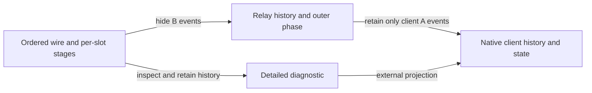

# Finite interaction diagnostics and client observations

Issue [#467](https://github.com/VladimirMarko/conaled/issues/467) connects arbitrary
finite interaction prefixes to internal propagation stages and the existing
external client semantics. The admitted traces are exactly the two-slot Boolean
`InteractionPlay` family from #440/#463, including repeated slot use after
delivery. Existing strategies, transitions, hiding and native client definitions
are unchanged.

The [independent contract](interaction-prefix-contract.md) was committed before
implementation against accepted `0dbe057b`. This is a mathematical observer that
could support a later debugger or checkpoint inspector. It does not implement a
runtime, scheduler or persistence service.

## Two observations

[PrefixDiagnostics.lean](../../Applications/Interaction/PrefixDiagnostics.lean)
defines `Detailed` with a stage for each slot and the complete globally ordered
wire history. `inspect` replays that history from idle. Its `dispatch` function
only selects a slot, calls the existing `wireStep`, and updates that slot's
stage. Replay uses the existing `FiniteStrategies.execute`. There is no copied
wire transition table or second operational model.

`inspect_characterization` identifies a successful result with the actual
per-slot paths and the unchanged history. `projects` and `assemble` prove both
directions between dispatched replay and those paths. Consequently,
`accepted_iff` says inspection succeeds exactly on `InteractionPlay`.
`endpoint_unique` uses the existing path determinism theorem to identify every
alternative endpoint with the recorded one. Malformed events are rejected;
a legal prefix with no completed answer is accepted.

The stages retain the payloads of the existing transition system. Both
`cAnswered b` and `bAnswered b` retain the C input b; `bAnswered` does **not**
rename that payload to the transformed B answer. Actual B answers are retained
in the wire history. The original `outerState` computes the policy-dependent
expected external reply from the stage and component policies.
`relay_projection` uses `hide_local`, `outerState` and `project_translate` to
prove the corresponding relay path and phase.

The external observation projects the retained history through the unchanged
hiding and client projection, then replays the existing native client evaluator.
It retains request/reply history, pending or answered slot states and result.
`Detailed.external` can reject an arbitrarily fabricated detailed value;
`external_accepted` proves it cannot reject a value produced by successful
inspection. `runClient` first validates the wire through `inspect`, then returns
that external observation.

## Why history is required

The internal stage and client state have different lifetimes:

| Prefix on the left slot | Internal stage | External left status |
|---|---|---|
| no events | idle | idle |
| A asks | aAsked | pending |
| A asks, then B asks | bAsked | pending |
| request reaches C, C replies true | cAnswered true | pending |
| B and A deliver true | idle | answered true |

The complete pair of internal idle stages therefore cannot determine the
external state. `stages_do_not_determine_client` proves this using the empty
history and a legal completed delivery. The full history retained by `Detailed`
supplies the missing information without storing a duplicate native state.

There is also loss in the opposite direction. `asked` and `forwarded` are legal
prefixes ending after A asks and after B asks, respectively. Their hidden
relay lists are equal, but their actual internal stages are `aAsked` and
`bAsked`. `cannot_recover_stage` proves that no function of the unchanged hidden
list can recover this selected internal distinction for all legal inputs.
The result does not reject either pending prefix or alter the hiding map.

## Local laws and all-prefix recovery

[PrefixClientObservation.lean](../../Applications/Interaction/PrefixClientObservation.lean)
uses the invariant `Fits`. An internal idle stage permits a native idle or
answered status. Every propagation phase requires a pending client status.
This is a relation between existing states, not another transition system.

`client_local` derives the native step from an actual `wireStep`: A asks and
A replies produce the corresponding native event; all other wire moves have
empty client projection. `client_step` lifts this to slot dispatch while leaving
other slots unchanged. `client_path` composes the local laws over arbitrary
finite histories. It covers repeated requests after completed delivery and
does not assume the history came from the fixed-schedule caller.

The projection boundaries matter:

A B request can change the internal stage while stuttering at both visible
boundaries. A C reply changes the relay-visible history and buffers a reply,
but stutters at the client boundary. `client_stutter` and `external_stutter`
state the latter boundary explicitly. `visible_step` gives the native update
when the projected event is visible and the corresponding native transition
is supplied. These theorems derive from the actual transitions and projection
history, rather than equating two wrappers around the same evaluator.

`buffered_pending` proves for any admitted history that a slot in `cAnswered`
or `bAnswered` is still externally pending. `client_accepted` constructs its
native state, and `client_unique` identifies the unique result of replay.
This supplies the all-prefix observation connection missing from #463's
schedule-boundary result.

At the original caller boundary, `runClient_caller` recovers
`OverlappingQueries.native q` for every original finite schedule q, including
rejection. It reuses #463's exact observation theorem and the accepted-schedule
network legality proof. `caller_rejection` also proves that a rejected original
schedule yields rejected wire inspection. None of these results enlarges the
original schedule API to arbitrary raw wire inputs.

## Correctness interpretations

[PrefixInterpretation.lean](../../Applications/Interaction/PrefixInterpretation.lean)
interprets a detailed record by mapping the same wire history and its endpoint
stages. `inspect_interpret` uses #463's actual `wire_path` theorem and projection
law to prove the exact output of inspection under the component response
certificates. This proves endpoint compatibility, not just target trace legality.

The concrete middle-only Boolean flip sends the negation/negation network to
a forwarding/forwarding network. `simplify_observer` proves that inspection
returns the interpreted diagnostic, its stages stay equal, and its complete
external observation stays equal. A checked prefix containing a false B answer
shows that the diagnostic history really changes. Its stages remain equal
because their payload is the original C input, which this interpretation keeps.

`shared_observed_witness` consumes the existing `interaction_compatible` result.
The same lifted wire realizes both component projections and receives an
accepted diagnostic; its external observation agrees with the original.
`twice_inspect` applies the two nonidentity interpretation stages to that explicit
wire, and `twice_detailed` recovers the entire original record.
`two_stage_external` reuses the existing `interchange` equation for the vertically
composed boundary maps. Legality or computational associativity alone would not
supply these observation equations.

## Checked separating cases

[InteractionPrefixes.lean](../../Examples/InteractionPrefixes.lean) retains:

- accepted prefixes before forwarding and after a C reply but before delivery;
- equal hidden histories with distinct internal stages, and the non-recovery proof;
- initially idle and delivered-idle stage pairs with different external states;
- two successive uses of the same slot with both deliveries in the correct order;
- equal final Boolean results with distinguishable answer histories across slots;
- unmatched delivery, repeated outstanding request and wrong B answer rejection;
- a changed middle-value history with unchanged stages and client observation;
- exact recovery of the original caller through the new validated observer.

`supplied_delivery` explicitly appends the B reply and A reply needed to finish
the buffered example. It is a finite conditional calculation. No result promises
that an absent environment reply or an unscheduled propagation step will occur.
There is no fairness, infinite-run liveness or runtime termination theorem.

## Reuse, limits and decisions

| Route | Decision within #467 | Remaining obligation |
|---|---|---|
| Existing local transitions and replay | Adopt | Slot dispatch and its equivalence to projected paths are proved here. |
| Existing relay hiding and `outerState` | Adopt | Their phase projection does not reconstruct historical client answers. |
| Native client state replay | Adopt | Local `Fits` laws establish acceptance and compatibility for general prefixes. |
| #463 shared-witness interpretation | Adopt | New endpoint and external-observation laws are proved rather than inferred from legality. |
| Recover internal stages from hidden history | Reject for the frozen contract | Equal hidden histories have checked distinct endpoints. |
| Recover external state from stage alone | Reject | Idle resets after delivery; history or justified sufficient data is needed. |
| Compact histories or incremental inspector state | Defer | This observer retains full finite history and makes no memory or performance claim. |
| Runtime, scheduler, durability or universal game architecture | Outside this task | Their contracts remain separate. |

The direct proof obligation was connecting actual internal transitions to
native client steps without losing delivered history. Existing replay, path
composition, hiding and interpretation lemmas avoid reimplementing their
semantics. The added adapters are slot dispatch, the `Fits` relation and a
detailed record with an external projection. This is a checked implementation
comparison, not an independent author trial or performance measurement.

[#196](https://github.com/VladimirMarko/conaled/issues/196) retains broader
behavioral families and progress questions; [#235](https://github.com/VladimirMarko/conaled/issues/235)
retains justified shared-interface extensions. Runtime scheduling (#27), live
FRP migration (#464), external effects (#194) and durability (#225) are unchanged.
No major architectural choice is made here.

## Validation and statement review

The contract precedes implementation. Focused compilation reaches the diagnostic,
client-compatibility, interpretation and example modules. The public entrypoint
imports the example. Parent orchestration owns exact-candidate full build,
exhaustive proof audit and independent Standards/Spec review.

Statement review checked that inspection admits exactly the original legal wire
domain; pending acceptance differs from completed answers; `Fits` permits both
historical cases of idle; projection uses unchanged hiding; stage payloads are
interpreted as C inputs; and the two flips operate on the same shared history.
The negative cases preserve their original observations. All claimed progress
is finite and conditional on supplied events.
