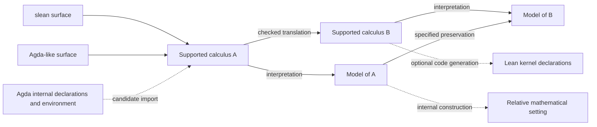

# Embedded languages, multiple frontends, and composable interpretations

Research synthesis, 2026-10-24. This records the owner's constraints and the
questions investigated in this session. It proposes design tests; it does not
select a replacement calculus, initiate an Agda importer, or change the proof
audit. The [shared language direction](../language-direction.md) remains the
governing ambition.

## Constraints supplied by the owner

- Continue the embedded language in Lean and investigate how far it can go.
- Agda library reuse is desirable, but Agda is not the desired language's
  specification. Investigate consuming Agda's elaborated core instead of
  reimplementing its surface elaborator.
- Call the proposed Lean dialect **slean**, with the intended successor-of-Lean
  pun. Its design should permit Agda library translation with superficial
  changes. That is a design requirement to test, not an achieved capability.
- Support more than one surface syntax. LLM productivity without model training
  is a practical requirement; familiar syntax is a hypothesis about how to
  satisfy it.
- Give generated Lean artifacts a mathematical denotation and investigate the
  limits of representing Lean's theory within Lean.
- Allow composable translations and nested internal mathematical settings.
  Do not prescribe one mandatory compilation chain.
- Establish the semantic contracts before undertaking substantial importing
  infrastructure.

The preserved conversation at `/home/vlad/composable-internal-languages.md`
motivated the last two questions. It is a local discussion artifact, not an
authoritative source for mathematical claims. The research below follows its
references to primary sources.

## Research records

| Question | Evidence and assessment |
| --- | --- |
| What survives Agda elaboration, and can familiar dialects support LLM authors? | [Agda core and slean frontends](agda-core-and-slean-frontends.md) |
| Which Lean-in-Lean claims are compatible with incompleteness and Löb's theorem? | [Lean self-modeling and reflection](lean-self-modeling-and-reflection.md) |
| What do functorial transport and Vickers's towers each require? | [Composable internal languages and relativization](composable-internal-languages-and-relativization.md) |

## A family of routes with explicit contracts

Separate the surface language, its elaborated calculus, a translation between
calculi, and a semantic interpretation. A surface can expose several fragments;
several surfaces can express the same fragment. Two fragments need not share
one universal representation before they can have a checked translation.
These are proposed design distinctions, not new implemented interfaces.

The diagram describes possible relationships, not a prescribed sequence:

The model map must agree with the selected syntax translation; arbitrary arrows
cannot be pasted merely because their endpoint names match. An internal
construction additionally needs a surrounding theory capable of expressing it
and proving its required laws. The two kinds of relationship need distinct
contracts. Comparisons between alternative routes may require isomorphisms,
equivalences, or relations rather than strict equality.

For each proposed route, record its source rules, translated rules, universe
and assumption requirements, preserved observations, and composition law.
Record reflection separately when conclusions must be brought back. Replacing
a logical connective by an encoding can preserve a proof even when a functor
does not preserve that connective directly. The target must support that
encoding and its soundness argument. See the relativization research for the
mathematical hypotheses and their limits.

## Relationship to the existing implementation

The existing [target-parametric compiler](../../Compiler.lean) already separates
`Target`, `Sound`, and `compile_sound`. Its `Sound` interface specifically uses
Set-valued meanings; its comments expressly disclaim a faithful closed
interpretation of every CCC in Set. It is useful local evidence for modular
contracts, not a universal semantic destination.

The [path-transport structural model](../../SquareKit/Internal/PathTransport/Model.lean)
and [contextual J model](../../SquareKit/Internal/PathTransport/ContextualModel.lean)
provide operations and laws for a bounded dependent fragment. Its
[typed syntax](../../SquareKit/Internal/PathTransport/Typed.lean) also carries
model-parametric semantic annotations. The present authoring costs concern
that representation and its interface; they do not establish a limitation of
all embedded languages. Retain it as a working approach and compare any proposed
representation against its checked cases before changing it.

The [graph comparison](../../SquareKit/Internal/Squares.lean) connects interpreted
graph reasoning to existing square composition. The
[Agda transfer interface](agda-transfer-interface.md) records a source proof
interpreted in groupoids and consumed as ordinary Lean mathematics. These are
bounded examples of interpretation and comparison. Neither supplies a general
syntax-to-syntax translation calculus or an internal construction of a new
semantic universe inside another.

The [independent author baseline](agda-transfer-independent-baseline/README.md)
remains evidence about author effort against a frozen interface. It is not a
test of Agda core export, a slean frontend, or arbitrary nesting depth. The
present research does not alter that baseline or its conclusions.

## Low-cost design tests before infrastructure

These investigations are tracked under [#36](https://github.com/VladimirMarko/conaled/issues/36).
They can proceed independently where their inputs permit; they do not authorize
a general importer or replacement language implementation.

| Follow-up | Issue |
| --- | --- |
| Lean core target denotation and self-modeling limits | [#114](https://github.com/VladimirMarko/conaled/issues/114) |
| Agda internal-declaration information retention | [#115](https://github.com/VladimirMarko/conaled/issues/115) |
| slean and Agda-like surfaces with superficial translation | [#116](https://github.com/VladimirMarko/conaled/issues/116) |
| LLM authoring comparison, with execution dependent on #116 | [#117](https://github.com/VladimirMarko/conaled/issues/117) |
| Composable interpretation routes and nested internal settings | [#118](https://github.com/VladimirMarko/conaled/issues/118) |

The existing embedded-interface repair [#107](https://github.com/VladimirMarko/conaled/issues/107)
and independent retest [#108](https://github.com/VladimirMarko/conaled/issues/108)
retain their separate scope and independence requirements.

1. **Specify denotation on a bounded target fragment.** Describe the Lean kernel
   declarations a selected translation would generate, their typing rules and
   semantic interpretation. Distinguish correctness of code generation from
   a theorem asserting the truth of every theorem of Lean. Use the self-modeling
   research to state the exact metatheory and assumptions.
2. **Inspect Agda artifacts before designing an importer.** Select representative
   declarations and identify everything needed to reconstruct their meaning
   after elaboration: definitions, types, options, primitives, conversion rules,
   and dependencies. Make an explicit loss and unsupported-feature inventory.
   Do not equate a printed core term with a complete checked declaration.
3. **Test superficial source translation.** For the selected declarations,
   classify each proposed edit as notation, binding, name resolution, inference
   annotation, or mathematical change. Replacing an identity type, assumption,
   eliminator, or proof argument is a semantic change unless justified by the
   translation. Supporting the source rule in slean can be necessary even when
   a particular backend cannot interpret it.
4. **Measure authoring with familiar surfaces.** Use equivalent tasks, shared
   examples, fixed context and repair budgets, and the same checker feedback.
   Compare a Lean-like surface, an Agda-like surface, and the existing embedded
   interface. Count semantic mistakes and completed checked tasks, not only
   parser acceptance. The frontend research describes the limits of current
   published evidence.
5. **Specify both kinds of composition.** Give a worked contract for changing
   models along a structure-preserving map and a separate one for constructing
   an internal setting. Then specify a mixed route and its compatibility
   obligation. This checks whether one proposed interface would erase a needed
   distinction before implementing a general framework.

Passing these tests would justify more specific infrastructure work. Failure
should identify a missing semantic capability, representation problem, or
authoring cost. It should not automatically trigger abandonment of the embedded
approach or a restriction to a single surface language.

## Validation scope

This is source-based research and design analysis. No Lean theorem, Agda
exporter, frontend, model, or benchmark was implemented by this investigation.
The linked notes distinguish published results, repository source inspection,
design recommendations, and unresolved empirical questions.
