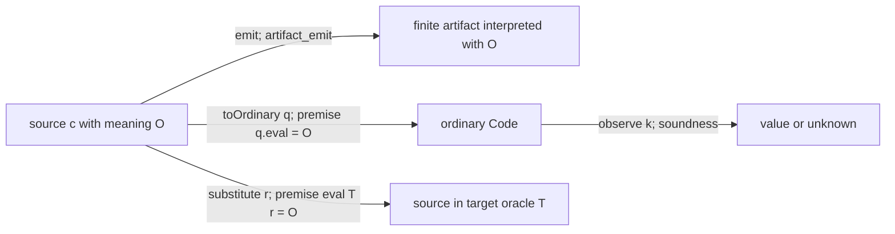

# Mathematical targets, judgments and realization contracts

The [#493 programme](https://github.com/VladimirMarko/conaled/issues/493) now
has concrete tests for three distinctions an interpretation interface must
preserve: what a judgment means, which observations a relation retains, and
which witnesses a consumer needs. Computable code, partial computations,
density matrices, persistent propositions and answer sheaves supply different
contracts. Their useful commonality is the need to state those contracts and
prove their composition, not a shared carrier or a mandatory execution pipeline.

This synthesis follows the adopted [language direction](../language-direction.md#mathematical-targets-and-external-foundations).
It selects no evidence API, does not unblock #489, and does not make native
Lean propositions the required external interface. The checked examples are
mathematics in Lean's verification metatheory; the modeled judgments below
have their own explicitly represented meanings.

## Evidence and programme requirements

Inspection baseline is `f1f3918744183526b48806be93bbfd0949583be7`, on
2026-11-12. #498, #499, #500 and #502 are published at `5d71d00d`, `d904a81b`,
`136f1bfb` and `cf795753`, respectively. The baseline publishes #501 after its
integrated build/audit and both independent review axes passed. All five
children are complete. The enclosing implementation record owns exact receipts
and this synthesis's independent review; neither is replaced by this document.

The four source-paper studies record their primary versions, correspondence,
licenses or unavailable artifacts in the linked reports. In particular, the
Turing study is a modern relative-halting adaptation, the CoqQ study restricts
assertions to effects and programs to a finite full register, Bauer's study
constructs a uniformly tracked diagonal, and Ahman–Bauer's study restricts to
two constant proposition-valued queries. No complete paper port, inter-prover
translation or whole-foundation soundness follows.

| #493 requirement | Concrete declaration evidence and independent specification | Positive and separating clients |
|---|---|---|
| Turing §4 relative-diagonal adaptation (#498) | [Core](../../Applications/OracleComputation/Core.lean): `recursiveIn_iff_exists_code` relates finite syntax to Mathlib's independently defined `Nat.RecursiveIn {oracle}`. [Coding](../../Applications/OracleComputation/Coding.lean): `ofIndex_index` and `recursiveIn_iff_exists_index` provide actual adequate codes. [Source report](oracle-relative-computation.md) identifies the historical specialization. | [Oracle clients](../../Examples/OracleComputation.lean) include realized queries, composed substitutions and malformed artifacts. [Separation](../../Applications/OracleComputation/Separation.lean): `haltingOracle_not_partrec` and `no_relative_halting_decider` use actual ordinary/relative computation, not a finite toy or an assumed impossibility field. |
| CoqQ R.IF/R.SC finite soundness (#499) | [Rules](../../Applications/QuantumSemantics/Rules.lean): `measurement_sound`, `sequence_sound`, `pre_sound`; `Valid` and `PartialValid` refer to the separately defined [density denotation](../../Applications/QuantumSemantics/Program.lean). `denote_state` proves intermediate admission. [Source report](coqq-finite-quantum-soundness.md) distinguishes paper and pinned implementation. | [Quantum clients](../../Examples/QuantumSemantics.lean): `prepareAndReset_sound` and independent `reset_denote`; `wrongFeedback_rejected`; `admitted_observation_separator` gives equal Z statistics but distinct states and a distinguishing admitted effect. |
| Bauer Theorem 5.2 uniform tracked analogue (#500) | [TrackedRecursion](../../SquareKit/TrackedRecursion.lean): `uniform_coverage`, `selected_diagonal`, `realized_recursion`. Coverage is proved for jointly recursive families; the direct proof does not invoke `Code.fixed_point`. [Assembly bridge](../../SquareKit/TrackedRecursionAssembly.lean): `uniform_iff_tracked`, `computationEvaluation_classifies`. [Source report](tracked-multivalued-recursion.md) maps assumptions. | [Prefix clients](../../SquareKit/TrackedRecursionClients.lean): constructor-only computable transformers and `prefixRelation_two_fixed`, with two distinct total results. [Separator](../../SquareKit/TrackedRecursionSeparation.lean): `avoidRelation_serial`, `avoidRelation_no_fixed`, `avoidRelation_no_realizer`, `avoid_diagonal_not_uniform`. |
| Ahman–Bauer Proposition 6 and constant-two-query Proposition 17 (#501) | [OracleModality](../../SquareKit/OracleModality.lean): `two_steps`, `least_prefixed`, `least_forcing`, `join_characterization`. [Kripke bridge](../../SquareKit/OracleModalityKripke.lean): `implication_adjunction`, `mem_himp`. [Answer sheaves](../../SquareKit/OracleModalitySections.lean): `hom_iff`, `productIso`, `parameterized_implication`, `global_section_iff`. [Source report](oracle-modality-two-query.md) states the bounded correspondence. | [Modal clients](../../Examples/OracleModalities.lean): `first_step_not_valid`, `two_queries`, `excluded_middle_fails`, actual `localJointAnswer`, and `modal_answer_without_section` for the same answer object; `suppliedSection` is a positive global section. |
| Mathematical/symbolic success without an ordinary executor (#502) | [Observation](../../Applications/OracleComputation/Observation.lean): actual `Code.evaln` via `observe_sound`, `observe_complete`, `observe_primrec`; `answer_code_exists` versus `no_computable_answer_selector`. [Interval observer](../../Applications/Intervals/Observation.lean): `observeZero_sound` versus `no_exact_zero_decoder`. | [Idealized clients](../../Examples/IdealizedTargets.lean): one source's `symbolic_preservation` and `effective_preservation`; `extraction_separator`, `unknown_is_not_divergence`, compiler-linked `compiled_source_nonzero`, and `dependency_loss`. [Report](idealized-target-realizations.md) records executable tests and model limits. |
| Distinct judgments, multistage comparison, principles and witness transport | The next three sections connect the named declarations and audit their premises. The comparisons use actual assembly and sheaf bridges as well as partial-computation and quantum judgments. | No claim of foundation independence rests solely on writing several Lean predicates. |
| Interface requirements, alternatives and scoped residuals | The final sections compare the #490/#492 proposals against these cases. | Adoption, source/export correspondence and broader interpretation obligations remain identified rather than inferred from child completion. |

## Carriers, admission and observations

| Setting | Carrier and admission | Observations and partiality | Retained witness or premise |
|---|---|---|---|
| Ordinary computation | Mathlib `Nat.Partrec.Code`; semantics `ℕ →. ℕ` | Result membership and domain; minimization may diverge. Bounded `observe` returns a value or unknown. | Actual code for an ordinary realization. `Computable` is a mathematical property; a separate existence proposition is not a supplied program. |
| Oracle-relative computation | `OracleComputation.Code`, interpreted with a specified possibly partial oracle; adequacy to its relative-recursion closure | Same value/domain observations, relative to that oracle. A total oracle does not make every program total. | Selected replacement code and equality of its partial meaning for `substitute_realizes` or `toOrdinary_correct`. |
| Ideal mathematical query | `haltingOracle`, a total mathematical 0/1 answer function | Exact ordinary-halting answers, with finite symbolic query instructions | No ordinary implementation exists by `haltingOracle_not_partrec`. Per-input correct constant programs do exist, but no uniform computable selector chooses them. |
| Finite quantum semantics | Complex matrices satisfying positivity and real trace at most one; effects bounded between zero and identity | Density equality, indexed unnormalized branches, outcome weights, and expectation inequalities are different observations. The delivered syntax preserves trace; it has no while or abort. | Unitary equations; measurement completeness; effect bounds; admission of intermediate states. Exact amplitudes are mathematical values, not a numerical implementation. |
| Uniformly tracked computations | Partial-recursive functions as an extensional subtype; jointly recursive families | Semantic relation `R p q`, whole partial behavior and assembly tracking; not all native functions or serial relations qualify | Total computable code transformer, actual coverage and terminating tracker on every input realizer. Existential fixed-code output is not an effective selector or a leastness theorem. |
| Persistent truth and answer sheaves | Upward-persistent sets on a preorder, then actual subterminal sheaves with fibers `PLift (w ∈ U)` | Entailment, future-stage implication, modal validity, local inhabitance and global section existence. These are not machine termination observations. | Persistence and nucleus laws; actual natural transformations or section terms when demanded. Two query layers denote closure, not a runtime query-count bound. |
| Rational enclosures | Rational intervals related to exact reals by `ContainsReal` | Containment and sound partial zero decisions. Unknown records inadequate information for this observer. | Input enclosure witnesses, compiler containment and a successful observation. A valid interval need not determine its exact represented point. |

Quantum computation is not classified here as hypercomputation. Likewise,
changing an oracle changes computational capability without automatically
changing deduction rules. These statements concern the particular models;
none supplies empirical evidence that a physical device realizes them.

## A concrete network of composable relations

Use #502's `answerThenSucc = .comp .succ .query`, rather than unrelated programs
at successive nodes. For a chosen oracle `O`, the following links are proved:

The first arrow relates denotations, including divergence; it does not execute
`O`. `artifact_result` and `artifact_termination` derive value/domain
observations. The artifact interpreter rejects malformed lists separately from
valid lists denoting divergent computations. For this source the artifact is
`[1,4,6]`, with mathematical result `haltingAnswer n + 1` under the ideal oracle.

The ordinary-code branch uses `toOrdinary_correct` with **selected code `q`**.
With `q = .succ`, `effective_preservation` gives `n+2`. For that same ordinary
program, `insufficient_bound`, `sufficient_bound` and
`unknown_is_not_divergence` compare actual bounded and unbounded evaluation.
`observe_mono` preserves a reported value as the bound grows; `observe_complete`
provides eventual success for each terminating result. A finite unknown neither
decides divergence nor gives the negative ideal answer. The bound is Mathlib's
numeric/recursion bound, not abstract-machine steps.

There is deliberately no artifact-to-executor arrow: the inspected theorems do
not translate every emitted artifact to an ordinary executor. Both branches
start from the same source, and their semantic agreement needs the selected
oracle implementation. Under `haltingOracle`, that implementation premise is
provably impossible in ordinary partial recursion. This missing edge cannot be
filled by an artifact hash, parser success or a classical existence theorem.

The substitution branch supplies its own composition proof:
`substitute_comp` composes two selected substitutions syntactically, and
`eval_substitute`/`substitute_realizes` match their oracle meanings.
`two_substitutions` checks this route on `answerThenSucc`. No universal
composition law for arbitrary realization records is inferred.

Two further routes test different contracts. In the interval client,
`Arithmetic.shared` has independently calculated value five; the actual
compiler produces `compiledBox`. `compiled_contains` consumes its containment
theorem, `compiled_real_contains` connects exact reals, and
`compiled_source_nonzero` consumes the successful observer. Containment composes,
but `dependency_loss` and `no_exact_zero_decoder` prevent strengthening it to
an exact decoder. In the quantum client, `sequence_sound` composes assertion
proofs only because `denote_state` admits the intermediate state.
`permutation_composition` also reuses the existing coordinate-unitary laws.
Neither route establishes a quantum-to-oracle compiler or an executable quantum
simulator.

## Foundation and judgment leakage ledger

| Boundary | What is actually justified | Invalid transfer and the evidence that detects it |
|---|---|---|
| Verification metatheory → source logic | Lean checks the stated declarations with the repository's allowed dependencies (`propext`, `Classical.choice`, `Quot.sound`). The source fragments and interpretation laws remain explicit. | A successful audit does not validate arbitrary foreign rules, prove Lean's whole soundness, or give mutual Lean/Agda interpretation. Host implementation language and verification foundation are separate choices. |
| Partial semantics → computable realization | #498 proves syntax adequacy for one specified oracle. #502 binds ordinary code to an actual supplied oracle implementation and proves bounded positive observations. | Arbitrary mathematical functions do not become executable through encoding. `query_realization_rejected` is an impossibility in the ordinary code model; missing numerical or device implementations are not thereby impossible. |
| Native family → represented computation judgment | #500 proves `uniform_coverage` and both directions of `uniform_iff_tracked`. Its evaluator returns a program realizer under the lift; `computationEvaluation_classifies` ties it to the existing saturated partial-map domain. | Pointwise code existence is not joint recursion. `avoid_diagonal_not_uniform` exhibits a native diagonal excluded from the represented families. A native serial relation cannot inherit unrestricted internal choice/coverage. |
| Source synthetic principles → bounded diagonal | Bauer's selected argument uses internal sequence coverage and Countable Choice; the studied applications obtain coverage through Enumeration, while Markov enters the later continuity argument. #500 replaces these with proved restricted coverage and supplied computability data. | No interpretation of the entire axiom package is supplied. `avoidRelation_serial` with `avoidRelation_no_fixed` rejects its naive transfer to all external serial relations. No least fixed point or selected trace follows; the #347/#371 solver keeps its stronger contracts. |
| External classical sets → persistent truth | #501 proves future-world implication via `implication_adjunction` and `mem_himp`. `hom_iff`, `productIso` and `parameterized_implication` represent entailment, conjunction and implication by actual answer-sheaf maps. | Deciding membership classically outside the model does not replace its internal negation. `excluded_middle_fails` holds in the non-Boolean model. This is a represented propositional fragment, not full dependent type theory or unrestricted source soundness. |
| Modal validity → answer witness | #501's `global_section_iff` identifies global elements of the actual internal section object with unmodalized validity. `localJointAnswer` and `modal_answer_without_section` concern that same display. | A modal proof does not produce a global answer section. The answers here are subsingletons; no general data-bearing answer-tree extraction or quotient-inductive sheafification is established. |
| Quantum judgment → observations | `Valid`/`PartialValid` use expectation inequalities over independently admitted density states. `partial_iff_total` depends on the delivered trace-preserving syntax. | Equal Z distributions do not imply density equality; the plus/mixed separator retains a distinguishing effect. Ordinary copying of Lean values is not a theorem permitting physical copying of unknown quantum states. No general tensor/ancilla complete-positivity theorem is delivered. |
| Existence or approximation → selected information | #502 proves `answer_code_exists` alongside `no_computable_answer_selector`; rational enclosure has its own `no_exact_zero_decoder`. | The first obstruction is computational uniform selection; the second rules out any decoder from the stated information, independently of computability. Neither is a blanket impossibility for all real representations or all execution models. |

The last rows supply witness and principle counterexamples, not just different
notations for Lean `Prop`. At the same time, these models do not establish an
external proof-import interface. A future route must identify which judgments,
contexts, equality/conversion laws and witnesses it interprets, with the
applicable soundness and any claimed reflection separately proved. Restricting
all sources to a fixed common logic would discard the differences these studies
were intended to preserve.

## Interface requirements and alternatives

The examples impose concrete requirements without fixing their representation:

- Bind evidence to the actual source, primitive meanings, selected target,
  parameters and artifact. Names and hashes can identify data; they do not
  prove semantic correspondence.
- Preserve the requested observation and its admission domain. Density equality,
  containment, successful-result evidence, modal truth and selected sections
  cannot silently replace one another.
- Retain code generators, trackers, sections and conversion witnesses as data
  where the consumer needs them. State whether an existence proof is enough.
- Expose required logical principles and computation models at each route.
  Compose only with matching contexts, premises and observations; retain native
  clients that already have an adequate direct contract.
- Keep code realization, termination/progress, resource guarantees and empirical
  device premises distinct. A relation between device models does not establish
  that a physical device satisfies either model.

The [#490 comparison](compiler-evidence-comparison.md#comparison-and-author-obligations)
and [#492 MMT study](mmt-compiler-evidence.md#alternatives-on-this-same-admission-problem)
remain alternatives, not adopted architecture. Their diagnostic probes do not
acquire kernel soundness from the later formal studies.

| Alternative | What these clients support | Obligation before broader use |
|---|---|---|
| Native semantic contracts with source-specific adapters | Existing oracle substitutions, quantum rules, containment and assembly/sheaf bridges already work directly. Preserve these clients and their local interfaces. | Prove each foreign source/export/target connection; native theorem names alone do not bind external artifacts or preserve source judgments. |
| Multiple proved certificate formats at a shared semantic admission boundary | #490's algebraic and finite-simulation probes show different evidence-production routes for its specified stateful client. The new studies clarify which observations and witnesses such a boundary must retain. | Prove checker soundness and exact source/artifact association. The Python probes are diagnostics, not verified checkers or controlled productivity evidence. Compare formats under the same contract before making either mandatory. |
| Theory-indexed judgments and composed interpretations, with optional MMT publication | #500/#501 give specific meaning to uniformity and persistent entailment that a theory-indexed route should preserve. MMT offers organization of theories and views. | Source encoding adequacy, foundation rules, totality, versioned exporters, selected witness transport and executable checker trust remain obligations. #492's small LF successes do not prove its arithmetic route or failed composite probe. |
| Extensible shared proof language | Potential reuse of common derivations while naming stronger-rule requirements. | Demonstrate repeated proof content and justified extensions on these clients. Do not impose a universal AST, erase witnesses, or make a fixed arithmetic fragment the ceiling of accepted mathematics. |

These choices can combine. Changing the compiler host need not change accepted
mathematics; changing the verification foundation requires justified transport
for the advertised judgments and witnesses. None promises soundness for every
stronger logic merely by abstracting an interface.

## Remaining obligations and ownership

The programme still requires independent acceptance of this synthesis. That
is a current completion obligation, not optional future work. A finding that a promised source/model bridge is missing must keep #493
open; closing children alone cannot discharge the comparison and leakage audit.
The accepted child declarations supply the planned bounded bridges. Their
acceptance does not approve this report’s cross-study inferences.

Beyond that acceptance gate, distinguish proposed extensions from defects in
the selected slices. The rows below identify existing coordination owners and
proposed scoping; they do not assign new implementation tasks:

| Residual or decision | Existing scope owner and concrete next question |
|---|---|
| Production evidence contract and supported source fragment | [#489](https://github.com/VladimirMarko/conaled/issues/489), informed by #490/#492: the owner must choose required observations, witnesses, trust policy and fallback behavior before implementation. This synthesis does not make that choice. |
| Proved multi-format checker comparison and author work | [#290](https://github.com/VladimirMarko/conaled/issues/290), coordinated with [#235](https://github.com/VladimirMarko/conaled/issues/235): prove the finite-certificate route against the native adapter on the same stateful contract and measure matched tasks. Existing probes leave these proofs unimplemented. |
| Stronger foundation-relative interpretation | [#36](https://github.com/VladimirMarko/conaled/issues/36), #235/#290: select a next source fragment with an observed witness or principle that the current bounded models do not preserve. Full realizability/topos interpretation, dependent answer sheafification and general inter-prover transport remain unproved; none is implied by these slices or required as a hidden whole-foundation port. |
| Relative universal evaluation and recursion | [#109](https://github.com/VladimirMarko/conaled/issues/109), using #498/#500: construct the relative evaluator and parameterization/self-reference obligations before claiming arbitrary-oracle recursion. Adequate syntax alone is insufficient. |
| Broader quantum or execution route | #235 and the relevant compiler consumer must first choose a contract. Tensor/ancilla extension, numerical simulation, progress/resource claims and physical applicability are separate unimplemented ambitions, not consequences of finite density soundness. No new workstream is adopted here. |

The unresolved architectural questions for the owner are therefore which
bounded admission contract to pursue, whether multiple certificate routes
remove recurring author work, and when a theory-indexed publication layer earns
its additional setup. The evidence supports testing those choices against the
same observation and witness obligations; it does not yet select among them.
